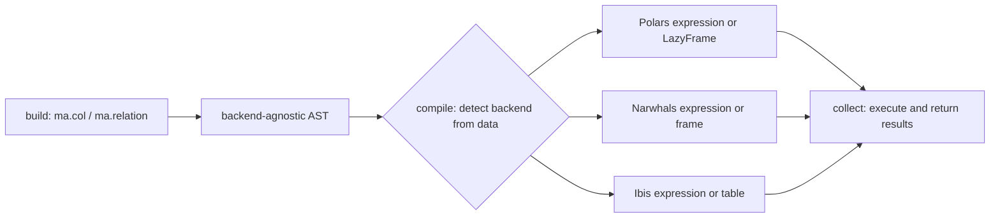

# What mountainash does

mountainash lets you write tabular data logic once, as expressions and relational plans with a Polars-style API, and run it on Polars, on the libraries Narwhals reaches (pandas, PyArrow, Dask, DuckDB) and on SQL engines through Ibis. mountainash holds the logic as a backend-agnostic tree, and a terminal call compiles that tree for the engine that owns the data.

Assumes: Python 3.12 and dataframe basics (columns, rows, filters, joins, group-by).

## One logic, many engines

<!-- concept:301 -->

A dataframe library gives Python code a table abstraction: named, typed columns and an API for filtering, deriving, joining and aggregating rows. An engine executes that work. Sometimes one package is both. Polars and pandas hold data in process memory and execute operations themselves. PyArrow provides a columnar in-memory format with its own compute functions. DuckDB is an embedded analytical database. Dask splits work across partitions. PostgreSQL, MySQL and SQLite are database servers or files that execute SQL.

Each of these has its own API. A filter is `df.filter(pl.col("age") > 30)` in Polars, `df[df["age"] > 30]` in pandas, and a `WHERE` clause in SQL. Code written against one API runs on that engine alone, so logic that targets several engines is usually written once per engine.

mountainash builds on two existing libraries that narrow that gap. [Narwhals](https://narwhals-dev.github.io/narwhals/) is a compatibility layer that exposes one Polars-like API over pandas, PyArrow, Dask, DuckDB, Polars and others. [Ibis](https://ibis-project.org/) is a dataframe API that compiles to SQL for many database engines. mountainash groups the engines it can target into three backend families:

| Backend family | Reached through | Engines named in the capability declarations |
|---|---|---|
| Polars | Polars directly | Polars eager and lazy frames |
| Narwhals | Narwhals | pandas, PyArrow, Dask, DuckDB, Polars, Polars lazy frames |
| Ibis | Ibis | DuckDB, SQLite, PostgreSQL, MySQL, Polars, SingleStoreDB, Exasol |

Within a family, each engine is a dialect (for example `narwhals-pandas` or `ibis-postgres`). Support differs by dialect, and the package records each dialect's support explicitly. [Backend support and known limits](../16-backend-support-and-limits/index.md#support-matrix) gives the recorded support level for each one.

<!-- concept:303 -->

Backend-agnostic data logic is a filter, a derived column, a join or a whole pipeline described independently of the engine that will run it. mountainash expresses such logic as expressions (`ma.col("age") > 30`) and relations (`ma.relation(source).filter(...)`), both written free of Polars, pandas and SQL. The data you hand to the relation picks the engine.

The function below describes one plan. The loop calls it with a Polars frame, a pandas frame and a DuckDB table opened through Ibis, using the same plan code each time:

```python
import ibis
import polars as pl

import mountainash as ma

people = pl.DataFrame({"name": ["Ada", "Lin", "Sam"], "age": [37, 22, 41]})


def adults_in_months(source):
    return (
        ma.relation(source)
        .filter(ma.col("age") > 30)
        .with_columns((ma.col("age") * 12).alias("age_months"))
        .sort("name")
    )


con = ibis.duckdb.connect()
sources = {
    "polars": people,
    "pandas": people.to_pandas(),
    "ibis-duckdb": con.create_table("people", people.to_arrow()),
}
for label, source in sources.items():
    print(label, adults_in_months(source).to_dicts())
```

```text
polars [{'name': 'Ada', 'age': 37, 'age_months': 444}, {'name': 'Sam', 'age': 41, 'age_months': 492}]
pandas [{'name': 'Ada', 'age': 37, 'age_months': 444}, {'name': 'Sam', 'age': 41, 'age_months': 492}]
ibis-duckdb [{'name': 'Ada', 'age': 37, 'age_months': 444}, {'name': 'Sam', 'age': 41, 'age_months': 492}]
```

The Polars frame runs on Polars. The pandas frame runs through Narwhals on pandas. The DuckDB table runs as SQL inside DuckDB. All three return the same result. The package's consistency rule requires one expression or relation to produce the same logical result on every backend that supports it. The package records each backend's limits, and a declared limit stops the call before it runs. [Execution targets and backend capabilities](../09-execution-targets-and-capabilities/index.md#capability-errors-and-capability_policy) covers how those refusals surface, and the divergences that remain are listed in [Known divergences](../16-backend-support-and-limits/index.md#known-divergences).

Logic written once is also reusable. A library can define a validation rule, a conformance step or a reusable transformation and apply it to whatever table a caller has. Tests can run the logic on a small Polars frame and production can run it inside a database. For this reason, the schemas, data contracts and validation in later chapters build on the same expressions and relations.

<!-- concept:307 -->

The public API follows Polars calling conventions. Method names, parameter names and chaining patterns match Polars, so a Polars user reads and writes mountainash code with the vocabulary they already know. `ma.col`, `ma.lit` and `ma.when` correspond to `pl.col`, `pl.lit` and `pl.when`. Relation methods (`filter`, `with_columns`, `select`, `sort`, `group_by`, `join`, `head`) mirror the Polars `LazyFrame` methods of the same name. Python operators work the way they do in Polars, so `ma.col("age") > 30` and `ma.col("age").gt(30)` build the same expression.

Next to the native Polars version of the plan above, only the entry point differs:

```python
native = (
    people.lazy()
    .filter(pl.col("age") > 30)
    .with_columns((pl.col("age") * 12).alias("age_months"))
    .sort("name")
    .collect()
)
print(native.equals(adults_in_months(people).to_polars()))
```

```text
True
```

The split is deliberate. Users see Polars conventions, and the internal representation follows a different model (see [Substrait alignment](#lazy-plans-and-the-ast) below). One layer of the package translates between the two, described in [Architecture](../17-architecture/index.md#three-layer-separation). mountainash covers the operations documented in [Building expressions](../04-building-expressions/index.md) and [Relations](../07-relations/index.md), using the Polars name and signature for each.

## Lazy plans and the AST

<!-- concept:302 -->

Lazy evaluation means describing work first and executing it later, as one unit. An eager library such as pandas runs each operation as soon as it is called. A lazy library records the operations in a query plan and runs them when a result is requested. Polars `LazyFrame`, Ibis tables and SQL databases all work this way. Deferring execution lets an engine optimise the whole plan (pushing filters down, pruning unused columns) and lets the plan be sent to wherever the data lives.

mountainash relations are lazy at two levels. Building a relation only records operations. Calling `.compile()` turns the recorded plan into the backend's own native object, which for a lazy backend is itself still an unexecuted plan. A terminal such as `.collect()`, `.to_polars()` or `.to_dicts()` executes it:

```python
plan = adults_in_months(people)
print(type(plan.compile()))
print(type(adults_in_months(sources["ibis-duckdb"]).compile()))
print(type(plan.collect()))
```

```text
<class 'polars.lazyframe.frame.LazyFrame'>
<class 'ibis.expr.types.relations.Table'>
<class 'polars.dataframe.frame.DataFrame'>
```

The eager Polars frame produces a Polars `LazyFrame` when compiled, and the DuckDB table produces an Ibis table expression. Both are still unexecuted plans. `.collect()` executes the plan and returns materialised data. An eager backend can return materialised data from `.compile()`, so use `.collect()` or an output terminal when you need the result. [Collecting results](../08-collecting-results/index.md#collect-and-terminals) lists every terminal and output format.

<!-- concept:304 -->

An abstract syntax tree (AST) represents a computation as a tree of nodes: each operation is a node and its inputs are its children. The expression `age > 30` becomes a comparison node with two children, a reference to the column `age` and the literal `30`. The tree records what to compute, independent of how any engine computes it.

Writing `ma.col("age") > 30` builds an expression object that wraps a small tree of nodes. The comparison itself runs later, against data. The `walk` function from `mountainash.expressions.introspect` visits each node:

```python
from mountainash.expressions.introspect import walk

older = ma.col("age") > 30
for node in walk(older):
    print(type(node).__name__)
```

```text
ScalarFunctionNode
FieldReferenceNode
LiteralNode
```

Most operations are a `ScalarFunctionNode` that names its operation with a function key and holds its arguments as child nodes. Column references and literals are leaves. Relations have their own node types, one per relational operation (read, filter, project, join, aggregate, sort and so on), with expression trees embedded where an operation needs one, such as a filter condition. Both trees are plain data, so you can inspect, compare and fingerprint them before any table is involved. [Inspecting an expression](../04-building-expressions/index.md#inspecting-an-expression) covers the introspection functions. The node catalogue is documented for maintainers in [How expressions compile](../18-expression-compilation/index.md#expression-ast-nodes) and [How relations compile](../19-relation-compilation/index.md#relation-ast-nodes).

<!-- concept:305 -->

Build then compile is the rule that connects lazy plans to the AST. Building and compiling are separate phases. The build phase creates the AST from your code alone, before any dataframe or backend is involved. The compile phase takes the AST and a concrete dataframe or table, detects the backend from the object's type, and walks the tree to produce the backend's native expression or plan. Compilation makes the backend choice for you.



The same expression object compiles to three different native forms, one for each family:

```python
print(older.compile(people))
print(older.compile(people.to_pandas()))
print(older.compile(sources["ibis-duckdb"]))
```

```text
[(col("age")) > (dyn int: 30)]
col(age).__gt__(lit(value=30, dtype=None))
(_['age'] > <scalar[int8]>)
```

The first is a Polars `Expr`, the second a Narwhals expression (the pandas frame is reached through Narwhals) and the third an Ibis expression. An expression compiles against a frame you pass in, because your frame owns the result and you can use the native expression in your own code. A relation compiles and collects itself, because the relation owns both its source and its result. [Compiling an expression](../04-building-expressions/index.md#compiling-an-expression) documents `compile()` and its options, and [Backend detection](../02-installation-and-package-surface/index.md#backend-detection) lists the types that are recognised.

Separate phases have practical effects. An expression can be defined in one module and applied to frames of different libraries. Building runs independently of the engine that will eventually run the logic. Errors that depend on a backend, such as an operation the engine cannot perform, appear at compile or collect time with the backend named. Between detection and lowering, compilation also consults the package's record of what the detected backend and dialect can do, and that record is how compilation refuses unsupported calls; [The capability spine](../20-capability-spine/index.md) explains that machinery.

<!-- concept:306 -->

[Substrait](https://substrait.io/) is an open specification for relational query plans. It defines a vocabulary of relation types (read, filter, project, join, aggregate, sort, fetch, set) and of scalar, aggregate and window functions, with names and semantics grouped into extension categories such as comparison, arithmetic, boolean, string and datetime.

The mountainash AST follows Substrait's model. Relation nodes correspond to Substrait relation types. Every operation in an expression tree is identified by a function key, and the keys for standard operations are grouped and named after the Substrait function they implement. Operations outside Substrait, such as the ternary logic below, live in a separate mountainash extension namespace with their own keys. You can see the split on any expression:

```python
print(older.node.function_key)
print(ma.t_col("age").t_gt(30).node.function_key)
```

```text
FKEY_SUBSTRAIT_SCALAR_COMPARISON.GT
FKEY_MOUNTAINASH_SCALAR_TERNARY.T_GT
```

This alignment gives the package a defined vocabulary and semantics for each operation, and a clear line between standard and custom behaviour. It also lets the public API and the AST differ: the package translates each Polars-style method on the surface into a Substrait-shaped node underneath, and each backend lowers from that node alone. Function keys and the registry that maps them to backend implementations are covered in [How expressions compile](../18-expression-compilation/index.md#function-keys).

!!! note "Status"
    Substrait alignment describes the shape and naming of the internal AST. mountainash does not currently import or export Substrait plans.

## Three-valued logic

<!-- concept:309 -->

Ordinary boolean logic has two values, true and false. Real data has missing values, and comparing a missing value gives an answer that is neither. In SQL and in most dataframe libraries, comparing a null returns null, and that null then propagates silently through `AND`, `OR` and filters. A filter on `age > 30` silently drops rows where `age` is null, and `NOT (age > 30)` drops them too.

Three-valued (ternary) logic makes the third outcome an explicit value. mountainash represents ternary results as integers: TRUE is 1, UNKNOWN is 0 and FALSE is -1. UNKNOWN is a value in its own right, distinct from null, and it takes part in logic with fixed rules: AND takes the minimum of its operands, OR takes the maximum and NOT flips the sign.

| Operands | AND (min) | OR (max) |
|---|---|---|
| TRUE, TRUE | TRUE (1) | TRUE (1) |
| TRUE, UNKNOWN | UNKNOWN (0) | TRUE (1) |
| TRUE, FALSE | FALSE (-1) | TRUE (1) |
| UNKNOWN, UNKNOWN | UNKNOWN (0) | UNKNOWN (0) |
| UNKNOWN, FALSE | FALSE (-1) | UNKNOWN (0) |
| FALSE, FALSE | FALSE (-1) | FALSE (-1) |

NOT maps TRUE to FALSE, FALSE to TRUE and leaves UNKNOWN as UNKNOWN. As a result, `FALSE AND UNKNOWN` is definitely FALSE and `TRUE OR UNKNOWN` is definitely TRUE, while anything that genuinely depends on the missing value stays UNKNOWN and can be inspected.

The same comparison as a boolean and as a ternary expression shows the difference on a row with a missing age:

```python
ages = pl.DataFrame({"name": ["Ada", "Lin", "Sam"], "age": [37, 22, None]})
print(
    ages.with_columns(
        boolean=(ma.col("age") > 30).compile(ages),
        ternary=ma.t_col("age").t_gt(30).compile(ages, booleanizer=None),
    )
)
```

```text
shape: (3, 4)
┌──────┬──────┬─────────┬─────────┐
│ name ┆ age  ┆ boolean ┆ ternary │
│ ---  ┆ ---  ┆ ---     ┆ ---     │
│ str  ┆ i64  ┆ bool    ┆ i32     │
╞══════╪══════╪═════════╪═════════╡
│ Ada  ┆ 37   ┆ true    ┆ 1       │
│ Lin  ┆ 22   ┆ false   ┆ -1      │
│ Sam  ┆ null ┆ null    ┆ 0       │
└──────┴──────┴─────────┴─────────┘
```

A filter needs a yes or no, so at the point of use a booleanizer turns the ternary result back into a boolean and states whether UNKNOWN rows pass. "Only definitely true" and "anything that might be true" become two named, explicit choices. Ternary logic is also what data contracts and validation use when a rule meets missing data. The ternary API (`t_col`, custom unknown sentinels, the `t_` comparisons and the booleanizers) is documented in [Ternary logic and unknown values](../06-ternary-logic/index.md#ternary-columns-and-sentinels).
