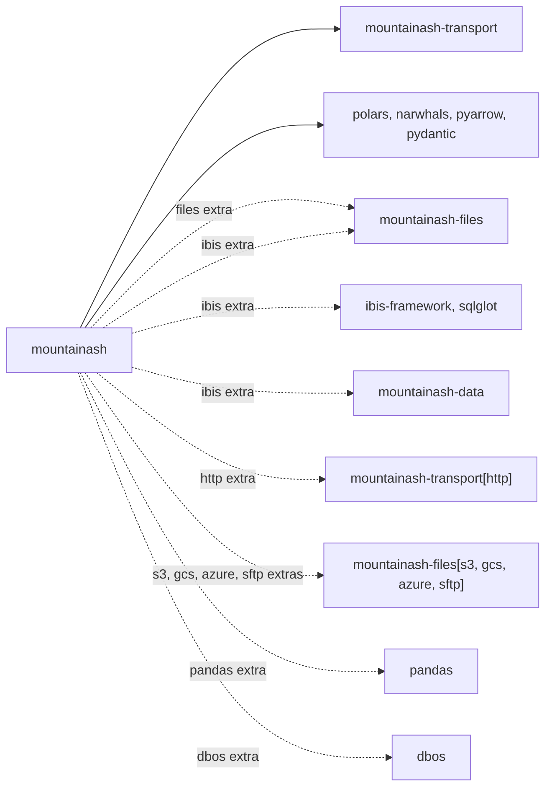

# Installation and the package surface

The `mountainash` distribution installs one Python package, imported as `import mountainash as ma`. The base install runs plans on Polars and, through Narwhals, on PyArrow; optional extras add pandas, the Ibis SQL backends and file and remote resource reading. Most work starts from the top-level namespace (`ma.col`, `ma.relation`, `ma.table_schema`), which detects the backend from the data you pass in and raises errors from one typed hierarchy.

Assumes: [What mountainash does](../01-what-mountainash-does/index.md).

## Where mountainash sits

<!-- concept:308 -->

mountainash owns the semantic layer: expressions, relations, schemas, conformance, data contracts, validation and orchestration of multi-table work. It relies on other packages for execution and for moving bytes. Execution belongs to the dataframe libraries and engines (Polars, Narwhals and the libraries it reaches, Ibis and its SQL engines). Reading resources from files and remote locations belongs to sibling `mountainash-*` packages. The dependency declarations in `pyproject.toml` show where each boundary sits:



Solid arrows are base dependencies and dotted arrows come with an extra.

`mountainash-transport` is a base dependency. mountainash uses it for remote resource I/O: when a `DataResource` or `DataPackage` descriptor points at a path, mountainash asks transport whether the path uses a remote storage scheme and, if it does, reads the bytes through it. Its `http` extra, exposed as `mountainash[http]`, adds reading of `https://` resources.

mountainash uses `mountainash-files` to parse file-backed resources (CSV, Parquet, and gzip or zip compressed files) into tables. It arrives with the `files` extra, with the `ibis` extra, and with the storage extras (`s3`, `gcs`, `azure`, `sftp`), which select the matching extra of `mountainash-files`. Reading a file-backed resource without it raises an error that names `mountainash[files]`.

`mountainash-data` comes with the `ibis` extra. mountainash uses it for physical operations against SQL backends: transactions and owned copies of tables. Plans that run on Polars or Narwhals never import it.

The `dbos` extra declares `dbos>=1.0.0`. No module in the current source imports it.

Pages that cross one of these boundaries link back here: [Table schemas and DataPackage](../10-table-schemas-and-datapackage/index.md#datapackage-resources-and-dialects) for resource reading, and [Execution targets and backend capabilities](../09-execution-targets-and-capabilities/index.md#operand-transfer-and-owned-copies) for owned copies on SQL backends.

## Base install and extras

<!-- concept:310 -->

mountainash requires Python 3.12 or later. Install the base package with uv or pip:

```bash
uv add mountainash
# or
pip install mountainash
```

Extras are added in brackets. Several can be combined:

```bash
uv add "mountainash[pandas]"
uv add "mountainash[ibis]" "ibis-framework[duckdb]"
uv add "mountainash[files,http]"
pip install "mountainash[all]"
```

!!! note "Release status"
    mountainash and its sibling packages are not yet published on public PyPI, so the commands above resolve only once those releases exist. Until then, work from a source checkout using the Hatch environments described in [Contributing and testing](../23-contributing-and-testing/index.md), which resolve the sibling packages from local checkouts.

Runnable recipes with their expected output live in the [examples folder](https://github.com/mountainash-io/mountainash/tree/develop/examples).

The base install pulls in Polars 2, Narwhals, PyArrow, Pydantic, `lazy_loader`, `universal-pathlib`, the JSON Schema and date-parsing libraries used by schema validation, and `mountainash-transport`. Narwhals is pinned to the 2.27 series because the backend capability declarations are qualified against that release.

| Extra | Pulls in | Adds |
|---|---|---|
| `pandas` | `pandas>=3.0.0` | pandas frames as a Narwhals dialect, and pandas output |
| `ibis` | `ibis-framework>=12.0.0`, `sqlglot>=29.0.1,<30.18.0`, `mountainash-data`, `mountainash-files` | the Ibis backend family, SQL transactions and owned copies, file resources |
| `files` | `mountainash-files` | reading file-backed resources |
| `http` | `mountainash-transport[http]` | reading `https://` resources |
| `s3`, `gcs`, `azure`, `sftp` | `mountainash-files` with the matching extra | file resources in that storage service |
| `dbos` | `dbos>=1.0.0` | nothing used by the current source |
| `all` | every extra above | everything above |

Which backends work depends on what is importable as well as on extras:

| Backend | What to install |
|---|---|
| Polars; Narwhals over Polars and PyArrow | the base install |
| Narwhals over pandas | the `pandas` extra |
| Ibis | the `ibis` extra plus an Ibis driver, for example `ibis-framework[duckdb]`, `[sqlite]` or `[postgres]` (the extra installs Ibis but no database driver) |
| Narwhals over Dask or DuckDB | `dask` or `duckdb` yourself; no mountainash extra declares them |

The support level recorded for each of these is listed in [Backend support and known limits](../16-backend-support-and-limits/index.md#support-matrix).

## The top-level namespace

<!-- concept:311 -->

`import mountainash as ma` gives one flat namespace. The names in its `__all__`, grouped by purpose:

| Purpose | Names |
|---|---|
| Building expressions | `col`, `lit`, `when`, `coalesce`, `greatest`, `least`, `native`, `element`, `now`, `today`, `duration` |
| Ternary logic | `t_col`, `always_true`, `always_false`, `always_unknown` |
| Horizontal functions | `all_horizontal`, `any_horizontal`, `max_horizontal`, `min_horizontal`, `sum_horizontal` |
| Aggregates | `len`, `count_records`, `corr`, `median`, `quantile` |
| Expression types and enums | `BaseExpressionAPI`, `BooleanExpressionAPI`, `CaseFailureBehaviour` (cast failure handling), `CONST_EXPRESSION_NODE_TYPES`, `CONST_LOGIC_TYPES` |
| Relations | `relation`, `concat`, `from_arrow`, `PydataIngress` |
| Execution | `materialization_scope`, `CheckpointPolicy` |
| Multi-table graphs | `RelationDAG` |
| Schemas and packages | `TableSchema`, `FieldDefinition`, `table_schema`, `DataPackage`, `DataResource`, `TableDialect`, `DescriptorWriteMode`, `ResourceRef` |
| Data contracts | `datacontract` |
| Data types | `MountainashDtype`, `DecimalDtype` |
| Capability policy | `capability_policy`, `CapabilityPolicy`, `CapabilityIssueClass`, `ProtectionMechanism` |
| Value classification | `ValueKind`, `value_kind`, `boolean_value`, `text_value` |
| Errors, typing and version | `MountainashError`, `DataFrameT`, `__version__` |

Typical code uses a handful of these: `ma.col` and `ma.lit` for expressions, `ma.relation` to wrap data, `ma.table_schema` or `ma.TableSchema` to declare a schema, and a terminal such as `.to_polars()`. The remaining names are documented where they are used: expressions in [Building expressions](../04-building-expressions/index.md), relations in [Relations](../07-relations/index.md), schemas in [Table schemas and DataPackage](../10-table-schemas-and-datapackage/index.md), contracts in [Data contracts](../12-data-contracts/index.md), graphs in [RelationDAG](../14-relationdag/index.md), dtypes in [Data types](../03-dtypes/index.md) and capability policy in [Execution targets and backend capabilities](../09-execution-targets-and-capabilities/index.md#capability-errors-and-capability_policy).

Typed errors other than the root live in `mountainash.exceptions` (see [Errors](#errors)). Subpackages such as `mountainash.expressions.introspect`, `mountainash.typespec` and `mountainash.pydata` hold further public functions, which the relevant chapters import explicitly.

<!-- concept:312 -->

Importing `mountainash` loads only lightweight names eagerly: dtypes, the error root, schema and DataPackage models, value classification and the version. Dataframe backends load later. The expression, relation, DAG, ingress and capability-policy names are attached lazily with `lazy_loader`. The first access to one of them imports its subpackage, and that subpackage registers the backends it can import:

```python
import sys

import mountainash as ma


def loaded():
    names = ("polars", "narwhals", "ibis", "mountainash.expressions", "mountainash.relations")
    return [name for name in names if name in sys.modules]


print(loaded())
ma.col
print(loaded())
ma.relation
print(loaded())
print("col" in dir(ma))
```

```text
[]
['polars', 'narwhals', 'ibis', 'mountainash.expressions']
['polars', 'narwhals', 'ibis', 'mountainash.expressions', 'mountainash.relations']
True
```

Touching `ma.col` loads the expression subpackage, which registers Polars and Narwhals and, because Ibis is installed in this environment, Ibis. Without Ibis installed, registration skips the Ibis backend and carries on. Lazy names still appear in `dir(ma)` and in tab completion. Scripts that only read schemas or descriptors therefore skip the cost of a backend import.

## Backend detection

<!-- concept:313 -->

The type of the dataframe or table you pass to `ma.relation(...)` or to an expression's `.compile(...)` picks the backend, so neither call takes a backend argument. Detection maps an object to one of the three backend families from [What mountainash does](../01-what-mountainash-does/index.md#one-logic-many-engines):

| Object | Family |
|---|---|
| Polars `DataFrame` or `LazyFrame` | Polars |
| Narwhals `DataFrame` or `LazyFrame` | Narwhals |
| Ibis table | Ibis |
| Anything `narwhals.from_native` accepts (pandas, PyArrow, Dask, DuckDB relations and so on) | Narwhals |

`ma.relation` converts Python data (dictionaries, lists of records, dataclasses, Pydantic models) to a Polars frame before detection, as described in [Relations from Python data](../07-relations/index.md#relations-from-python-data).

The function the package uses is `identify_backend`, in `mountainash.core.backend_detection`. Most code leaves the call to the package; calling it directly shows the decision:

```python
import polars as pl

from mountainash.core.backend_detection import identify_backend

frame = pl.DataFrame({"id": [1, 2]})
for label, native in {
    "polars": frame,
    "polars lazy": frame.lazy(),
    "pandas": frame.to_pandas(),
    "pyarrow": frame.to_arrow(),
}.items():
    print(label, identify_backend(native))
```

```text
polars polars
polars lazy polars
pandas narwhals
pyarrow narwhals
```

An object that no family accepts raises a plain `ValueError` at compile time:

```python
try:
    ma.col("id").compile({"id": [1, 2]})
except ValueError as exc:
    print(exc)
```

```text
Cannot identify backend for type <class 'dict'>. Module: builtins, Class: dict. Tip: Try wrapping your DataFrame with narwhals: nw.from_native(df)
```

Detection also resolves a dialect within the family where it can, such as `narwhals-pandas` or, for an Ibis table bound to a connection, `ibis-duckdb`. The dialect selects which capability declarations apply; [Backend capabilities, families and dialects](../09-execution-targets-and-capabilities/index.md#backend-capabilities-families-and-dialects) covers identity and dialects, and [Backends](../21-backends/index.md) covers how each family is wired in.

!!! warning "Backend limit"
    Backend detection rejects a Narwhals frame that wraps an Ibis table. Pass the Ibis table itself (unwrap it with `.to_native()`).

    ```python
    import ibis
    import narwhals as nw

    con = ibis.duckdb.connect()
    table = con.create_table("ids", frame.to_arrow())
    try:
        ma.col("id").compile(nw.from_native(table))
    except ValueError as exc:
        print(exc)
    ```

    ```text
    Narwhals-wrapped Ibis tables are not supported due to upstream compatibility issues. Please unwrap the Ibis table using `df.to_native()` and use the Ibis backend directly.
    ```

## Errors

<!-- concept:314 -->

Errors that mountainash raises deliberately derive from one root, `ma.MountainashError`. Under the root, a domain with several related errors has its own base class: `ConformError`, `DAGError`, `DtypeError`, `DescriptorError`, `TypeSpecError`, `MembershipArgumentError` and `ValidationError`. Single errors derive from the root directly.

Many of these classes also inherit a built-in exception: `UnknownDtypeError` is a `DtypeError` and also a `ValueError`, `RelationDAGRequired` is a `RuntimeError`, and `DescriptorReferenceNotFound` is a `FileNotFoundError`. Code that already catches the built-in keeps working, and new code can catch the mountainash class. An unknown type name in a schema shows both:

```python
try:
    ma.table_schema({"id": "int"})
except ma.MountainashError as exc:
    print(type(exc).__name__, isinstance(exc, ValueError))
    print(exc)
```

```text
UnknownDtypeError True
'int' is not a frictionless Table Schema type. Valid: ['any', 'array', 'boolean', 'date', 'datetime', 'duration', 'geojson', 'geopoint', 'integer', 'list', 'number', 'object', 'string', 'time', 'year', 'yearmonth']
```

Catch `MountainashError` to handle any mountainash failure in one place, a domain base such as `ConformError` to handle one area, or a specific class when the recovery is specific. Some exceptions come from outside the hierarchy. Backend detection raises a plain `ValueError` (shown above), and errors raised by the backend engine itself during execution reach you as that engine's exception type. Conventions for adding typed errors are in [Typed error conventions](../23-contributing-and-testing/index.md#typed-error-conventions).

<!-- concept:315 -->

The package top level exports only the root. Import every other typed error from `mountainash.exceptions`, which follows the `polars.exceptions` convention: it re-exports each class from the module that owns it and defines none of its own, so `mountainash.exceptions.DtypeError` is the same object the dtype code raises.

```python
from mountainash.exceptions import DtypeError

try:
    ma.table_schema({"id": "int"})
except DtypeError as exc:
    print([cls.__name__ for cls in type(exc).__mro__])
```

```text
['UnknownDtypeError', 'DtypeError', 'MountainashError', 'ValueError', 'Exception', 'BaseException', 'object']
```

The facade does not yet re-export some typed errors, for example the pipeline errors (in `mountainash.pipelines.errors`) and the execution-location errors (in `mountainash.relations.core.errors`). They are still `MountainashError` subclasses, so a broad catch covers them.

## Value classification

<!-- concept:316 -->

Value classification answers "what kind of scalar is this?" and leaves the value uncoerced. `ma.value_kind(value)` returns a `ma.ValueKind`: `ABSENT`, `BOOLEAN`, `INTEGER`, `FLOAT`, `TEXT` or `UNSUPPORTED`. It inspects exact types only and calls no `bool()`, `str()` or comparison on the value, so `True` classifies as a boolean and never as the integer 1. NumPy scalars and pandas missing markers are recognised when those libraries are already loaded. Other types, including dates and `Decimal`, are `UNSUPPORTED`.

```python
from datetime import date

for value in (None, True, 1, 2.5, "yes", date(2026, 1, 1)):
    print(repr(value), ma.value_kind(value))
```

```text
None ValueKind.ABSENT
True ValueKind.BOOLEAN
1 ValueKind.INTEGER
2.5 ValueKind.FLOAT
'yes' ValueKind.TEXT
datetime.date(2026, 1, 1) ValueKind.UNSUPPORTED
```

`ma.boolean_value(value, source=...)` projects a boolean from one named domain and returns `None` outside it: `"boolean"` (the default) admits only booleans, `"binary_number"` admits exactly 0 and 1, and `"finite_number"` treats any finite non-zero number as `True`. An unknown `source` raises `ValueError`. `ma.text_value(value)` returns text only when the value already is text.

```python
print(ma.boolean_value(1))
print(ma.boolean_value(1, source="binary_number"))
print(ma.boolean_value(2, source="binary_number"))
print(ma.boolean_value(2, source="finite_number"))
print(ma.text_value("yes"), ma.text_value(1))
```

```text
None
True
None
True
yes None
```

The same three operations exist as expression methods, so a column can be classified inside a plan:

```python
flags = pl.DataFrame({"flag": [1, 0, 7]})
print(
    ma.relation(flags)
    .with_columns(
        ma.col("flag").value_kind().alias("kind"),
        ma.col("flag").boolean_value(source="binary_number").alias("as_bool"),
    )
    .to_polars()
)
```

```text
shape: (3, 3)
┌──────┬─────────┬─────────┐
│ flag ┆ kind    ┆ as_bool │
│ ---  ┆ ---     ┆ ---     │
│ i64  ┆ str     ┆ bool    │
╞══════╪═════════╪═════════╡
│ 1    ┆ integer ┆ true    │
│ 0    ┆ integer ┆ false   │
│ 7    ┆ integer ┆ null    │
└──────┴─────────┴─────────┘
```
