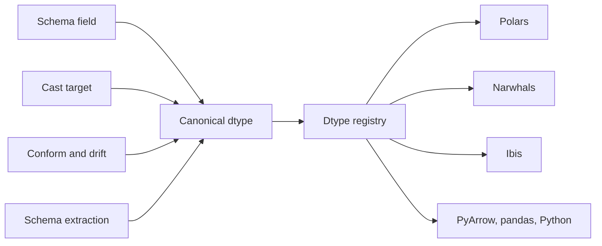

# Data types

Mountainash describes column types with one vocabulary of its own, the canonical dtypes. Table schemas, expression casts, conformance and schema extraction all state types in that vocabulary, and a dtype registry translates each canonical type into the native type of Polars, Narwhals, Ibis, PyArrow, pandas or plain Python when work reaches that library. Most users meet the canon as `ma.MountainashDtype` members, short strings such as `"i64"`, and `ma.DecimalDtype(10, 2)`.

Assumes: [What mountainash does](../01-what-mountainash-does/index.md) and [Installation and the package surface](../02-installation-and-package-surface/index.md).

## Canonical dtypes

<!-- concept:395 -->
`ma.MountainashDtype` is a string enum with one member per type family. Its values are short Substrait-style names: `bool`; signed integers `i8` to `i64`; unsigned integers `u8` to `u64`; `fp32` and `fp64`; `string` and `binary`; `date`, `time`, `timestamp` and `duration`; the containers `list` and `struct`; and `json`. Three more members, `xsd_duration`, `xsd_year` and `xsd_yearmonth`, carry Frictionless lexical types that are stored as strings rather than as native durations or integers.

Because the enum subclasses `str`, a member compares equal to its value:

```python
import mountainash as ma

print(ma.MountainashDtype.I64)
print(ma.MountainashDtype.I64 == "i64")
print([d.value for d in ma.MountainashDtype if d.value.startswith("u")])
```

```text
MountainashDtype.I64
True
['u8', 'u16', 'u32', 'u64']
```

The canon exists so that every part of the package that talks about types talks about the same thing. A field declared in a [table schema](../10-table-schemas-and-datapackage/index.md#tableschema-and-fields), the target of a [cast](../04-building-expressions/index.md#casting-cast-safety-and-nulls), the declared type that [conform](../11-conforming-data/index.md) reconciles data against, and the type recovered when a schema is extracted from a dataframe are all canonical values, not Polars or Ibis dtypes. A native dtype enters only when one is passed explicitly, and it is then wrapped so that its owning library is recorded (see [Parsing dtypes](#parsing-dtypes)). A schema written once can therefore be lowered to any target, and a type comparison between a declared schema and observed data happens in one vocabulary instead of pairwise between libraries.



One canonical value drives several native representations. Here a decimal declared on a schema field lowers to both a Polars and an Arrow schema:

```python
from mountainash.typespec.converters import to_arrow_schema, to_polars_schema

price = ma.DecimalDtype(10, 2)
schema = ma.TableSchema({"price": ma.FieldDefinition(dtype=price)})
print(to_polars_schema(schema))
print(to_arrow_schema(schema))
```

```text
{'price': Decimal(precision=10, scale=2)}
price: decimal128(10, 2)
```

The same `price` object is accepted by `.cast()` on an expression. The canon is aligned with Substrait's type names, as the expression AST is aligned with Substrait functions (see [Lazy plans and the AST](../01-what-mountainash-does/index.md#lazy-plans-and-the-ast)).

The canon is not the Frictionless type list. Frictionless Table Schema types such as `integer`, `number` and `year` form a separate boundary vocabulary that maps onto the canon when a descriptor is read or written; [Frictionless descriptors](../10-table-schemas-and-datapackage/index.md#frictionless-descriptors) covers that mapping.

<!-- concept:396 -->
Some types are incomplete without parameters. `mountainash.core.dtypes` provides frozen descriptor classes for them, and `ma.DecimalDtype` is also exported at the top level:

| Descriptor | Parameters |
|---|---|
| `DecimalDtype(precision, scale)` | total digits 1 to 38; fractional digits 0 to `precision` |
| `TimestampDtype(precision, timezone_aware, timezone)` | fractional-second digits (3 is milliseconds, 6 microseconds, 9 nanoseconds); awareness; IANA zone name or `None` |
| `TimeDtype(precision)` | fractional-second digits |
| `DurationDtype(unit, semantics)` | unit such as `"ms"` or `"D"`; `"fixed"` elapsed time or `"calendar"` interval |
| `ListDtype(element)` | element dtype |
| `ArrayDtype(element, dimensions)` | element dtype; fixed shape as a tuple |
| `StructDtype(fields)` | ordered tuple of `(name, dtype)` pairs |

Element and field types nest, so a list of structs is a `ListDtype` whose element is a `StructDtype`.

```python
from mountainash.core.dtypes import (
    ListDtype, StructDtype, TimestampDtype, TypeTarget, dtype_is_complete, registry,
)

D = ma.MountainashDtype
event_time = TimestampDtype(precision=6, timezone_aware=True, timezone="Europe/Paris")
tags = ListDtype(D.STRING)
point = StructDtype((("x", D.FP64), ("y", D.FP64)))

for dtype in (event_time, tags, point, ma.DecimalDtype(10, 2)):
    print(registry.to_native_schema(dtype, TypeTarget.POLARS))
```

```text
Datetime(time_unit='us', time_zone='Europe/Paris')
List(String)
Struct({'x': Float64, 'y': Float64})
Decimal(precision=10, scale=2)
```

Any parameter left out is `SchemaTypeStatus.UNKNOWN`, which means "not stated", not "matches anything". The bare members `TIMESTAMP`, `TIME`, `DURATION`, `LIST` and `STRUCT` are the incomplete forms of the same families. `dtype_is_complete()` reports whether every required parameter is known. When an incomplete type must become a native one, the target fills its own default, which for Polars is a naive microsecond timestamp:

```python
print(dtype_is_complete(D.TIMESTAMP), dtype_is_complete(event_time))
print(registry.to_native_schema(D.TIMESTAMP, TypeTarget.POLARS))
```

```text
False True
Datetime
```

Descriptors validate their parameters on construction:

```python
try:
    ma.DecimalDtype(40, 2)
except ValueError as exc:
    print(type(exc).__name__, exc)
```

```text
UnknownDtypeError DecimalDtype requires 1 <= precision <= 38 and 0 <= scale <= precision, got (40, 2)
```

## Parsing dtypes

<!-- concept:397 -->
Two functions in `mountainash.core.dtypes` turn user input into a canonical type. `parse_dtype()` returns a `MountainashDtype` member and accepts:

- a `MountainashDtype` member;
- a Python type: `int`, `float`, `str`, `bool`, `bytes`, `datetime.datetime`, `datetime.date`, `datetime.time` or `datetime.timedelta`;
- an alias string: the canonical names, Polars-style names (`"Int64"`, `"Utf8"`, `"Datetime"`), lowercase names (`"int64"`, `"float32"`, `"f64"`), Python names (`"int"`, `"str"`) and the Frictionless structural names `"integer"`, `"number"`, `"datetime"`, `"array"` and `"object"`. The full table is `DTYPE_ALIASES`.

```python
import datetime
from mountainash.core.dtypes import parse_dtype

for spec in ["i64", "Int64", "int64", "integer", int, datetime.datetime, D.FP32]:
    print(repr(spec), "->", parse_dtype(spec))
```

```text
'i64' -> MountainashDtype.I64
'Int64' -> MountainashDtype.I64
'int64' -> MountainashDtype.I64
'integer' -> MountainashDtype.I64
<class 'int'> -> MountainashDtype.I64
<class 'datetime.datetime'> -> MountainashDtype.TIMESTAMP
<MountainashDtype.FP32: 'fp32'> -> MountainashDtype.FP32
```

Anything else raises `UnknownDtypeError`, a subclass of both `MountainashError` and `ValueError`. There is no string syntax for parameters, and a native dtype object is refused with a pointer to the right entry point:

```python
import polars as pl
from mountainash.core.dtypes import UnknownDtypeError

for spec in ["decimal(10,2)", pl.Int64, 3.5]:
    try:
        parse_dtype(spec)
    except UnknownDtypeError as exc:
        print(exc)
```

```text
Unknown dtype string 'decimal(10,2)'. Use a canonical name like 'i64', 'string', 'fp64', or a MountainashDtype member.
Int64 is a native backend dtype, not a canonical dtype. Use parse_cast_target() for expression casts or registry.from_native() for extraction.
Cannot interpret 3.5 (type float) as a dtype.
```

`parse_cast_target()` is what `.cast()` uses. It accepts everything `parse_dtype()` does, returns parameterized descriptors unchanged, and wraps a native dtype object in a `NativeDtype` that records its owning target without converting it, so its parameters survive until compilation:

```python
from mountainash.core.dtypes import parse_cast_target

print(parse_cast_target("f64"))
print(parse_cast_target(event_time) is event_time)
print(parse_cast_target(pl.Datetime("ms", "UTC")))
```

```text
MountainashDtype.FP64
True
value=Datetime(time_unit='ms', time_zone='UTC') target=<TypeTarget.POLARS: 'polars'>
```

## Native type targets

<!-- concept:399 -->
A `TypeTarget` names a library whose types the canon maps to and from: `polars`, `pandas`, `pyarrow`, `ibis`, `narwhals` and `python`. Type targets are not the same thing as execution backends. pandas, PyArrow and Python are targets because schemas are converted to them, data is extracted from them and results are returned in them, even though plans run on Polars, Narwhals or Ibis. Which backend a dataframe belongs to is decided by [backend detection](../02-installation-and-package-surface/index.md#backend-detection); the matching type target follows from it.

The module-level `registry` (a `DtypeRegistry`) performs every translation. Its main methods are `to_native_schema()` for schema construction, `to_native_cast()` for cast targets, `from_native()` to decode a native type back to the canon, `parse_type_string()` for native type spellings, and `types_equal()` to compare two native types with their parameters. Each target's module is imported the first time it is used, so importing mountainash never imports pandas, PyArrow or Ibis, and a missing optional library raises only when its target is requested.

```python
print(list(TypeTarget))
for target in TypeTarget:
    try:
        print(target.value, registry.to_native_schema(event_time, target))
    except ValueError as exc:
        print(target.value, type(exc).__name__, exc)
```

```text
[<TypeTarget.POLARS: 'polars'>, <TypeTarget.PANDAS: 'pandas'>, <TypeTarget.PYARROW: 'pyarrow'>, <TypeTarget.IBIS: 'ibis'>, <TypeTarget.NARWHALS: 'narwhals'>, <TypeTarget.PYTHON: 'python'>]
polars Datetime(time_unit='us', time_zone='Europe/Paris')
pandas datetime64[us, Europe/Paris]
pyarrow timestamp[us, tz=Europe/Paris]
ibis timestamp('Europe/Paris', 6)
narwhals Datetime(time_unit='us', time_zone='Europe/Paris')
python DtypeMappingError Python datetime type hints cannot encode timestamp precision
```

A target that cannot represent a requested type raises `DtypeMappingError` instead of silently dropping a parameter. Decoding goes the other way and keeps parameters; the target is detected from the native object when it is not passed:

```python
print(registry.from_native(pl.Datetime("ms", "UTC")))
print(registry.from_native(pl.List(pl.Int32)))
```

```text
TimestampDtype(precision=3, timezone_aware=True, timezone='UTC', native=None)
ListDtype(element=<MountainashDtype.I32: 'i32'>, native=None)
```

A `NativeDtype` lowers only on its own target. Casting is stricter than schema construction in one more way: a bare container is a valid schema placeholder but not a cast target, because a cast needs the element type.

```python
native = parse_cast_target(pl.Datetime("ms", "UTC"))
print(registry.to_native_cast(native, TypeTarget.POLARS))
try:
    registry.to_native_cast(native, TypeTarget.IBIS)
except ValueError as exc:
    print(type(exc).__name__, exc)

try:
    registry.to_native_cast(D.LIST, TypeTarget.POLARS)
except ValueError as exc:
    print(type(exc).__name__)
print(registry.to_native_cast(ListDtype(D.I32), TypeTarget.POLARS))
```

```text
Datetime(time_unit='ms', time_zone='UTC')
DtypeMappingError Native refinement targets polars, not ibis
DtypeMappingError
List(Int32)
```

!!! warning "Backend limit"
    Temporal precision support differs by target. Polars represents timestamps and fixed durations only at precision 3, 6 or 9 (milliseconds, microseconds, nanoseconds) and times only at 9; the Narwhals and Ibis targets also restrict time precision; and calendar-semantics durations lower only on Ibis, and there only for month and year units. An unrepresentable request raises `DtypeMappingError` instead of being rounded to a nearby resolution (source: `src/mountainash/core/dtypes/target_polars.py` and the sibling `target_*.py` modules).

    ```python
    try:
        registry.to_native_schema(TimestampDtype(precision=0), TypeTarget.POLARS)
    except ValueError as exc:
        print(type(exc).__name__, exc)
    print(registry.to_native_schema(TimestampDtype(precision=0), TypeTarget.IBIS))
    ```

    ```text
    DtypeMappingError Polars timestamp cannot represent precision 0; supported precisions are 3, 6 and 9
    timestamp(0)
    ```

The table below gives the native type for each bare canonical dtype on every target, with the Frictionless type it exports to. It was generated by calling `registry.to_native_schema()` and the Frictionless boundary map for every `MountainashDtype` member at source revision `0a625ad`. Container rows show the bare placeholder; a parameterized descriptor lowers to the full native type, as in the examples above.

| Canonical | Polars | Narwhals | Ibis | PyArrow | pandas | Python | Frictionless export |
|---|---|---|---|---|---|---|---|
| `bool` | `Boolean` | `Boolean` | `boolean` | `bool` | `boolean` | `bool` | `boolean` |
| `i8` | `Int8` | `Int8` | `int8` | `int8` | `Int8` | `int` | `integer` |
| `i16` | `Int16` | `Int16` | `int16` | `int16` | `Int16` | `int` | `integer` |
| `i32` | `Int32` | `Int32` | `int32` | `int32` | `Int32` | `int` | `integer` |
| `i64` | `Int64` | `Int64` | `int64` | `int64` | `Int64` | `int` | `integer` |
| `u8` | `UInt8` | `UInt8` | `uint8` | `uint8` | `UInt8` | `int` | `integer` |
| `u16` | `UInt16` | `UInt16` | `uint16` | `uint16` | `UInt16` | `int` | `integer` |
| `u32` | `UInt32` | `UInt32` | `uint32` | `uint32` | `UInt32` | `int` | `integer` |
| `u64` | `UInt64` | `UInt64` | `uint64` | `uint64` | `UInt64` | `int` | `integer` |
| `fp32` | `Float32` | `Float32` | `float32` | `float` | `float32` | `float` | `number` |
| `fp64` | `Float64` | `Float64` | `float64` | `double` | `float64` | `float` | `number` |
| `string` | `String` | `String` | `string` | `string` | `string` | `str` | `string` |
| `binary` | `Binary` | `Binary` | `binary` | `binary` | `object` | `bytes` | `string` (format `binary`) |
| `date` | `Date` | `Date` | `date` | `date32[day]` | `datetime64[ns]` | `date` | `date` |
| `time` | `Time` | `Time` | `time` | `time64[ns]` | `object` | `time` | `time` |
| `timestamp` | `Datetime` | `Datetime` | `timestamp` | `timestamp[ns]` | `datetime64[ns]` | `datetime` | `datetime` |
| `duration` | `Duration` | `Duration` | `interval` | `duration[ns]` | `timedelta64[ns]` | `timedelta` | `duration` |
| `list` | `List` | `List` | `array` | `list<item: string>` | `object` | `list` | `array` |
| `struct` | `Struct` | `Struct` | `struct` | `struct<>` | `object` | `dict` | `object` |
| `json` | `String` | `String` | `string` | `string` | `string` | `str` | `geojson` |
| `xsd_duration` | `String` | `String` | `string` | `string` | `string` | `str` | `duration` |
| `xsd_year` | `String` | `String` | `string` | `string` | `string` | `str` | `year` |
| `xsd_yearmonth` | `String` | `String` | `string` | `string` | `string` | `str` | `yearmonth` |

For extension authors and backend maintainers: the registry holds no mapping tables itself. Each target is one stateless adapter class that implements the `NativeTypeAdapter` protocol in `mountainash.core.dtypes.protocols` (`from_native`, `to_native_schema`, `to_native_cast`, `parse_type_string`, `types_equal`) and the `NativeArrowTransportAdapter` protocol for Arrow transport. A new target means a `TypeTarget` member, an adapter module, and a registry entry naming both; every canonical dtype must be mapped, and `tests/core/dtypes/test_completeness.py` fails when one is missing. [Type and schema adapters](../22-extending-mountainash/index.md#type-and-schema-adapters) walks through adding one.
