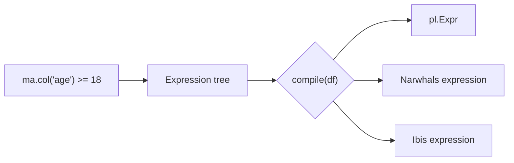

# Building expressions

A mountainash expression is a backend-free description of a column computation. `ma.col()`, `ma.lit()` and `ma.when()` start one; Python operators and named methods such as `.cast()`, `.fill_null()` and `.alias()` extend it. Compiling the finished tree against a dataframe turns it into a Polars, Narwhals or Ibis expression, either directly with `.compile(df)` or through a [relation](../07-relations/index.md) that uses it.

Assumes: [What mountainash does](../01-what-mountainash-does/index.md), [Installation and the package surface](../02-installation-and-package-surface/index.md) and [Data types](../03-dtypes/index.md).

## Expression objects

<!-- concept:320 -->
Every expression entry point returns an expression object, an instance of `ma.BaseExpressionAPI` (concretely `BooleanExpressionAPI`). The object holds one node of the [abstract syntax tree](../01-what-mountainash-does/index.md#lazy-plans-and-the-ast). Data and backend arrive at compile time.

```python
import mountainash as ma

adult = ma.col("age") >= 18
print(isinstance(adult, ma.BaseExpressionAPI))
print(adult)
```

```text
True
BooleanExpressionAPI(ScalarFunctionNode(function_key=<FKEY_SUBSTRAIT_SCALAR_COMPARISON.GTE: 5>, arguments=[FieldReferenceNode(function_key=None, field='age', unknown_values=None), LiteralNode(function_key=None, value=18, dtype=None, is_native=False)], options={}, diagnostic_context={}))
```

The `>=` produced a function node keyed by a Substrait comparison, with the column reference and the literal `18` as its arguments. That is the [build-then-compile](../01-what-mountainash-does/index.md#lazy-plans-and-the-ast) model at work: building records intent as a tree, and compilation chooses the backend later.

Expressions are immutable. Each method or operator returns a new expression whose tree contains the old one, so a partial expression can be reused safely as the base of several others:

```python
base = ma.col("price")
taxed = base * 1.1
print(base)
```

```text
BooleanExpressionAPI(FieldReferenceNode(function_key=None, field='price', unknown_values=None))
```

The tree is backend-independent, so one expression runs unchanged on any supported dataframe. Here the same `total` runs on a Polars frame and on a pandas frame (reached through Narwhals):

```python
import pandas as pd
import polars as pl

total = (ma.col("price") * ma.col("qty")).alias("total")
orders_pl = pl.DataFrame({"price": [2.5, 4.0], "qty": [3, 2]})
orders_pd = pd.DataFrame({"price": [2.5, 4.0], "qty": [3, 2]})
print(ma.relation(orders_pl).select(total).to_dict())
print(ma.relation(orders_pd).select(total).to_dict())
```

```text
{'total': [7.5, 8.0]}
{'total': [7.5, 8.0]}
```

`ma.relation(...).select(...)` and `.to_dict()` are covered in [Relations](../07-relations/index.md) and [Collecting results](../08-collecting-results/index.md); on this page they serve only to run expressions.



Methods reach an expression in two ways. Most operations are flat methods directly on the object (`.gt()`, `.cast()`, `.fill_null()`). Domain-specific operations sit in namespaces: `.str`, `.dt`, `.name`, `.list`, `.struct`, `.cat` and `.geo`, described in [Namespaces](../05-namespaces-aggregates-and-windows/index.md#namespaces). Method names and parameters follow Polars conventions, while the tree underneath stays aligned with Substrait. Where the two vocabularies differ, both spellings exist and build the same node: `.ge()` and `.gte()`, `.ne()` and `.not_equal()`, `.modulo()` and `.modulus()`, `.sub()` and `.subtract()`. How the methods are assembled from separate builder classes is described in [API builders and expression systems](../17-architecture/index.md#api-builders-and-expression-systems).

Operator support has one side effect: `==` builds an expression and returns no `bool`, so expression objects are unhashable and cannot be dictionary keys or set members.

## Columns, literals and conditions

<!-- concept:321 -->
`ma.col(name)` references one column by name. It takes exactly one string; `ma.col("a", "b")` raises `TypeError`, and column selection works by name only, with no dtype-based form. For a ternary-aware column reference with sentinel values, see [`ma.t_col()`](../06-ternary-logic/index.md#ternary-columns-and-sentinels).

Building an expression leaves the name unchecked. A misspelled column fails when the expression is compiled or run against data that lacks it, because a schema exists only at that point.

Two string forms pass through to the backend as selectors: `"*"` (all columns) and a regular expression wrapped in `^...$`. Polars expands them; other backends treat them as literal column names.

```python
import ibis

con = ibis.duckdb.connect()
orders_ib = con.create_table("orders", orders_pl.to_arrow())

print(ma.relation(orders_pl).select(ma.col("^p.*$")).to_dict())
try:
    ma.relation(orders_ib).select(ma.col("^p.*$")).to_dict()
except Exception as exc:
    print(type(exc).__name__, exc)
```

```text
{'price': [2.5, 4.0]}
IbisTypeError Column '^p.*$' is not found in table. Existing columns: 'price', 'qty'.
```

!!! warning "Backend limit"
    `"*"` and `"^...$"` selector strings come from Polars selector lowering and are specific to Polars. They work on Polars frames and fail on Ibis tables. Use explicit column names in expressions meant to run on more than one backend (source: `tests/relations/cross_backend/test_rel_projection_names.py`). See [Backend support and known limits](../16-backend-support-and-limits/index.md).

<!-- concept:322 -->
`ma.lit(value)` wraps a constant. Plain Python values on the other side of an operator or method are wrapped automatically, so `ma.col("qty") + 1` needs no `lit`. Use `lit` when the constant comes first, when a constant column is wanted on its own, or to fix its type with `dtype=`, which accepts any canonical form from [Parsing dtypes](../03-dtypes/index.md#parsing-dtypes) and rejects a native dtype. `ma.lit(None)` is a null literal.

```python
print(
    ma.relation(orders_pl)
    .select(ma.lit(5, dtype="i16").alias("five"), ma.lit(None).alias("nothing"), ma.col("qty") + 1)
    .to_polars()
)
```

```text
shape: (2, 3)
┌──────┬─────────┬─────┐
│ five ┆ nothing ┆ qty │
│ ---  ┆ ---     ┆ --- │
│ i16  ┆ null    ┆ i64 │
╞══════╪═════════╪═════╡
│ 5    ┆ null    ┆ 4   │
│ 5    ┆ null    ┆ 3   │
└──────┴─────────┴─────┘
```

<!-- concept:323 -->
`ma.when(condition).then(value)` starts a conditional; further `.when(...).then(...)` pairs add branches, tested in order, and `.otherwise(value)` closes it. Plain values in `then` and `otherwise` are literals, so `then("A")` produces the string `"A"`, where Polars would read it as a reference to a column named `A`. A row whose condition is null takes the next branch, which is why the null score below falls through to `"F"`.

```python
scores = pl.DataFrame({"score": [95, 72, None, 40]})
grade = (
    ma.when(ma.col("score") >= 90).then("A")
    .when(ma.col("score") >= 60).then("B")
    .otherwise("F")
    .alias("grade")
)
print(ma.relation(scores).with_columns(grade).to_dict())
```

```text
{'score': [95, 72, None, 40], 'grade': ['A', 'B', 'F', 'F']}
```

Until `.otherwise()` closes it, the chain is an incomplete builder with no expression methods:

```python
try:
    ma.when(ma.col("score") >= 90).then("A").alias("grade")
except AttributeError as exc:
    print(exc)
```

```text
'SubstraitThenAPIBuilder' object has no attribute 'alias'
```

<!-- concept:334 -->
`ma.today()` and `ma.now()` take no arguments and produce the current date and the current timestamp as a constant column.

```python
stamps = ma.relation(orders_pl).select(ma.today().alias("run_date"), ma.now().alias("run_at"))
print(stamps.to_polars().schema)
```

```text
Schema({'run_date': Date, 'run_at': Datetime(time_unit='us', time_zone=None)})
```

!!! warning "Backend limit"
    The value is fixed once, when the expression is compiled, and every row gets that value. `today()` reads the Python process's local date on every backend. `now()` reads the Python process's clock on Polars and Narwhals, but on Ibis it compiles to the database's own current-time function, so the timestamp comes from the database server's clock (source: `src/mountainash/expressions/backends/expression_systems/ibis/extensions_mountainash/expsys_ib_ext_ma_scalar_datetime.py`).

## Operators

<!-- concept:324 -->
Python operators on an expression delegate to named methods and build the same nodes:

| Operator | Named method | Operator | Named method |
|---|---|---|---|
| `a + b` | `add` | `a > b` | `gt` |
| `a - b` | `subtract` (`sub`) | `a >= b` | `ge` (`gte`) |
| `a * b` | `multiply` (`mul`) | `a < b` | `lt` |
| `a / b` | `divide` (`truediv`) | `a <= b` | `le` (`lte`) |
| `a // b` | `floor_divide` (`floordiv`) | `a == b` | `eq` (`equal`) |
| `a % b` | `modulo` (`modulus`, `mod`) | `a != b` | `ne` (`not_equal`) |
| `a ** b` | `power` (`pow`) | `a & b` | `and_` |
| `-a` | `negate` (`neg`) | `a \| b` | `or_` |
| | | `a ^ b` | `xor_` (`xor`) |
| | | `~a` | `not_` |

Arithmetic operators also work with a plain value on the left. `10 - ma.col("qty")` calls the reversed form, and the reversed methods are available by name as `rsubtract`, `rdivide`, `rfloor_divide`, `rmodulo` and `rpower`:

```python
print(
    ma.relation(orders_pl)
    .select(
        (10 - ma.col("qty")).alias("left"),
        (2 ** ma.col("qty")).alias("power"),
        ma.col("qty").rsubtract(10).alias("same_as_left"),
    )
    .to_dict()
)
```

```text
{'left': [7, 8], 'power': [8, 4], 'same_as_left': [7, 8]}
```

Combine conditions with `&`, `|` and `~`, never with Python's `and`, `or` and `not`. Those keywords call `bool()` on the expression, which is always true for an object, so `a and b` silently evaluates to `b` alone with no error. Wrap each comparison in parentheses, since `&` and `|` bind more tightly than comparisons.

```python
wrong = (ma.col("qty") > 2) and (ma.col("price") > 3)
right = (ma.col("qty") > 2) & (ma.col("price") > 3)
print(ma.relation(orders_pl).select(wrong.alias("wrong"), right.alias("right")).to_dict())
```

```text
{'wrong': [False, True], 'right': [False, False]}
```

<!-- concept:343 -->
Beyond the operators, the arithmetic methods include `abs`, `sign`, `sqrt`, `exp`, `factorial`, the trigonometric and hyperbolic functions (`sin` to `atanh`, `atan2`, `radians`, `degrees`) and bitwise operations (`bitwise_and`, `shift_left` and others). Comparison methods add `is_between(lower, upper)` (alias of Substrait `between`), `is_close` and `clip`. Division of integers returns a float, and division by zero follows the backend's native behaviour.

```python
pairs = pl.DataFrame({"a": [7, -7, 1], "b": [2, 3, 0]})
print(
    ma.relation(pairs)
    .select(
        (ma.col("a") / ma.col("b")).alias("div"),
        (ma.col("a") // ma.col("b")).alias("floordiv"),
        ma.col("a").is_between(0, 5).alias("in_range"),
    )
    .to_dict()
)
```

```text
{'div': [3.5, -2.3333333333333335, inf], 'floordiv': [3, -3, None], 'in_range': [False, False, True]}
```

The named methods accept Substrait options that have no operator form: `overflow=` on `add`, `subtract`, `multiply` and `power`, and `on_division_by_zero=` and `on_domain_error=` on `divide`. A backend that cannot honour a requested option raises a capability error and never silently substitutes its own behaviour ([Capability errors](../09-execution-targets-and-capabilities/index.md#capability-errors-and-capability_policy)).

```python
try:
    ma.relation(pairs).select(ma.col("a").add(1, overflow="ERROR")).to_dict()
except Exception as exc:
    print(type(exc).__name__, exc)
```

```text
BackendCapabilityError [polars] Polars only supports SILENT overflow handling. Omit overflow or use SILENT for native Polars behavior.
```

!!! warning "Backend limit"
    Polars supports only `overflow="SILENT"` and IEEE division by zero; other values raise `BackendCapabilityError` (source: `src/mountainash/expressions/backends/capabilities/polars/dialects/polars/substrait/arithmetic.py`). Each Ibis dialect declares its own supported modes; see [Backend support and known limits](../16-backend-support-and-limits/index.md).

<!-- concept:344 -->
Boolean expressions combine with `&` (`and_`), `|` (`or_`), `^` (`xor_`) and `~` (`not_`), plus `and_not(other)` for "this and not that". Nulls follow three-valued (Kleene) rules: `null & False` is `False`, `null | True` is `True`, and any other combination involving null is null.

```python
flags = pl.DataFrame({"x": [True, True, None, False], "y": [False, None, True, None]})
print(
    ma.relation(flags)
    .select(
        (ma.col("x") & ma.col("y")).alias("and"),
        (ma.col("x") | ma.col("y")).alias("or"),
        (~ma.col("x")).alias("not_x"),
        ma.col("x").and_not(ma.col("y")).alias("x_and_not_y"),
    )
    .to_dict()
)
```

```text
{'and': [False, None, None, False], 'or': [True, True, True, None], 'not_x': [False, False, None, True], 'x_and_not_y': [True, None, False, False]}
```

These are ordinary boolean operations on nullable columns. Mountainash also has explicit ternary operations (`t_and`, `t_gt` and the rest) that treat unknown as a value in its own right and let sentinel values count as unknown; they are described in [Ternary logic](../06-ternary-logic/index.md).

<!-- concept:347 -->
Rounding methods are `ceil()`, `floor()` and `round(decimals)`, where `decimals` must be a literal `int` (an expression raises `TypeError`). Logarithms are `ln()`, `log10()`, `log2()`, `log1p()` and `log(base)`.

```python
values = pl.DataFrame({"v": [2.345, -1.5, 100.0]})
print(
    ma.relation(values)
    .select(
        ma.col("v").round(1).alias("round_1"),
        ma.col("v").ceil().alias("ceil"),
        ma.col("v").floor().alias("floor"),
        ma.col("v").abs().log10().alias("log10"),
        ma.col("v").abs().log(2).alias("log2"),
    )
    .to_polars()
)
```

```text
shape: (3, 5)
┌─────────┬───────┬───────┬──────────┬──────────┐
│ round_1 ┆ ceil  ┆ floor ┆ log10    ┆ log2     │
│ ---     ┆ ---   ┆ ---   ┆ ---      ┆ ---      │
│ f64     ┆ f64   ┆ f64   ┆ f64      ┆ f64      │
╞═════════╪═══════╪═══════╪══════════╪══════════╡
│ 2.3     ┆ 3.0   ┆ 2.0   ┆ 0.370143 ┆ 1.229588 │
│ -1.5    ┆ -1.0  ┆ -2.0  ┆ 0.176091 ┆ 0.584963 │
│ 100.0   ┆ 100.0 ┆ 100.0 ┆ 2.0      ┆ 6.643856 │
└─────────┴───────┴───────┴──────────┴──────────┘
```

!!! warning "Backend limit"
    `round()` uses the backend's tie-breaking rule, and `%` uses the backend's sign convention. Polars rounds halves to even and gives the remainder the divisor's sign; DuckDB through Ibis rounds halves away from zero, returns an integer from `round()`, and gives the remainder the dividend's sign. The cross-backend tests accept either result (source: `tests/expressions/cross_backend/test_edge_cases_numeric.py`). For exact, explicit rounding, cast to a `DecimalDtype` with a `rounding=` mode.

    ```python
    edge = pl.DataFrame({"v": [0.5, 1.5, 2.5, -2.5], "a": [-7, 7, -7, 7], "b": [3, -3, -3, 3]})
    for source in (edge, con.create_table("edge", edge.to_arrow())):
        print(ma.relation(source).select(ma.col("v").round(), (ma.col("a") % ma.col("b")).alias("mod")).to_dict())
    ```

    ```text
    {'v': [0.0, 2.0, 2.0, -2.0], 'mod': [2, -2, -1, 1]}
    {'v': [1, 2, 3, -3], 'mod': [-1, 1, -1, 1]}
    ```

## Casting, cast safety and nulls

<!-- concept:345 -->
`.cast(dtype, failure_behavior="throw", rounding=None)` converts an expression to another type. `dtype` is anything [`parse_cast_target()`](../03-dtypes/index.md#parsing-dtypes) accepts: a canonical name, a `MountainashDtype` member, a Python type, a parameterized descriptor such as `ma.DecimalDtype(6, 1)`, or a native dtype object. `failure_behavior="null"` turns unconvertible values into nulls; `ma.CaseFailureBehaviour` holds the two values. A `DecimalDtype` target requires `rounding=` (`"half_to_even"`, `"half_away_from_zero"` or `"to_zero"`) and accepts precision up to 16; other targets reject `rounding=`.

```python
raw = pl.DataFrame({"code": ["1", "2", "x"], "amount": [1.25, 2.5, -3.75]})
print(
    ma.relation(raw)
    .select(
        ma.col("code").cast("i32", failure_behavior="null"),
        ma.col("amount").cast(ma.MountainashDtype.I64).alias("amount_i64"),
        ma.col("amount").cast(ma.DecimalDtype(6, 1), rounding="half_to_even").alias("amount_dec"),
    )
    .to_polars()
)
```

```text
shape: (3, 3)
┌──────┬────────────┬──────────────┐
│ code ┆ amount_i64 ┆ amount_dec   │
│ ---  ┆ ---        ┆ ---          │
│ i32  ┆ i64        ┆ decimal[6,1] │
╞══════╪════════════╪══════════════╡
│ 1    ┆ 1          ┆ 1.2          │
│ 2    ┆ 2          ┆ 2.5          │
│ null ┆ -3         ┆ -3.8         │
└──────┴────────────┴──────────────┘
```

With the default `failure_behavior="throw"` the backend raises its own error at run time. Building the expression catches a missing `rounding=`:

```python
try:
    ma.relation(raw).select(ma.col("code").cast("i32")).to_dict()
except Exception as exc:
    print(type(exc).__name__, str(exc).splitlines()[0])
try:
    ma.col("amount").cast(ma.DecimalDtype(6, 1))
except ValueError as exc:
    print(type(exc).__name__, exc)
```

```text
InvalidOperationError conversion from `str` to `i32` failed in column 'code' for 1 out of 1 values: ["x"]
InvalidOptionValueError cast: invalid rounding; required for DecimalDtype targets: one of half_to_even, half_away_from_zero, to_zero
```

A native dtype keeps all its parameters but ties the expression to its own library ([Native type targets](../03-dtypes/index.md#native-type-targets)):

```python
raw_ib = con.create_table("raw", raw.to_arrow())
print(ma.relation(raw).select(ma.col("amount").cast(pl.Float32)).to_polars().schema)
try:
    ma.relation(raw_ib).select(ma.col("amount").cast(pl.Float32)).to_dict()
except ValueError as exc:
    print(type(exc).__name__, exc)
```

```text
Schema({'amount': Float32})
DtypeMappingError Native refinement targets polars, not ibis
```

!!! warning "Backend limit"
    Float-to-integer casts truncate on Polars and Narwhals but round on DuckDB through Ibis (source: `tests/expressions/cross_backend/test_type_resolution.py`, which marks the DuckDB case as an expected failure):

    ```python
    for source in (raw, raw_ib):
        print(ma.relation(source).select(ma.col("amount").cast("i64")).to_dict())
    ```

    ```text
    {'amount': [1, 2, -3]}
    {'amount': [1, 2, -4]}
    ```

    On pandas through Narwhals, integer casts of NumPy `float64` columns that contain missing values raise, because NumPy integers cannot hold them (source: `src/mountainash/expressions/backends/capabilities/narwhals/dialects/narwhals_pandas/substrait/cast.py`). The Narwhals pandas, Polars, PyArrow, DuckDB and lazy dialects and the Ibis SQLite, MySQL, Exasol and SingleStoreDB dialects refuse decimal casts with a capability error, and Ibis PostgreSQL refuses `failure_behavior="null"` for them (source: the `extensions_mountainash/value.py` declarations under `src/mountainash/expressions/backends/capabilities/`). Decimal casts run on the native Polars backend and on Ibis DuckDB.

<!-- concept:398 -->
Cast safety is a separate question from whether a cast succeeds: it asks whether converting one canonical type to another can lose information. `mountainash.core.dtypes` answers it from a fixed table. `is_safe_cast(from_type, to_type)` returns a `bool`, `classify_cast()` returns `CastSafety.SAFE` or `CastSafety.UNSAFE`, and the pairs themselves are in `SAFE_CASTS`.

```python
from mountainash.core.dtypes import classify_cast, is_safe_cast

D = ma.MountainashDtype
print(is_safe_cast(D.I32, D.I64), is_safe_cast(D.I64, D.I32))
print(classify_cast(D.FP64, D.I64), classify_cast(D.DATE, D.STRING))
```

```text
True False
CastSafety.UNSAFE CastSafety.SAFE
```

Safe casts are: identity; widening within the signed or the unsigned integer family; any scalar type to `string`; `fp32` to `fp64`; any integer to `fp64`, and 8- and 16-bit integers to `fp32`; `date` to and from `timestamp`; and `bool` to a signed integer. Every other pair is unsafe by default. `.cast()` casts whatever it is asked to, independent of the table. The package uses the table where it decides on its own whether a type change is acceptable, chiefly when [conform](../11-conforming-data/index.md#drift-reporting) reconciles data with a declared schema and reports type drift.

<!-- concept:346 -->
Nulls and NaN are different: null is a missing value in any type, and NaN is a floating-point value. `is_null()` and `is_not_null()` test for null; `is_nan()`, `is_finite()` and `is_infinite()` test floats. `fill_null(value)` replaces nulls, `fill_nan(value)` replaces NaN, and `null_if(value)` (Substrait spelling `nullif`) turns matching values into nulls.

```python
readings = pl.DataFrame({"r": [1.0, float("nan"), None], "status": ["ok", "UNKNOWN", "ok"]})
print(
    ma.relation(readings)
    .select(
        ma.col("r").is_null().alias("is_null"),
        ma.col("r").is_nan().alias("is_nan"),
        ma.col("r").fill_null(0.0).alias("fill_null"),
        ma.col("r").fill_nan(0.0).alias("fill_nan"),
        ma.col("status").null_if("UNKNOWN").alias("status"),
    )
    .to_polars()
)
```

```text
shape: (3, 5)
┌─────────┬────────┬───────────┬──────────┬────────┐
│ is_null ┆ is_nan ┆ fill_null ┆ fill_nan ┆ status │
│ ---     ┆ ---    ┆ ---       ┆ ---      ┆ ---    │
│ bool    ┆ bool   ┆ f64       ┆ f64      ┆ str    │
╞═════════╪════════╪═══════════╪══════════╪════════╡
│ false   ┆ false  ┆ 1.0       ┆ 1.0      ┆ ok     │
│ false   ┆ true   ┆ NaN       ┆ 0.0      ┆ null   │
│ true    ┆ null   ┆ 0.0       ┆ null     ┆ ok     │
└─────────┴────────┴───────────┴──────────┴────────┘
```

## Combining columns

<!-- concept:327 -->
`ma.coalesce(*exprs)` returns the first non-null value across its arguments, row by row. `ma.greatest(*exprs)` and `ma.least(*exprs)` return the largest and smallest value, ignoring nulls. Each takes two or more expressions or plain values and raises `ValueError` with fewer. The arguments are peers, so these are free functions; `ma.max_horizontal()` and `ma.min_horizontal()` are Polars-named aliases of `greatest` and `least`, alongside the other [horizontal functions](../05-namespaces-aggregates-and-windows/index.md#horizontal-functions).

```python
contacts = {"mobile": [None, "555-1", None], "home": ["555-9", None, None], "a": [5, 2, 7], "b": [3, 9, None]}
combined = [
    ma.coalesce(ma.col("mobile"), ma.col("home"), "none").alias("phone"),
    ma.greatest(ma.col("a"), ma.col("b")).alias("high"),
    ma.least(ma.col("a"), ma.col("b")).alias("low"),
]
for source in (pl.DataFrame(contacts), con.create_table("contacts", pl.DataFrame(contacts).to_arrow())):
    print(ma.relation(source).select(*combined).to_dict())
```

```text
{'phone': ['555-9', '555-1', 'none'], 'high': [5, 9, 7], 'low': [3, 2, 7]}
{'phone': ['555-9', '555-1', 'none'], 'high': [5, 9, 7], 'low': [3, 2, 7]}
```

```python
try:
    ma.coalesce(ma.col("mobile"))
except ValueError as exc:
    print(exc)
```

```text
coalesce requires at least 2 arguments
```

## Escaping to native expressions

<!-- concept:326 -->
`ma.native(expr)` wraps a backend-native expression (a `pl.Expr`, a Narwhals expression or a concrete Ibis value) so it can be used where a mountainash expression is expected, alongside portable operations. Compilation passes it through to the backend unchanged.

```python
people = pl.DataFrame({"name": ["ann", "bob"], "age": [30, 17]})
title = ma.native(pl.col("name").str.to_titlecase()).alias("title")
print(ma.relation(people).select(title, (ma.col("age") >= 18).alias("adult")).to_dict())
```

```text
{'title': ['Ann', 'Bob'], 'adult': [True, False]}
```

A native piece ties the expression to one backend: the expression runs on that piece's backend and fails at compile time on any other. For Ibis, the wrapped value must already be bound to the table:

```python
people_ib = con.create_table("people", people.to_arrow())
try:
    ma.relation(people_ib).select(title).to_dict()
except TypeError as exc:
    print(exc)
print(ma.relation(people_ib).select(ma.native(people_ib.name.capitalize()).alias("title")).to_dict())
```

```text
Backend mismatch: polars expression cannot be used with ibis backend
{'title': ['Ann', 'Bob']}
```

A native expression is opaque to mountainash, so its output name has to come from you. Give native pieces an explicit `.alias()`, and prefer a portable operation whenever one exists.

## Compiling an expression

<!-- concept:325 -->
`expr.compile(df)` turns an expression into the native expression of the dataframe's backend. [Backend detection](../02-installation-and-package-surface/index.md#backend-detection) finds the backend from the type of `df`, and that type also tells the compiler which dialect to target. The result is used with the library's own methods.

```python
amount = (ma.col("price") + 1) * ma.col("qty")

polars_expr = amount.compile(orders_pl)
print(type(polars_expr).__name__, polars_expr)
print(orders_pl.select(polars_expr))
```

```text
Expr [([(col("price")) + (dyn int: 1)]) * (col("qty"))]
shape: (2, 1)
┌───────┐
│ price │
│ ---   │
│ f64   │
╞═══════╡
│ 10.5  │
│ 10.0  │
└───────┘
```

The same expression compiled against an Ibis table returns an Ibis deferred expression, and against a pandas frame a Narwhals expression:

```python
ibis_expr = amount.compile(orders_ib)
print(type(ibis_expr).__name__, ibis_expr)
print(orders_ib.select(ibis_expr).to_pyarrow().to_pydict())

pandas_expr = amount.compile(orders_pd)
print(type(pandas_expr).__module__)
```

```text
Deferred ((_['price'] + <scalar[int8]>) * _['qty'])
{'Multiply(Add(price, 1), qty)': [10.5, 10.0]}
narwhals.expr
```

`compile()` also takes `booleanizer=`, which decides how a ternary result becomes a boolean; see [Booleanization](../06-ternary-logic/index.md#booleanization). Relations call `compile()` for every expression they contain, so most code leaves the call to them. Direct compilation mixes mountainash logic into existing native code. The steps inside `compile()` (operation lookup, the visitor, capability gating) are described in [How expressions compile](../18-expression-compilation/index.md).

## Output names

<!-- concept:331 -->
When expressions are used in a relation's `select` or `with_columns`, mountainash decides each output column's name from the expression tree, the same way on every backend:

- a column reference is named after the column, and an operation takes the name of its first operand, so `ma.col("price") + 1` is `price` and `ma.lit(1) + ma.col("qty")` is `literal`;
- a conditional takes the name of its first `then` value;
- casts, null handling and similar wrappers keep the name of their input;
- `.alias(name)` replaces the name, and the `.name` namespace derives one: `.name.prefix()`, `.name.suffix()`, `.name.to_uppercase()` and `.name.to_lowercase()`.

```python
for source in (orders_pl, orders_ib):
    print(
        ma.relation(source)
        .select(
            ma.col("price") + 1,
            ma.lit(1) + ma.col("qty"),
            ma.when(ma.col("qty") > 2).then(ma.col("qty") * 2).otherwise(0),
            ma.col("qty").cast("fp64").name.suffix("_f"),
            ma.col("qty").alias("units"),
        )
        .columns
    )
```

```text
['price', 'literal', 'qty', 'qty_f', 'units']
['price', 'literal', 'qty', 'qty_f', 'units']
```

Building the relation rejects two expressions in one projection that resolve to the same name, before any data is touched:

```python
try:
    ma.relation(orders_pl).select(ma.col("qty") + 1, ma.col("qty") * 2)
except ValueError as exc:
    print(exc)
```

```text
PROJECT_SELECT expression 1: duplicate output 'qty'
```

A standalone `compile()` leaves naming to the native library. Polars named the compiled expression above `price`, while Ibis named it `Multiply(Add(price, 1), qty)`. Alias any expression whose name matters before compiling it directly.

## Inspecting an expression

<!-- concept:332 -->
`mountainash.expressions` provides three functions for reading an expression tree, modelled on Python's `ast` module. Import them from there; the top level does not re-export them.

- `collect_field_references(expr)` returns the set of column names the expression reads.
- `walk(expr, order="depth_first")` yields every node, root first; `order="breadth_first"` gives level order.
- `iter_child_nodes(expr)` returns a node's direct children.

Each accepts an expression or a raw node and raises `TypeError` for anything else. The `.node` property gives the root node itself.

```python
from mountainash.expressions import collect_field_references, iter_child_nodes, walk

label = ma.when(ma.col("age") >= 18).then(ma.col("name")).otherwise(ma.lit("minor")).alias("label")
print(sorted(collect_field_references(label)))
print([type(node).__name__ for node in walk(label)])
print([type(node).__name__ for node in iter_child_nodes(label)])
print(label.node.function_key)
```

```text
['age', 'name']
['ScalarFunctionNode', 'IfThenNode', 'ScalarFunctionNode', 'FieldReferenceNode', 'LiteralNode', 'FieldReferenceNode', 'LiteralNode']
['IfThenNode']
FKEY_MOUNTAINASH_NAME.ALIAS
```

The root is the alias, a function node; under it are the conditional, its comparison, and the column and literal leaves. `collect_field_references` finds columns that appear as nodes, so it omits column names given as plain strings inside window ordering. The node types are described in [Expression AST nodes](../18-expression-compilation/index.md#expression-ast-nodes).
