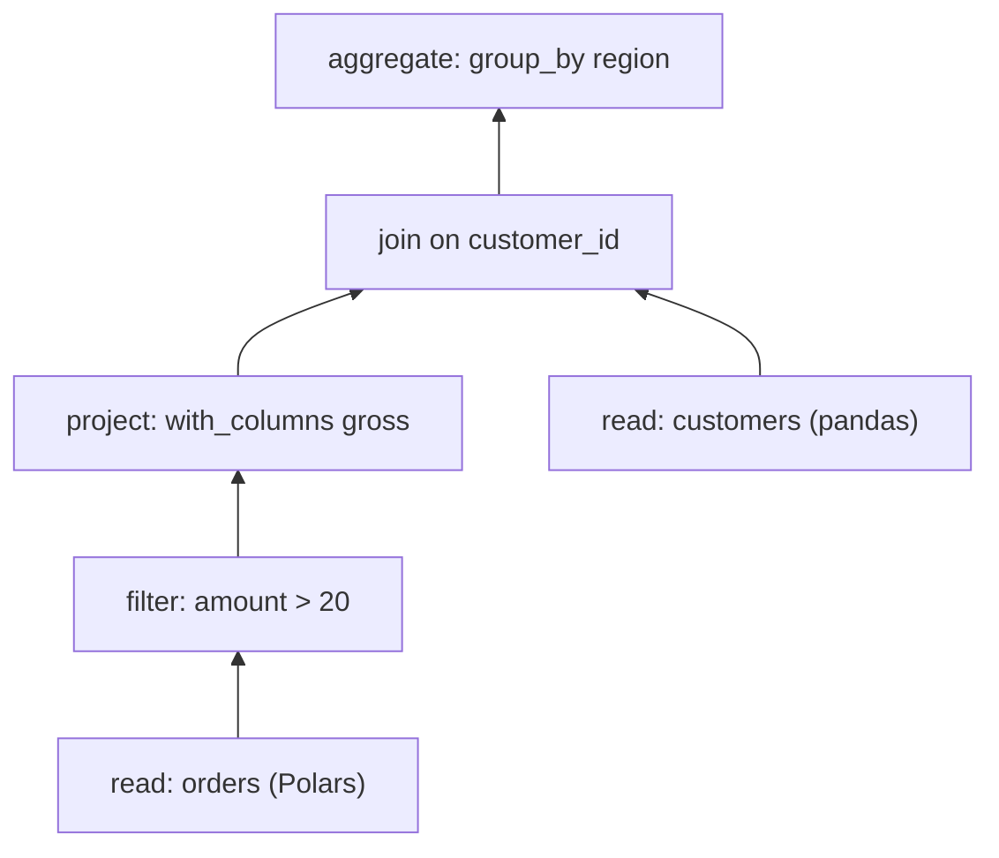

# Relations

A relation is a lazy table plan. `ma.relation(data)` wraps a dataframe, a database table or plain Python data, and methods such as `filter`, `with_columns`, `join` and `group_by` add steps to the plan without reading any rows. A terminal such as `.to_polars()` or `.to_dicts()` compiles the plan for the engine that owns the data and runs it there.

Assumes: [What mountainash does](../01-what-mountainash-does/index.md), [Backend detection](../02-installation-and-package-surface/index.md#backend-detection), [Building expressions](../04-building-expressions/index.md) and [Aggregates](../05-namespaces-aggregates-and-windows/index.md#aggregates).

## Relation objects

<!-- concept:360 -->

A `Relation` holds a tree of relational operations. Each chainable method returns a new `Relation` whose tree has one more operation on top, and leaves the relation it was called on unchanged. Building reads nothing and compiles nothing, so a base relation can be reused as the start of several plans.

```python
import ibis
import pandas as pd
import polars as pl

import mountainash as ma

orders = pl.DataFrame({
    "order_id": [1, 2, 3, 4, 5],
    "customer_id": [10, 20, 10, 30, 20],
    "amount": [25.0, 40.0, 15.5, 60.0, None],
})
customers = pd.DataFrame({
    "customer_id": [10, 20, 30],
    "region": ["north", "south", "north"],
})

base = ma.relation(orders)
plan = (
    base.filter(ma.col("amount") > 20)
    .with_columns((ma.col("amount") * 1.1).alias("gross"))
    .join(customers, on="customer_id")
    .group_by("region")
    .agg(ma.col("gross").sum().alias("gross"))
)
print(base.columns)
print(plan.columns)
```

```text
['order_id', 'customer_id', 'amount']
['region', 'gross']
```

`base` still has its three columns after five operations were chained from it. `plan` is a separate object whose output columns are already known from the plan alone. Its tree reads from the bottom up:



Each step is a node. The node kinds follow the Substrait relation types introduced in [Lazy plans and the AST](../01-what-mountainash-does/index.md#lazy-plans-and-the-ast): read, filter, project (`select`, `with_columns`, `drop`, `rename`), join, aggregate (`group_by`, `unique`), sort, fetch (`head`, `tail`, `slice`) and set (`concat`). Operations Substrait does not define, such as `drop_nulls`, `explode`, `pivot` and `sample`, are mountainash extension nodes. `explain()` prints the tree with the engine each node will run on, without running it:

```python
print(plan.explain())
```

```text
root: AggregateRelNode on polars (bound)
root/input: JoinRelNode on polars (bound)
root/input/left: ProjectRelNode on polars (bound)
root/input/left/input: FilterRelNode on polars (bound)
root/input/left/input/input: ReadRelNode on polars (bound)
root/input/right: ReadRelNode on narwhals-pandas (bound)
transfer root/input/right: narwhals-pandas (bound) -> polars (bound)
```

The last line shows a decision made at preparation time: the pandas `customers` frame is converted to Polars so the join can run where the left side lives. [Cross-type joins](#joins) below covers that rule, and [Explain, fingerprint and snapshots](../08-collecting-results/index.md#explain-fingerprint-and-snapshots) covers `explain()`.

A terminal compiles and runs the plan:

```python
print(plan.sort("region").to_polars())
```

```text
shape: (2, 2)
┌────────┬───────┐
│ region ┆ gross │
│ ---    ┆ ---   │
│ str    ┆ f64   │
╞════════╪═══════╡
│ north  ┆ 93.5  │
│ south  ┆ 44.0  │
└────────┴───────┘
```

Method names and parameters follow the Polars `LazyFrame` API. Where mountainash differs from Polars (for example `with_columns` takes positional expressions only), the difference is stated in the section for that method. How the tree is compiled is documented for maintainers in [How relations compile](../19-relation-compilation/index.md#relation-ast-nodes).

<!-- concept:361 -->

`ma.relation(data)` is the entry point for every relation. It takes one argument and decides what kind of source it is:

| Argument | Where the plan runs |
|---|---|
| Polars `DataFrame` or `LazyFrame` | Polars |
| pandas or PyArrow objects, Narwhals frames (including `narwhals.from_native(...)` wrappers of Dask frames and DuckDB relations) | Narwhals, on that library |
| Ibis table bound to a connection | that connection, as SQL |
| `list`, `dict`, dataclass instance, Pydantic model instance | Polars, after conversion (see [Relations from Python data](#relations-from-python-data)) |

!!! warning "Backend limit"
    A bare Dask frame or DuckDB relation is detected as a Narwhals source but fails at the terminal with Narwhals' `TypeError: Cannot only use series_only=True or eager_only=False with DuckDBPyRelation`. Wrap it first: `ma.relation(narwhals.from_native(duckdb_relation))`. See [Narwhals and its providers](../21-backends/index.md#narwhals-and-its-providers).

The backend is detected from the object's type as described in [Backend detection](../02-installation-and-package-surface/index.md#backend-detection). `collect()` returns the engine's own result type, so the result stays in the library you started with:

```python
for label, source in {
    "polars lazy": orders.lazy(),
    "pandas": orders.to_pandas(),
    "pyarrow": orders.to_arrow(),
}.items():
    result = ma.relation(source).filter(ma.col("amount") > 30).collect()
    print(label, type(result).__name__, len(result))
```

```text
polars lazy DataFrame 2
pandas DataFrame 2
pyarrow Table 2
```

The argument is checked when the plan runs, not when the relation is built. A string is not a file path, and an Ibis table must be bound to a connection:

```python
for source in ("orders.csv", ibis.memtable(orders.to_arrow())):
    try:
        ma.relation(source).to_dicts()
    except Exception as exc:
        print(type(exc).__name__, exc)
```

```text
ValueError Unknown backend identifier: 'orders.csv'. Valid options: ['polars', 'pl', 'ibis', 'ir', 'narwhals', 'nw', 'pandas', 'pd']
UnresolvedExecutionLocationError Selected execution location at root has unresolved Ibis binding: ibis (unresolved binding)
```

`UnresolvedExecutionLocationError` is importable from `mountainash.relations.core.errors`. Create Ibis tables through a connection, as in `con.create_table(...)` below. Files and DataPackage resources are read through a `RelationDAG`, described in [Resources and DataPackage](../14-relationdag/index.md#resources-and-datapackage).

## Relations from Python data

<!-- concept:480 -->

When `ma.relation` receives a list, a dict, a dataclass instance or a Pydantic model instance, it records the data and its detected shape. Conversion to a Polars `DataFrame` happens when the plan compiles, and from then on the relation runs on Polars like any other Polars source. Column types come from the type annotations of dataclasses and Pydantic models where there are any, and are inferred from the values otherwise:

```python
import datetime as dt
from dataclasses import dataclass


@dataclass
class Reading:
    sensor: str
    value: float
    taken: dt.date


readings = ma.relation([
    Reading("a", 1, dt.date(2026, 1, 1)),
    Reading("b", 2, dt.date(2026, 1, 2)),
])
print(readings.schema)
print(readings.to_polars())
```

```text
{'sensor': <MountainashDtype.STRING: 'string'>, 'value': <MountainashDtype.FP64: 'fp64'>, 'taken': <MountainashDtype.DATE: 'date'>}
shape: (2, 3)
┌────────┬───────┬────────────┐
│ sensor ┆ value ┆ taken      │
│ ---    ┆ ---   ┆ ---        │
│ str    ┆ f64   ┆ date       │
╞════════╪═══════╪════════════╡
│ a      ┆ 1.0   ┆ 2026-01-01 │
│ b      ┆ 2.0   ┆ 2026-01-02 │
└────────┴───────┴────────────┘
```

The `value` field holds Python integers but is annotated `float`, so the column is `f64`. With a dict or list of dicts there are no annotations and the dtypes come from the values.

The conversion is done by `ma.PydataIngress`. Calling `ma.PydataIngress.convert(data)` directly returns the Polars `DataFrame` without building a relation. Both accept a target schema that renames and casts columns during conversion; that is covered in [Typed Python data ingress](../10-table-schemas-and-datapackage/index.md#typed-python-data-ingress). The reverse direction, relation rows back to Python objects, is [Python data egress](../08-collecting-results/index.md#egress-formats).

<!-- concept:481 -->

The shape of the data selects a conversion handler:

| Python data | Columns |
|---|---|
| dict of lists, `{"id": [1, 2], "name": ["a", "b"]}` | one per key |
| list of dicts | one per key of the records |
| dataclass instance, or a list of them | one per field |
| Pydantic model instance, or a list of them | one per field |
| list of named tuples | one per field |
| list of plain tuples | `col_0`, `col_1`, ... |
| dict of Polars or pandas Series | one per key |
| dict of lists of records, `{"x": [{...}], "y": [{...}]}` | the record keys plus `index` holding the dict key |
| list of scalars | `value` |

```python
from typing import NamedTuple


class Pair(NamedTuple):
    id: int
    name: str


for data in (
    {"id": [1, 2], "name": ["a", "b"]},
    [Pair(1, "a"), Pair(2, "b")],
    [(1, "a"), (2, "b")],
    {"x": [{"id": 1}], "y": [{"id": 2}]},
    [1, 2],
):
    print(ma.relation(data).to_dicts())
```

```text
[{'id': 1, 'name': 'a'}, {'id': 2, 'name': 'b'}]
[{'id': 1, 'name': 'a'}, {'id': 2, 'name': 'b'}]
[{'col_0': 1, 'col_1': 'a'}, {'col_0': 2, 'col_1': 'b'}]
[{'id': 1, 'index': 'x'}, {'id': 2, 'index': 'y'}]
[{'value': 1}, {'value': 2}]
```

Records must be in a list or dict. A top-level tuple of tuples is not recognised as Python data and fails when the plan runs with `TypeError: Cannot coerce tuple to Polars: expected mappings`. Adding a handler for another shape is covered in [Ingress handlers, units and rules](../22-extending-mountainash/index.md#ingress-handlers-units-and-rules).

## Relations from Arrow

<!-- concept:374 -->

`ma.from_arrow(table, *, target=None)` imports a PyArrow table immediately and returns an ordinary relation over the imported data. With no target the data becomes a Polars source. With an Ibis connection as the target, it becomes a temporary table on that connection, owned by mountainash and kept for as long as plans derived from the relation need it:

```python
import pyarrow as pa

labels = pa.table({"id": [1, 2], "label": ["x", "y"]})
con = ibis.duckdb.connect()

in_polars = ma.from_arrow(labels)
in_duckdb = ma.from_arrow(labels, target=con)
print(type(in_polars.collect()).__name__)
print(type(in_duckdb.collect()).__name__, in_duckdb.filter(ma.col("id") > 1).to_dicts())
print(type(ma.relation(labels).collect()).__name__)
```

```text
DataFrame
Table [{'id': 2, 'label': 'y'}]
Table
```

The difference from `ma.relation(arrow_table)` is when and where the data moves. `ma.relation` keeps the Arrow table as the source and runs the plan through Narwhals on PyArrow, so `collect()` returns a PyArrow table. `from_arrow` copies the data into the target engine once, up front, and later plans start there. The connection stays yours: keep it open while the relation is in use. A Polars import may share Arrow buffers with the original table; `snapshot()` gives an independent copy (see [Snapshots](../08-collecting-results/index.md#explain-fingerprint-and-snapshots)). The `target` argument uses the vocabulary described in [Execution targets and locations](../09-execution-targets-and-capabilities/index.md#execution-targets-and-locations).

!!! warning "Backend limit"
    Importing into a SQL connection creates a temporary table, which MySQL, SingleStoreDB and Exasol refuse (`relations/backends/capabilities/ibis/dialects/ibis_mysql/extensions_mountainash/relation.py` and the matching files for the other two). SQLite cannot store NaN, non-null decimals or nested types in the imported table (`ibis_sqlite/extensions_mountainash/relation.py`).

## Filtering, selecting and sorting

<!-- concept:362 -->

`filter(*predicates)` keeps the rows where every predicate is true. Several predicates are combined with AND. A predicate is a boolean expression from [Operators](../04-building-expressions/index.md#operators); rows where it is null are dropped:

```python
print(base.filter(ma.col("amount") > 20, ma.col("customer_id") == 20).to_dicts())
```

```text
[{'order_id': 2, 'customer_id': 20, 'amount': 40.0}]
```

A ternary expression must be booleanized before it is used as a filter, for example `ma.t_col("amount").t_gt(20).t_is_true()`. Relations do not booleanize automatically; see [Booleanization](../06-ternary-logic/index.md#booleanization).

`remove(predicate)` is the inverse of `filter`. Unlike Polars `remove`, which keeps rows where the predicate is null, mountainash drops them as well, because it filters on the negated predicate and the negation of null is null:

```python
print(base.remove(ma.col("amount") > 20).to_dicts())
```

```text
[{'order_id': 3, 'customer_id': 10, 'amount': 15.5}]
```

<!-- concept:363 -->

`select` returns only the listed columns and expressions. `with_columns` keeps every existing column and adds or replaces the listed ones. Both accept column names and expressions; each expression's output name comes from its alias or its source column, as described in [Output names](../04-building-expressions/index.md#output-names). Unlike Polars, `with_columns` takes positional expressions only; name a new column with `.alias()`, not a keyword argument. `drop` removes columns and `rename` takes a mapping of old to new names:

```python
print(base.select("order_id", (ma.col("amount") * 2).alias("double")).columns)
print(base.with_columns((ma.col("amount") > 30).alias("large")).columns)
print(base.drop("amount").rename({"customer_id": "customer"}).columns)
print(base.select("^.*_id$").columns)
```

```text
['order_id', 'double']
['order_id', 'customer_id', 'amount', 'large']
['order_id', 'customer']
['order_id', 'customer_id']
```

A string that starts with `^` and ends with `$` is a regular expression over column names, and `"*"` selects every column.

<!-- concept:364 -->

`sort(*columns, descending=False)` orders rows by one or more column names. `descending` is a single flag or one flag per column. Sort keys are column names; to sort by a computed value, add it with `with_columns` first. `head(n)` and `tail(n)` keep the first or last `n` rows (default 5), and `slice(offset, length)` keeps a window. `limit`, `first` and `last` are the Polars aliases for `head(n)`, `head(1)` and `tail(1)`.

```python
print(base.sort("customer_id", "amount", descending=[False, True]).head(3).to_dicts())
print(base.slice(1, 2).to_dicts())
```

```text
[{'order_id': 1, 'customer_id': 10, 'amount': 25.0}, {'order_id': 3, 'customer_id': 10, 'amount': 15.5}, {'order_id': 2, 'customer_id': 20, 'amount': 40.0}]
[{'order_id': 2, 'customer_id': 20, 'amount': 40.0}, {'order_id': 3, 'customer_id': 10, 'amount': 15.5}]
```

!!! warning "Backend limit"
    Null placement in `sort` is not consistent across backends. Polars and Ibis sources put nulls last in both directions (Polars itself puts them first by default), while pandas sources put them first. There is no `nulls_last` parameter. Filter or fill nulls before sorting when their position matters.

    `slice` with a positive offset is refused on Dask (`narwhals/dialects/narwhals_dask/substrait/relation.py`), because building the offset would evaluate source rows before the terminal.

## Joins

<!-- concept:365 -->

`join(other, *, on=None, left_on=None, right_on=None, how="inner", suffix="_right", coalesce=None)` combines two relations. `how` is one of `inner`, `left`, `right`, `outer`, `semi`, `anti` and `cross`; `cross_join(other)` is the alias for the last. Use `on` when the key has the same name on both sides, or `left_on` and `right_on` when it does not.

The output is every left column followed by every right column. A right column whose name is already taken gets `suffix`, and if that name is taken too, `_1`, `_2` and so on are appended with a `UserWarning`. `coalesce` controls the keys: with `on`, the key pair is merged into one column by default; with `left_on`/`right_on` both keys are kept unless `coalesce=True`. Join output order is not guaranteed, so sort when order matters:

```python
left = pl.DataFrame({"id": [1, 2], "v": [1, 2]})
right = pl.DataFrame({"key": [2, 3], "v": [20, 30]})

outer = ma.relation(left).join(right, left_on="id", right_on="key", how="outer")
print(outer.sort("id").to_dicts())
merged = ma.relation(left).join(right, left_on="id", right_on="key", how="outer", coalesce=True)
print(merged.sort("id").to_dicts())
```

```text
[{'id': 1, 'v': 1, 'key': None, 'v_right': None}, {'id': 2, 'v': 2, 'key': 2, 'v_right': 20}, {'id': None, 'v': None, 'key': 3, 'v_right': 30}]
[{'id': 1, 'v': 1, 'v_right': None}, {'id': 2, 'v': 2, 'v_right': 20}, {'id': 3, 'v': None, 'v_right': 30}]
```

<!-- concept:366 -->

The right side of a join does not have to come from the same library as the left. `other` can be another relation, a native frame from any supported library, a dict or a list of dicts. The left side decides where the join runs, and the right side is converted to that location when the plan executes. A Polars relation can join a pandas lookup, and a DuckDB table can join the same lookup inside DuckDB:

```python
orders_db = con.create_table("orders", orders.to_arrow())
joined = ma.relation(orders_db).join(customers, on="customer_id")
print(type(joined.collect()).__name__)
print(joined.sort("order_id").to_dicts()[:2])
print(joined.explain())
```

```text
Table
[{'order_id': 1, 'customer_id': 10, 'amount': 25.0, 'region': 'north'}, {'order_id': 2, 'customer_id': 20, 'amount': 40.0, 'region': 'south'}]
root: JoinRelNode on ibis-duckdb (bound)
root/left: ReadRelNode on ibis-duckdb (bound)
root/right: ReadRelNode on narwhals-pandas (bound)
transfer root/right: narwhals-pandas (bound) -> ibis-duckdb (bound)
```

The `transfer` line in the explain output is the conversion: the pandas frame is moved into the DuckDB connection before the join. Conversion is decided at execution time from the left operand, so the call site never converts by hand. A list of scalars is not a table and is rejected with `TypeError: Cannot coerce list to Polars: expected mappings`. To run a join on the right operand's engine instead, pass `execute_on="right"`; that and the transfer rules for databases are described in [Operand transfer and owned copies](../09-execution-targets-and-capabilities/index.md#operand-transfer-and-owned-copies).

<!-- concept:367 -->

`join_asof(other, *, on, by=None, strategy="backward", tolerance=None)` matches each left row to the nearest right row on an ordered key instead of an equal one. `strategy="backward"` takes the last right row whose key is less than or equal to the left key, `"forward"` the first one greater than or equal, and `"nearest"` the closest. `by` restricts matches to rows with equal values in those columns, and `tolerance` limits how far apart the keys may be. The output keeps all left columns in order followed by the right payload columns; shared `on` and `by` keys appear once.

```python
trades = pl.DataFrame({
    "time": [dt.datetime(2026, 1, 1, 9, 0, s) for s in (5, 12, 30)],
    "symbol": ["A", "A", "B"],
    "qty": [100, 50, 10],
})
quotes = pl.DataFrame({
    "time": [dt.datetime(2026, 1, 1, 9, 0, s) for s in (0, 10, 20)],
    "symbol": ["A", "A", "B"],
    "price": [10.0, 10.5, 20.0],
})
for source in ((trades, quotes), (trades.to_pandas(), quotes.to_pandas())):
    matched = ma.relation(source[0]).join_asof(source[1], on="time", by="symbol")
    print([row["price"] for row in matched.to_dicts()])
print([row["price"] for row in ma.relation(trades).join_asof(
    quotes, on="time", by="symbol", tolerance=dt.timedelta(seconds=3),
).to_dicts()])
```

```text
[10.0, 10.5, 20.0]
[10.0, 10.5, 20.0]
[None, 10.5, None]
```

Both sides should be sorted by `on`. With `by` on a Polars source, Polars emits a `UserWarning` that it cannot check sortedness.

!!! warning "Backend limit"
    `tolerance` is refused on Narwhals backends, including pandas sources, with a `BackendCapabilityError` (`narwhals/family/extensions_mountainash/relation.py`); omit it or use Polars. The `forward` and `nearest` strategies are refused on the Ibis Polars backend (`ibis/dialects/ibis_polars/extensions_mountainash/relation.py`). On DuckDB through Ibis, a backward join may pick any right row tied at the nearest key; deduplicate right-side keys when the choice matters.

## Grouping and reshaping

<!-- concept:368 -->

`group_by(*keys)` returns a `GroupedRelation`, and its `agg(*expressions)` returns a relation with one row per distinct key combination: the key columns followed by one column per aggregate. Any aggregate expression from [Aggregates](../05-namespaces-aggregates-and-windows/index.md#aggregates) can be used, and each needs an output name:

```python
per_customer = base.group_by("customer_id").agg(
    ma.col("amount").sum().alias("total"),
    ma.count_records().alias("orders"),
)
print(per_customer.sort("customer_id").to_polars())
```

```text
shape: (3, 3)
┌─────────────┬───────┬────────┐
│ customer_id ┆ total ┆ orders │
│ ---         ┆ ---   ┆ ---    │
│ i64         ┆ f64   ┆ u32    │
╞═════════════╪═══════╪════════╡
│ 10          ┆ 40.5  ┆ 2      │
│ 20          ┆ 40.0  ┆ 2      │
│ 30          ┆ 60.0  ┆ 1      │
└─────────────┴───────┴────────┘
```

Group order in the result is not defined, so sort afterwards when order matters. To aggregate the whole relation to a single Python value, use a scalar terminal such as `base.sum("amount")` (see [Scalar terminals](../08-collecting-results/index.md#scalar-terminals)).

<!-- concept:370 -->

`pivot(*, on, index=None, values=None, aggregate_function="first")` turns long data wide: each distinct value of `on` becomes a column holding `values`, one row per `index`. `unpivot(*, on, index=None, variable_name="variable", value_name="value")` turns wide data long, and `melt` is its Polars alias.

```python
long = pl.DataFrame({
    "id": [1, 1, 2, 2],
    "metric": ["x", "y", "x", "y"],
    "value": [10, 20, 30, 40],
})
wide = ma.relation(long).pivot(on="metric", index="id", values="value").sort("id")
print(wide.to_polars())
print(ma.relation(wide.to_polars()).unpivot(on=["x", "y"], index="id").sort("id", "variable").to_dicts())
```

```text
shape: (2, 3)
┌─────┬─────┬─────┐
│ id  ┆ x   ┆ y   │
│ --- ┆ --- ┆ --- │
│ i64 ┆ i64 ┆ i64 │
╞═════╪═════╪═════╡
│ 1   ┆ 10  ┆ 20  │
│ 2   ┆ 30  ┆ 40  │
└─────┴─────┴─────┘
[{'id': 1, 'variable': 'x', 'value': 10}, {'id': 1, 'variable': 'y', 'value': 20}, {'id': 2, 'variable': 'x', 'value': 30}, {'id': 2, 'variable': 'y', 'value': 40}]
```

The columns a pivot produces depend on the data, so they are not known until the plan runs; see [Schema and columns](#schema-and-columns).

!!! warning "Backend limit"
    `pivot` runs on Polars and eager Narwhals sources. It fails on every Ibis backend with a `TypeError` from Ibis and on lazy Narwhals frames with an `AttributeError`. `unpivot` and `melt` fail on SQLite through Ibis with `OperationNotDefinedError`. These limits are not yet declared as capabilities; the evidence is the expected-failure cases in `tests/relations/cross_backend/test_rel_extension_ops_results.py`.

## Row operations

<!-- concept:369 -->

`unique()` with no arguments keeps one copy of each distinct row. `drop_nulls(subset=None)` removes rows with a null in any column, or in the listed columns. `drop_nans(subset=None)` removes rows with a floating-point NaN, checking only float columns when no subset is given.

```python
print(ma.concat([base, base]).unique().count_rows())
print(base.drop_nulls().count_rows(), base.drop_nulls(subset=["customer_id"]).count_rows())
```

```text
5
4 5
```

!!! warning "Backend limit"
    `unique("col", ...)` with columns is not portable. Polars and pandas sources return whole rows, one per distinct key, while Ibis sources return only the key columns. The `keep` argument is accepted and ignored. Select the key columns first and call `unique()` on them, which gives the same result everywhere. `drop_nans` fails on SQLite through Ibis (`tests/relations/cross_backend/test_rel_extension_ops_results.py`).

<!-- concept:371 -->

`explode(*columns)` turns each element of a list column into its own row, repeating the other columns. `unnest(*columns, separator)` expands struct columns into top-level columns named `{column}{separator}{field}`; `separator` is required, and `separator=""` keeps the bare field names. `with_row_index(name="index")` adds a zero-based row number column; on Polars it becomes the first column.

```python
nested = pl.DataFrame({
    "id": [1, 2],
    "tags": [["a", "b"], ["c"]],
    "info": [{"x": 1, "y": "p"}, {"x": 2, "y": "q"}],
})
print(ma.relation(nested).explode("tags").select("id", "tags").to_dicts())
print(ma.relation(nested).unnest("info", separator="_").columns)
print(base.with_row_index(name="row").head(2).to_dicts())
```

```text
[{'id': 1, 'tags': 'a'}, {'id': 1, 'tags': 'b'}, {'id': 2, 'tags': 'c'}]
['id', 'tags', 'info_x', 'info_y']
[{'row': 0, 'order_id': 1, 'customer_id': 10, 'amount': 25.0}, {'row': 1, 'order_id': 2, 'customer_id': 20, 'amount': 40.0}]
```

The row index is a native position, not a stable identity. On SQL backends it is a window row number, and neither its order nor which row gets which number is guaranteed to repeat between runs, even after a `sort`.

!!! warning "Backend limit"
    `unnest` is refused on every Narwhals backend (`narwhals/family/extensions_mountainash/relation.py`); use a Polars source. `explode` and `unnest` need a native list or struct type, which pandas does not have; they are tested on Polars, Narwhals over Polars and DuckDB through Ibis. `with_row_index` is refused on the Ibis Polars backend (`ibis/dialects/ibis_polars/extensions_mountainash/relation.py`) and fails on lazy Narwhals frames.

<!-- concept:372 -->

`sample(*, n=None, fraction=None, seed=None)` returns a random subset of rows: exactly `n` rows, or about `fraction` of them. Exactly one of `n` and `fraction` must be given, and the arguments are checked when the relation is built, raising `InvalidSampleArgumentsError` (in `mountainash.exceptions`). A `seed` makes the sample repeatable on the same backend. `top_k(k, *, by, descending=True)` returns the `k` rows with the largest values in `by`, and `bottom_k(k, *, by)` the smallest.

```python
print(base.sample(n=2, seed=1).count_rows())
print(base.top_k(2, by="amount").to_dicts())
try:
    base.sample(n=2, fraction=0.5)
except ma.MountainashError as exc:
    print(type(exc).__name__, exc)
```

```text
2
[{'order_id': 5, 'customer_id': 20, 'amount': None}, {'order_id': 4, 'customer_id': 30, 'amount': 60.0}]
InvalidSampleArgumentsError sample() requires exactly one of n or fraction (got n=2, fraction=0.5)
```

!!! warning "Backend limit"
    `sample(n=..., seed=...)` is declared unsupported for Ibis (`ibis/family/extensions_mountainash/relation.py`). The SQL dialects refuse it with a `BackendCapabilityError`, and the Ibis Polars backend fails with an Ibis `OperationNotDefinedError`. Omit the seed or sample by fraction. A seeded fractional sample fails on SQLite.

    `top_k` and `bottom_k` treat nulls differently by backend. On Polars and pandas sources a null in `by` sorts ahead of every value in both directions, so the row with `order_id` 5 (a null amount) appears in the result above; Ibis sources skip it, as Polars' own `top_k` does. Drop nulls in `by` first for a portable result.

## Combining relations

<!-- concept:373 -->

`ma.concat(relations, *, distinct=False, timezone=None)` stacks relations with the same columns, as a SQL `UNION ALL`. `distinct=True` removes duplicate rows, as `UNION`. As with joins, the inputs may come from different libraries: the first relation decides where the result runs, and the others are converted to it.

```python
late = pd.DataFrame({"order_id": [6], "customer_id": [40], "amount": [12.0]})
combined = ma.concat([base, ma.relation(late)])
print(combined.count_rows(), combined.tail(1).to_dicts())
print(ma.concat([base.select("customer_id"), base.select("customer_id")], distinct=True).count_rows())
```

```text
6 [{'order_id': 6, 'customer_id': 40, 'amount': 12.0}]
3
```

Timestamp columns whose precision differs across inputs are widened to a common precision without changing time zones. Passing an IANA zone name as `timezone` converts timezone-aware timestamp columns to that zone, keeping the instants; naive columns are not localised. SQLite does not support the explicit `timezone` conversion.

## Schema and columns

<!-- concept:375 -->

A relation reports its output shape without running the plan. `columns` lists output names, `schema` maps names to [canonical dtypes](../03-dtypes/index.md#canonical-dtypes), `dtypes` and `width` follow from those, and `output_schema` gives the same information as a Frictionless schema dictionary. Names and types come from the plan itself and from metadata the source can supply cheaply; no rows are transferred.

```python
print(per_customer.columns)
print(per_customer.schema)
print(per_customer.output_schema)
```

```text
['customer_id', 'total', 'orders']
{'customer_id': <MountainashDtype.I64: 'i64'>, 'total': <MountainashDtype.FP64: 'fp64'>, 'orders': <MountainashDtype.U32: 'u32'>}
{'fields': [{'name': 'customer_id', 'type': 'integer'}, {'name': 'total', 'type': 'number'}, {'name': 'orders', 'type': 'integer'}]}
```

Some plans cannot be described in advance. A pivot's column names depend on the data, so its `schema` is empty and `columns` is an empty list. `collect_schema()` requires a complete answer and raises `IncompleteSchemaError` (in `mountainash.exceptions`) when it cannot get one; `collect_schema(allow_execution=True)` runs the plan when metadata is not enough:

```python
pivoted = ma.relation(long).pivot(on="metric", index="id", values="value")
print(pivoted.schema, pivoted.columns)
try:
    pivoted.collect_schema()
except ma.MountainashError as exc:
    print(type(exc).__name__, exc)
print(pivoted.collect_schema(allow_execution=True))
```

```text
{} []
IncompleteSchemaError Incomplete schema (output names/order): Pivot output names depend on source values
{'id': <MountainashDtype.I64: 'i64'>, 'x': <MountainashDtype.I64: 'i64'>, 'y': <MountainashDtype.I64: 'i64'>}
```

Treat an empty `columns` list as "unknown", not "no columns". How the package infers and resolves schemas, including which sources it probes, is described in [Schema inference and resolution](../09-execution-targets-and-capabilities/index.md#schema-inference-and-resolution).
