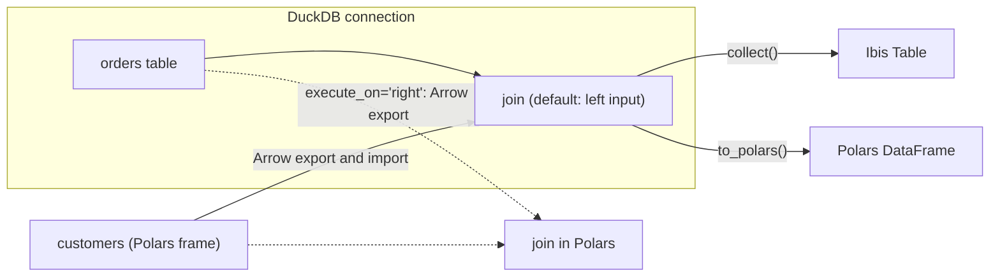

# Execution targets and backend capabilities

A relation plan runs at an execution location: a backend family and dialect, and for SQL backends a specific Ibis connection. mountainash places each operation where its inputs live, moves an operand to another location when an operation needs it there, and checks the plan against the capability declarations for each location it uses before anything runs. Most code leaves placement to mountainash. For explicit control, use `execute_on=` on joins and `collect(target=...)` for placement, `ma.materialization_scope` for owned snapshots and checkpoints, and `ma.capability_policy` to adjust how strictly mountainash enforces declared backend limits.

Assumes: [Backend detection](../02-installation-and-package-surface/index.md#backend-detection), [Relations](../07-relations/index.md) and [Collect and terminals](../08-collecting-results/index.md#collect-and-terminals).

## Execution targets and locations

<!-- concept:385 -->
An execution target is a placement request, made in one of two places. `execute_on=` on `join`, `cross_join` and `join_asof` chooses which input a join runs at, and `target=` on `collect()` (and `collect_with_drift()`) chooses where the root of the plan runs. With neither, placement follows the data: a join runs where its left input lives.

The examples on this page share a DuckDB table and a Polars frame:

```python
import ibis
import polars as pl
import mountainash as ma

con = ibis.duckdb.connect()
orders = con.create_table(
    "orders", pl.DataFrame({"id": [1, 2, 3], "customer": [10, 20, 10]}).to_arrow()
)
customers = pl.DataFrame({"customer": [10, 20], "name": ["Ada", "Bo"]})

joined = ma.relation(orders).join(ma.relation(customers), on="customer")
print(joined.explain())
print(type(joined.collect()))
```

```text
root: JoinRelNode on ibis-duckdb (bound)
root/left: ReadRelNode on ibis-duckdb (bound)
root/right: ReadRelNode on polars (bound)
transfer root/right: polars (bound) -> ibis-duckdb (bound)
<class 'ibis.expr.types.relations.Table'>
```

`explain()` prints the placement whenever a plan crosses a boundary: one line per node with its location, then one line per transfer. Here the join runs in DuckDB and the Polars frame is moved there. `execute_on="right"` runs the same join in Polars, so mountainash executes the DuckDB side and moves its result:

```python
on_polars = ma.relation(orders).join(
    ma.relation(customers), on="customer", execute_on="right"
)
print(on_polars.explain())
print(type(on_polars.collect()))
```

```text
root: JoinRelNode on polars (bound)
root/left: ReadRelNode on ibis-duckdb (bound)
root/right: ReadRelNode on polars (bound)
transfer root/left: ibis-duckdb (bound) -> polars (bound)
<class 'polars.dataframe.frame.DataFrame'>
```

`execute_on` accepts `"left"`, `"right"`, `None` or the `ExecutionTarget` enum from `mountainash.core.constants`; anything else raises `ValueError` when the join is built. `collect(target=...)` accepts a family name (`"polars"`, `"narwhals"`, `"pandas"`, `"pyarrow"`, `"ibis"`), a dialect identifier such as `"narwhals-pandas"`, or an Ibis connection. It moves only the root operation; each input keeps its own location, and its result travels to the root:

```python
local = ma.relation(customers).filter(ma.col("customer") > 10)
print(type(local.collect(target=con)))
print(type(local.collect(target="pandas")))
print(type(joined.collect(target="polars")))
```

```text
<class 'ibis.expr.types.relations.Table'>
<class 'pandas.DataFrame'>
<class 'polars.dataframe.frame.DataFrame'>
```

The other terminals (`to_polars()`, `to_dicts()` and the rest) run the plan at its own placement and convert the result, as [Egress formats](../08-collecting-results/index.md#egress-formats) describes.

<!-- concept:386 -->
An execution location is what placement resolves to: a family, a dialect, an evaluation form (eager, lazy or deferred) and a binding. For Ibis the binding is the connection; `bound` in the `explain()` output means a physical connection is known. Placement resolves locations from the plan alone and reads no rows:

- A source lives where its data lives. A Polars frame is at `polars`, a pandas or PyArrow frame at its Narwhals dialect, an Ibis table built from a connection at that connection, and Python data (dictionaries, records) at `polars`.
- An operation with one input runs at that input's location.
- A join runs at its left input unless `execute_on="right"`; a set operation such as `ma.concat` runs at its first input.
- An in-memory Ibis table (`ibis.memtable`) is unbound. In a join or set operation it borrows the connection of a peer input.

```python
flags = ma.relation(ibis.memtable({"customer": [10], "vip": [True]}))
print(ma.relation(orders).join(flags, on="customer").to_dicts())
```

```text
[{'id': 1, 'customer': 10, 'vip': True}, {'id': 3, 'customer': 10, 'vip': True}]
```

A placement with no usable connection raises `UnresolvedExecutionLocationError`. That happens for a memtable with no bound peer, for an Ibis expression that mixes tables from two connections, and for an Ibis dialect identifier passed as `target=` (a dialect names a kind of engine; pass the connection itself). A terminal `target=` that contradicts an explicit `execute_on=` raises `ConflictingExecutionTargetError`. Both are `MountainashError` subclasses (and `ValueError`s) defined in `mountainash.relations.core.errors`; import them from that module, because `mountainash.exceptions` does not re-export them:

```python
from mountainash.relations.core.errors import (
    ConflictingExecutionTargetError,
    UnresolvedExecutionLocationError,
)

try:
    ma.relation(ibis.memtable({"customer": [10]})).collect()
except UnresolvedExecutionLocationError as exc:
    print(exc)

try:
    local.collect(target="ibis-duckdb")
except UnresolvedExecutionLocationError as exc:
    print(exc)

pinned = ma.relation(orders).join(
    ma.relation(customers), on="customer", execute_on="left"
)
try:
    pinned.collect(target="polars")
except ConflictingExecutionTargetError as exc:
    print(exc)
```

```text
Selected execution location at root has unresolved Ibis binding: ibis (unresolved binding)
Selected execution location at root has unresolved Ibis binding: ibis-duckdb (unresolved binding)
Explicit target at root is ibis-duckdb (bound), not polars (bound)
```

Placement and transfer planning are part of relation compilation. [How relations compile](../19-relation-compilation/index.md) describes how preparation fits into compilation, and this page defines the placement and transfer rules themselves.

## Materialization scopes and checkpoints

<!-- concept:388 -->
`ma.materialization_scope()` is a context manager that owns snapshots. Inside it, `scope.snapshot(rel)` (and `rel.snapshot()`, which uses the innermost open scope) executes the plan now and returns a relation over an independent copy of the result, as [Explain, fingerprint and snapshots](../08-collecting-results/index.md#explain-fingerprint-and-snapshots) describes. The scope releases every copy it still holds when it exits; `scope.detach(rel)` hands the copies reachable from `rel` back to the caller so they outlive the scope. A relation over a released copy raises `MaterializationScopeClosedError` (also in `mountainash.relations.core.errors`).

`scope.checkpoint(rel, replaces=previous)` marks one completed stage of an iterative computation. The scope's `CheckpointPolicy` decides whether that stage is copied: `ma.CheckpointPolicy.EVERY_STAGE` (the default), `ma.CheckpointPolicy.every(k)` for every kth stage, or `ma.CheckpointPolicy.NEVER`. A copy cuts the plan: later stages build on the stored result, which keeps the chain of operations short, and the scope releases the copy behind `replaces=`:

```python
from mountainash.relations.core.errors import MaterializationScopeClosedError

with ma.materialization_scope(checkpoint=ma.CheckpointPolicy.every(2)) as scope:
    rel = ma.relation(orders)
    for _ in range(4):
        step = rel.with_columns((ma.col("id") * 10).alias("id"))
        rel = scope.checkpoint(step, replaces=rel)
    kept = scope.detach(scope.snapshot(rel))
    held = scope.snapshot(rel)

print(kept.to_dicts())
try:
    held.to_dicts()
except MaterializationScopeClosedError as exc:
    print(exc)
```

```text
[{'id': 10000, 'customer': 10}, {'id': 20000, 'customer': 20}, {'id': 30000, 'customer': 10}]
snapshot's materialization scope is closed
```

`scope.capture(*rels)` snapshots several relations as one batch: either all copies are published or none. On a SQL connection the batch uses one connection and one transaction, and the scope refuses relations on different backends or connections.

!!! warning "Backend limit"
    Snapshots, checkpoints and captures of an Ibis plan need an explicit connection and a plan that uses only one physical connection, and they raise `BackendCapabilityError` otherwise. Ibis Exasol, MySQL and SingleStoreDB also refuse them, because those dialects declare owned-table adoption unsupported, and so does any Ibis backend outside the known dialects (source: `src/mountainash/relations/core/relation_api/materialization_scope.py`, `src/mountainash/relations/backends/relation_systems/ibis/_physical.py`, and the `IMPORT_INTO` gates under `src/mountainash/relations/backends/capabilities/ibis/dialects/`).

## Operand transfer and owned copies

<!-- concept:387 -->
An operand transfer moves the result of a subtree from its own location to the location of the operation that consumes it. Preparation plans transfers before execution, and `explain()` shows them as `transfer` lines. Between two locations that hold the same native library (a Polars frame and the same frame wrapped by Narwhals) only the wrapper and the eager or lazy form change. Otherwise mountainash executes the source, exports it as an Arrow table and imports it at the destination: into Polars or Narwhals as a native frame, into an Ibis connection as an in-memory table registered on that connection. mountainash registers what it imports and unregisters or drops it when the execution that needed it is finished.



Solid arrows show the default placement of the example join; dotted arrows show the same join with `execute_on="right"`. When no declared route can carry a value to its destination, preparation raises `UnsupportedRelationTransportError`, a `BackendConversionError` whose `limitation` attribute holds the destination's declared import limit when one explains the refusal.

<!-- concept:389 -->
An owned copy is an independent native value that mountainash created and whose cleanup it owns. Snapshots, checkpoints and captures produce owned copies. So does a transfer whose result must outlive the execution on an Ibis connection, for example a local plan collected into a connection, where the result holds its own data, independent of every table on that connection:

```python
scratch = ibis.duckdb.connect()
result = local.collect(target=scratch)
print([name[:9] for name in scratch.list_tables()])
```

```text
['ma_owned_']
```

For Polars, pandas and Arrow an owned copy is an in-memory copy. For an Ibis connection it is a table named `ma_owned_` plus a random suffix, created on the same connection. When the value becomes unreachable, or its scope closes, mountainash queues the table for deletion and drops it on the thread that created it, the next time it makes an owned copy on that connection or closes a scope that used it.

SQL connections use `mountainash-data`, which arrives with the `ibis` extra (see [Where mountainash sits](../02-installation-and-package-surface/index.md#where-mountainash-sits)). mountainash borrows the connection through it and leaves ownership where it was, requires the connection to have no open transaction, and drops owned tables inside a committed transaction. A connection with an open transaction raises `BackendCapabilityError`, which keeps mountainash's work out of the caller's transaction.

## Compilation reuse

<!-- concept:390 -->
One terminal call prepares one placement plan and one transfer session for the whole plan. A relation object that appears several times in that plan, such as the same branch passed to `ma.concat` twice, is compiled once and transferred once; `explain()` still lists each occurrence. Reuse goes by object identity: two relations built separately from equal inputs compile separately. Reuse lasts for one terminal call, so each call reads its sources again and sees their current contents. Raw native expressions and host-clock values such as `now()` are evaluated per occurrence even inside a reused subtree.

## Schema inference and resolution

<!-- concept:391 -->
`rel.schema` (introduced in [Schema and columns](../07-relations/index.md#schema-and-columns)) is the best schema available before the result is evaluated. Column names come from the plan; types come from source schemas and native metadata. Reading metadata may probe a source, and it stops short of transferring rows or executing the plan. A type that metadata leaves open appears as `SchemaTypeStatus.UNKNOWN` ([Data types](../03-dtypes/index.md)). A cross-location plan is the common case, because the types of a transferred operand become known once the source has run:

```python
from mountainash.exceptions import IncompleteSchemaError

print(joined.schema)
try:
    joined.collect_schema()
except IncompleteSchemaError as exc:
    print(exc)
print(joined.collect_schema(allow_execution=True))
```

```text
{'id': <SchemaTypeStatus.UNKNOWN: 'unknown'>, 'customer': <SchemaTypeStatus.UNKNOWN: 'unknown'>, 'name': <SchemaTypeStatus.UNKNOWN: 'unknown'>}
Incomplete schema (id, customer, name): Boundary root/right requires execution; use .collect()
{'id': <MountainashDtype.I64: 'i64'>, 'customer': <MountainashDtype.I64: 'i64'>, 'name': <MountainashDtype.STRING: 'string'>}
```

`collect_schema()` requires every name and type and raises `IncompleteSchemaError` when any is missing. With `allow_execution=True` it runs the plan when metadata falls short; a native inference error propagates unchanged, with no retry through execution. A relation that stays on one location, such as `ma.relation(orders)`, resolves completely from metadata.

## Backend capabilities, families and dialects

<!-- concept:509 -->
mountainash keeps a registry of capability declarations for each backend family and dialect. Most declarations are descriptive information: what a native engine supports, restricts or does differently. A smaller set are executable policies, each naming the runtime path that acts on it:

| Consumer | Action | Effect |
|---|---|---|
| gate | block | The gate refuses the call with `BackendCapabilityError` before anything runs. |
| immediate or materialization error | enrich | A native error from that call is re-raised as `BackendCapabilityError` carrying the declared message and workaround. |
| result protection | detect non-null to null | Conformance checks the result for values the engine silently turned into nulls ([Conforming data to a schema](../11-conforming-data/index.md)). |

Compilation consults declarations against the whole bound call (the operation and its actual arguments) and the execution location. A gate can therefore refuse one argument combination and allow another: the example in [Capability errors and capability_policy](#capability-errors-and-capability_policy) blocks a seeded exact-count sample on Ibis and allows a fractional one. Some declarations are qualified by package or engine versions and apply only when the running environment matches. A missing declaration means unknown coverage. [Backend support and known limits](../16-backend-support-and-limits/index.md) lists what is declared; [The capability spine](../20-capability-spine/index.md) explains how declarations are authored, loaded and evaluated.

<!-- concept:514 -->
A backend identity is the pair of family and dialect that selects which declarations apply. `native_identity` in `mountainash.core.backend_detection` shows the identity mountainash derives from a native value, using the detection described in [Backend detection](../02-installation-and-package-surface/index.md#backend-detection):

```python
import pandas as pd

from mountainash.core.backend_detection import native_identity

for native in (customers, customers.to_pandas(), orders, ibis.memtable({"x": [1]})):
    print(native_identity(native))
```

```text
BackendIdentity(family=<CONST_BACKEND.POLARS: 'polars'>, dialect='polars')
BackendIdentity(family=<CONST_BACKEND.NARWHALS: 'narwhals'>, dialect='narwhals-pandas')
BackendIdentity(family=<CONST_BACKEND.IBIS: 'ibis'>, dialect='ibis-duckdb')
BackendIdentity(family=<CONST_BACKEND.IBIS: 'ibis'>, dialect=None)
```

A dialect of `None` means unknown, and then only family-wide declarations apply. A call takes the identity of its execution location: in `joined` above, the Polars frame's columns are compiled under the `ibis-duckdb` declarations because the join runs in DuckDB.

<!-- concept:513 -->
A family is the API mountainash compiles to (Polars, Narwhals or Ibis); a dialect is the engine behind it. `KNOWN_DIALECTS` in `mountainash.core.capabilities` is the vocabulary declarations may name:

```python
from mountainash.core.capabilities import KNOWN_DIALECTS

for family, dialects in KNOWN_DIALECTS.items():
    print(family.value, sorted(dialects))
```

```text
polars ['polars']
ibis ['ibis-duckdb', 'ibis-exasol', 'ibis-mysql', 'ibis-polars', 'ibis-postgres', 'ibis-singlestoredb', 'ibis-sqlite']
narwhals ['narwhals-dask', 'narwhals-duckdb', 'narwhals-lazy', 'narwhals-pandas', 'narwhals-polars', 'narwhals-pyarrow']
pandas ['pandas']
pyarrow ['pyarrow']
```

`pandas` and `pyarrow` appear as identities for data carriers; their frames execute through Narwhals as `narwhals-pandas` and `narwhals-pyarrow`. `narwhals-lazy` is the dialect for lazy Narwhals frames. Family-wide declarations apply to every dialect of the family, and dialect declarations add to them. Declarations can target any dialect named here; the [Support matrix](../16-backend-support-and-limits/index.md#support-matrix) shows how much each dialect has declared and tested.

## Capability errors and capability_policy

<!-- concept:519 -->
`BackendCapabilityError` (in `mountainash.exceptions`, a `MountainashError`) reports a call that a backend's declarations refuse, or a native failure that a declaration explains. The message starts with the family in brackets and adds `Workaround:` and `Upstream ref:` lines when the declaration has them. The attributes give the details: `backend`, `function_key` (the operation) and `limitation`, the declaration itself, with its `dialect`, `param`, `level`, `message` and `workaround`. The planner checks the gates it can see in the plan during preparation, before reading any source; compilation checks the rest as it compiles each call for its backend:

```python
from mountainash.exceptions import BackendCapabilityError

numbers = con.create_table("numbers", pl.DataFrame({"n": range(100)}).to_arrow())
sampled = ma.relation(numbers).sample(n=5, seed=7)
try:
    sampled.to_polars()
except BackendCapabilityError as exc:
    print(exc)
    print(exc.backend, exc.function_key)
    print(exc.limitation.dialect, exc.limitation.param, exc.limitation.level)
```

```text
[ibis] Ibis exact-count sampling with a seed is unsupported; omit seed or use fractional sampling where supported.
ibis RKEY_MOUNTAINASH_REL.SAMPLE
ibis-duckdb seed CapabilityLevel.UNSUPPORTED
```

<!-- concept:520 -->
`ma.capability_policy(policy)` sets how declarations are enforced for the code inside the `with` block. A `ma.CapabilityPolicy` has four fields:

- `protection`: which issue classes the protective mechanisms act on: `"all"`, `"none"` or a frozenset of `ma.CapabilityIssueClass` members (`AVAILABILITY`, `ARGUMENT_CONTRACT`, `SEMANTICS`, `TYPE_INFERENCE`, `NAMING`, `PRECISION`, `ENGINE_LENIENCY`, `UNCLASSIFIED`).
- `mechanisms`: a frozenset of `ma.ProtectionMechanism` members: `GATE` (refuse before running) and `MATERIALIZATION` (result protection).
- `error_enrichment`: which issue classes get native errors re-raised as `BackendCapabilityError`.
- `disclosure`: which issue classes diagnostic views, such as the coverage report's policy view, disclose.

The ambient default is `CapabilityPolicy.checked()`, with everything selected. `native_debugging()` keeps protection but shows native errors unchanged, and `trusted()` turns protection, enrichment and disclosure off. Fields left as `None` keep the value of the enclosing policy, and each preset accepts field overrides. A terminal reads the policy when it runs, so the policy around the terminal call applies, whatever was active when the relation was built. The policy is context-local, so separate threads and async tasks keep their own.

```python
default = ma.CapabilityPolicy.checked()
print(default.protection, default.error_enrichment, default.disclosure)
print(sorted(mechanism.value for mechanism in default.mechanisms))
```

```text
all all all
['gate', 'materialization']
```

Relaxing protection gives up exactly what the declaration protected. Under `trusted()` the seeded sample from the previous example runs, and its draws vary between runs despite the seed:

```python
with ma.capability_policy(ma.CapabilityPolicy.trusted()):
    draws = {tuple(row["n"] for row in sampled.to_dicts()) for _ in range(5)}
print(len(draws) > 1)
```

```text
True
```

Turning enrichment off trades the declared explanation for the engine's own error. A list membership test on pandas through Narwhals fails natively in both cases:

```python
tags = ma.relation(pd.DataFrame({"tags": [["a", "b"], ["c"]]})).with_columns(
    ma.col("tags").list.contains("a").alias("has_a")
)
for policy in (ma.CapabilityPolicy.checked(), ma.CapabilityPolicy.native_debugging()):
    with ma.capability_policy(policy):
        try:
            tags.to_polars()
        except Exception as exc:
            print(f"{type(exc).__name__}: {exc}")
```

```text
BackendCapabilityError: [narwhals] Narwhals pandas list membership requires Arrow-backed list storage.
Workaround: Use Polars or Ibis list membership; Arrow conversion alone does not implement contains.
Upstream ref: NW-LIST-01
TypeError: Series must be of PyArrow List type to support list namespace.
```

A selection narrows protection to some issue classes. Here only `AVAILABILITY` is protected; the sampling gate is classed `UNCLASSIFIED`, so the seeded sample runs:

```python
from mountainash import CapabilityIssueClass, ProtectionMechanism

only_availability = ma.CapabilityPolicy(
    protection=frozenset({CapabilityIssueClass.AVAILABILITY})
)
with ma.capability_policy(only_availability) as active:
    print(active.protection, active.mechanisms == frozenset(ProtectionMechanism))
    print(len(sampled.to_dicts()))
```

```text
frozenset({<CapabilityIssueClass.AVAILABILITY: 'availability'>}) True
5
```

The policy governs enforcement only. Backend implementations still validate their own arguments, and an operation missing from a backend still fails. [Gates and preflight](../20-capability-spine/index.md#gates-and-preflight) covers how policies select declarations at each consumer.
