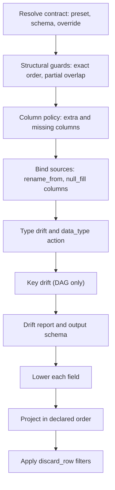

# Conforming data to a schema

Conforming reshapes and converts a relation to match a [table schema](../10-table-schemas-and-datapackage/index.md). It selects, renames and orders columns as declared, parses text into the declared types, turns missing values into nulls or fills, and keeps, drops or rejects columns outside the schema. You call `relation.conform(schema)`, set the schema's `fields_match` mode, and pass `contract=` to state exactly what happens to extra columns, missing columns and type mismatches. `collect_with_drift()` returns the conformed frame together with a report of every divergence it reconciled.

Assumes: [Relations](../07-relations/index.md), [Collecting results](../08-collecting-results/index.md) and [Table schemas and DataPackage](../10-table-schemas-and-datapackage/index.md).

## Relation conform

<!-- concept:420 -->
`relation.conform(schema)` adds a conform step to the relation's plan and returns a new relation. Like every other relation operation it is deferred: a terminal such as `to_polars()` or `collect()` compiles the plan, inspects the columns and runs the backend code (see [Collect and terminals](../08-collecting-results/index.md#collect-and-terminals)). At that point the source's column names and types are known, and conform decides what to do with them.

```python
import polars as pl
import mountainash as ma
from mountainash.typespec import UniversalType

raw = pl.DataFrame({
    "uid": ["1", "2", "3"],
    "amount": ["10.5", "", "7"],
    "note": ["a", "b", "c"],
})
spec = ma.TableSchema(
    fields={
        "user_id": ma.FieldDefinition(type=UniversalType.INTEGER, rename_from="uid"),
        "amount": ma.FieldDefinition(type=UniversalType.NUMBER, null_fill=0.0),
    },
    fields_match="subset",
)
conformed = ma.relation(raw).conform(spec)
print(conformed.schema)
print(conformed.to_polars())
```

```text
{'user_id': <MountainashDtype.I64: 'i64'>, 'amount': <MountainashDtype.FP64: 'fp64'>}
shape: (3, 2)
┌─────────┬────────┐
│ user_id ┆ amount │
│ ---     ┆ ---    │
│ i64     ┆ f64    │
╞═════════╪════════╡
│ 1       ┆ 10.5   │
│ 2       ┆ 0.0    │
│ 3       ┆ 7.0    │
└─────────┴────────┘
```

Conform reads `user_id` from the source column `uid` and casts it to integer. The empty string in `amount` is a missing value (the schema default is `[""]`), so `null_fill` replaces it. `note` is undeclared, and `subset` drops it. `conformed.schema` reports the output types from a schema-only run of the reconciliation logic. The terminal runs the same logic in executing mode, so the two agree.

Conform builds the conversion from ordinary backend-neutral expressions, so the same schema conforms a pandas frame or an Ibis table to the same values:

```python
import pandas as pd
import ibis

data = raw.to_dict(as_series=False)
con = ibis.duckdb.connect()
sources = {
    "pandas": pd.DataFrame(data),
    "duckdb": con.create_table("raw", raw.to_arrow()),
}
for name, source in sources.items():
    print(name, ma.relation(source).conform(spec).to_polars().to_dicts())
```

```text
pandas [{'user_id': 1, 'amount': 10.5}, {'user_id': 2, 'amount': 0.0}, {'user_id': 3, 'amount': 7.0}]
duckdb [{'user_id': 1, 'amount': 10.5}, {'user_id': 2, 'amount': 0.0}, {'user_id': 3, 'amount': 7.0}]
```

`conform` takes two keyword arguments. `contract=` overrides the reconciliation policy, as described in the next section. `apply_value_transforms=False` keeps only the structural part: conform selects, renames and checks columns, turns missing-value sentinels into null and reports type differences, and leaves values in their source types.

Conform also runs implicitly. Reading a [DataPackage resource](../10-table-schemas-and-datapackage/index.md#datapackage-resources-and-dialects) as a relation conforms it to its schema, and a [RelationDAG](../14-relationdag/index.md) conforms each resource the same way. Value constraints such as `minimum` or `unique` belong to [validation](../13-validation/index.md), which checks them separately.

## ConformContract dimensions and presets

<!-- concept:421 -->
The reconciliation contract states what conform does with each kind of divergence between the schema and the data. It has four dimensions:

| Dimension | Modes | Meaning |
|---|---|---|
| `extra_columns` | `evolve`, `freeze`, `discard` | A source column the schema does not declare |
| `missing_columns` | `skip`, `freeze`, `null_fill` | A declared field absent from the source |
| `data_type` | `coerce`, `evolve`, `freeze`, `discard_value`, `discard_row` | A source type that cannot be safely cast to the declared type |
| `keys` | `ignore`, `freeze` | A foreign key broken by the conform step (RelationDAG only) |

The modes mean the same thing wherever they appear:

- `evolve` accepts what the data has: an extra column is kept, and a column whose type cannot be cast safely keeps its source type. A safe, widening cast (for example `i32` to `i64`) still goes to the declared type.
- `freeze` raises `SchemaDriftError`.
- `discard` drops the extra column.
- `skip` leaves the missing field out; `null_fill` emits it as an all-null column of the declared type.
- `coerce` (the `data_type` default) casts to the declared type and fails if a value cannot be converted.
- `discard_value` turns values that fail conversion into null; `discard_row` drops rows whose non-null source value fails conversion.
- `ignore` reports the divergence and takes no action.

Conform resolves the contract from three layers, and later layers override earlier ones per dimension: the `fields_match` preset, then `TableSchema.contract`, then `conform(contract=...)`. A dictionary sets dimensions by name. A single string such as `contract="freeze"` sets the two extension dimensions, `data_type` and `keys`, and leaves the column dimensions to the earlier layers.

```python
dirty = pl.DataFrame({"uid": ["1", "2", "x"], "amount": ["10.5", "", "7"], "note": ["a", "b", "c"]})
wide = ma.TableSchema(
    fields={**spec.fields, "region": ma.FieldDefinition(type=UniversalType.STRING)},
    fields_match="partial",
)
lenient = {"missing_columns": "null_fill", "data_type": "discard_value"}
print(ma.relation(dirty).conform(wide, contract=lenient).to_polars())
print(ma.relation(dirty).conform(wide, contract={**lenient, "data_type": "discard_row"}).to_polars())
print(ma.relation(dirty).conform(wide, contract={"data_type": "evolve"}).to_polars().schema)
```

```text
shape: (3, 3)
┌─────────┬────────┬────────┐
│ user_id ┆ amount ┆ region │
│ ---     ┆ ---    ┆ ---    │
│ i64     ┆ f64    ┆ str    │
╞═════════╪════════╪════════╡
│ 1       ┆ 10.5   ┆ null   │
│ 2       ┆ 0.0    ┆ null   │
│ null    ┆ 7.0    ┆ null   │
└─────────┴────────┴────────┘
shape: (2, 3)
┌─────────┬────────┬────────┐
│ user_id ┆ amount ┆ region │
│ ---     ┆ ---    ┆ ---    │
│ i64     ┆ f64    ┆ str    │
╞═════════╪════════╪════════╡
│ 1       ┆ 10.5   ┆ null   │
│ 2       ┆ 0.0    ┆ null   │
└─────────┴────────┴────────┘
Schema({'user_id': String, 'amount': String})
```

`conform()` validates a contract dictionary when you call it, so a wrong dimension or mode fails while you build the plan:

```python
from mountainash.exceptions import ConformError

try:
    ma.relation(dirty).conform(wide, contract={"extra_columns": "keep"})
except ConformError as exc:
    print(type(exc).__name__, exc)
```

```text
ConformError invalid mode 'keep' for dimension 'extra_columns'; allowed: ['discard', 'evolve', 'freeze']
```

Conform judges type drift by cast safety. A source column of a different type that casts safely to the declared type counts as compatible, so `freeze` lets it through:

```python
narrow = pl.DataFrame({"uid": pl.Series([1, 2], dtype=pl.Int32), "amount": [1.0, 2.0]})
print(ma.relation(narrow).conform(spec, contract="freeze").to_polars().schema)
```

```text
Schema({'user_id': Int64, 'amount': Float64})
```

A contract stored on the schema (`TableSchema(contract={...})`) goes into Frictionless descriptors under `x-mountainash`, so it travels with the schema. The `keys` dimension needs foreign-key context, which a [RelationDAG](../14-relationdag/index.md#collecting-a-dag) supplies; conform assesses it only there.

!!! warning "Backend limit"
    `discard_value` and `discard_row` need a cast that returns null on failure. Narwhals lacks one, so on pandas, PyArrow and the other Narwhals-reached libraries these modes raise `BackendCapabilityError` ("null-on-failure casts are not expressible on the Narwhals backend"). Ibis on SQLite lacks a `TryCast` compilation rule and raises Ibis's `OperationNotDefinedError`. Polars and Ibis on DuckDB support both modes. Evidence: `src/mountainash/expressions/backends/expression_systems/narwhals/substrait/expsys_nw_cast.py` and the expected failures in `tests/conform/cross_backend/test_conform_transforms.py`. See [Backend support and known limits](../16-backend-support-and-limits/index.md).

<!-- concept:422 -->
`TableSchema.fields_match` names a preset: a Frictionless-defined combination of the two column dimensions plus a structural guard. It is the first layer of the contract, and its default is `exact`.

| `fields_match` | `extra_columns` | `missing_columns` | Also |
|---|---|---|---|
| `exact` (default) | freeze | freeze | Source columns must match the declared source names in count, names and order |
| `equal` | freeze | freeze | Any order |
| `subset` | discard | freeze | |
| `superset` | freeze | skip | |
| `partial` | discard | skip | At least one declared field must be present |
| `open` | evolve | skip | Mountainash extension, written under `x-mountainash` |

```python
for mode in ["exact", "equal", "subset", "superset", "partial", "open"]:
    schema = ma.TableSchema(fields=wide.fields, fields_match=mode)
    try:
        print(mode, ma.relation(raw).conform(schema).to_polars().columns)
    except ConformError as exc:
        print(mode, type(exc).__name__)
```

```text
exact ExactFieldsMismatchError
equal MissingFieldsError
subset MissingFieldsError
superset ExtraFieldsError
partial ['user_id', 'amount']
open ['user_id', 'amount', 'note']
```

A preset violation raises the preset's own error (`ExactFieldsMismatchError`, `MissingFieldsError`, `ExtraFieldsError`, `NoMatchingFieldsError`) whenever the reconciliation runs, including for `relation.schema`. With an explicit contract layer present, a `freeze` on a column dimension raises `SchemaDriftError` instead, at execution. To keep extra columns and still fail on a missing declared field, combine `open` with `contract={"missing_columns": "freeze"}`. A validation rule that reads a column outside the schema needs that column to survive conform: declare it, or use `open`.

## Transform stages

<!-- concept:423 -->
At the terminal, conform reconciles the declared schema against the source's column names and types in a fixed order, then lowers each declared field to expressions:



A `freeze` that trips raises at its stage, so a column-policy failure surfaces before conform examines any type. Lowering a field applies the field's reading properties in this order:

1. Missing-value sentinels (field `missing_values`, else the schema's) become null. This applies to text sources only.
2. Conform cleans number text: it strips leading and trailing non-numeric characters when `bare_number=False`, removes `group_char`, and replaces `decimal_char` with `.`.
3. Conform converts the value: a temporal parse by format, a list parse with `delimiter` and `item_type`, boolean tokens, categories, geospatial parsing, a decimal cast with `rounding`, or a plain cast to the declared type. The `data_type` action decides whether a failure raises, gives null or marks the row for removal.
4. `null_fill` replaces values that were null or a sentinel in the source.

```python
prices = pl.DataFrame({"amount": [" 1.234,50", "", "12,00"]})
lexical = ma.TableSchema(fields={
    "amount": ma.FieldDefinition(
        type=UniversalType.NUMBER,
        group_char=".", decimal_char=",", bare_number=False, null_fill=0.0,
    ),
})
print(ma.relation(prices).conform(lexical).to_polars())
```

```text
shape: (3, 1)
┌────────┐
│ amount │
│ ---    │
│ f64    │
╞════════╡
│ 1234.5 │
│ 0.0    │
│ 12.0   │
└────────┘
```

The source's missingness selects the fill, so `null_fill` applies only to values that were missing in the source. A value that fails conversion stays visible: under `discard_value` it becomes null. Each stage uses the expression namespaces from [Namespaces, aggregates and windows](../05-namespaces-aggregates-and-windows/index.md), so conform runs wherever those operations run. [Relation compilation](../19-relation-compilation/index.md) covers how the relation visitor compiles the conform step.

!!! warning "Backend limit"
    On pandas, filling an integer field whose source column contains nulls currently fails with `ValueError: cannot convert float NaN to integer`, because the intermediate column loses its nullable integer representation. The same declaration works on Polars and Ibis. Evidence: strict expected failures in `tests/conform/cross_backend/test_conform_transforms.py` (`test_null_fill_integer`). See [Backend support and known limits](../16-backend-support-and-limits/index.md).

<!-- concept:427 -->
Fields declared `array` or `object` need special handling unless the source already holds a native list or struct. Conform picks a carrier for each such field from the source type alone: it converts a native list or struct column in place, carries a string or JSON column as JSON text and decodes it at the end, and carries a column of unknown type as an opaque value. Against a native struct or list, a field declared with nested `fields` or `element` is cast member by member with the `.struct` and `.list` namespaces ([Names, structs and lists](../05-namespaces-aggregates-and-windows/index.md#names-structs-and-lists)).

Logical terminals decode values carried as JSON text. These are the terminals that return Python objects or a converted frame (`to_polars`, `to_pandas`, `to_dict`, `to_dicts`, `to_tuples`, `item`, `to_dataclasses`, `to_pydantic`, and validation). A native terminal such as `collect()` would hand back undecoded text, so it raises `LogicalTerminalRequired`:

```python
orders = pl.DataFrame({
    "id": [1, 2],
    "payload": ['{"sku": "A1", "qty": 2}', '{"sku": "B7", "qty": 1}'],
})
structured = ma.TableSchema(fields={
    "id": ma.FieldDefinition(type=UniversalType.INTEGER),
    "payload": ma.FieldDefinition(type=UniversalType.OBJECT),
})
rel = ma.relation(orders).conform(structured)
print(rel.to_dicts())
from mountainash.exceptions import LogicalTerminalRequired
try:
    rel.collect()
except LogicalTerminalRequired as exc:
    print(type(exc).__name__, exc)
```

```text
[{'id': 1, 'payload': {'sku': 'A1', 'qty': 2}}, {'id': 2, 'payload': {'sku': 'B7', 'qty': 1}}]
LogicalTerminalRequired Logical terminal required for payload (object). Use one of: validation, to_polars, to_pandas, to_dict, to_dicts, to_tuples, item, to_dataclasses, to_pydantic
```

Decoding honours the `data_type` action: under `coerce` an invalid value raises, while `discard_value` and `discard_row` null the value or drop the row (shown under [Conform errors](#conform-errors)). A column of a known scalar type, such as integers, raises `IncompatibleSourceTypeError` for an `array` or `object` field under every action.

## Conform errors

<!-- concept:424 -->
Conform errors derive from `ConformError`, part of the hierarchy described in [Errors](../02-installation-and-package-surface/index.md#errors), and you import them from `mountainash.exceptions`. Apart from contract validation, the terminal raises all of them, once the source shape is known.

| Error | Raised when |
|---|---|
| `ExactFieldsMismatchError` | `exact` preset: count, names or order differ, or a source is a dotted nested path; `.reason` says which |
| `MissingFieldsError`, `ExtraFieldsError` | A preset rejects missing or extra columns |
| `NoMatchingFieldsError` | `partial` preset: no declared field is present |
| `SchemaDriftError` | A `freeze` policy from an explicit contract layer trips; `.drift` carries the report |
| `DecimalConversionRequiredError` | A decimal field needs conversion but declares no `rounding` |
| `UnresolvedSourceTypeError` | A typed conversion needs a source type the backend did not report |
| `IncompatibleSourceTypeError` | The source type cannot satisfy the declared field at all |
| `ConformTransformError` | A conform transform fails while being compiled, or a structured value fails to decode |
| `UnsupportedStructuredTransportUse` | A carried structured field reaches an operation before it is decoded |

```python
from mountainash.exceptions import SchemaDriftError

try:
    ma.relation(dirty).conform(wide, contract={"missing_columns": "freeze"}).to_polars()
except SchemaDriftError as exc:
    print(type(exc).__name__, exc)
    print(exc.drift.missing_columns)
```

```text
SchemaDriftError missing_columns drift under freeze policy
[ColumnDrift(name='region', action='freeze')]
```

Import `DecimalConversionRequiredError` from `mountainash.conform.errors`; `mountainash.exceptions` leaves it out. The error asks for an explicit rounding mode (`half_to_even`, `half_away_from_zero` or `to_zero`):

```python
from mountainash.conform.errors import DecimalConversionRequiredError
from mountainash.exceptions import IncompatibleSourceTypeError

floats = pl.DataFrame({"price": [1.25, 2.5]})
price = ma.FieldDefinition(dtype=ma.DecimalDtype(10, 2))
try:
    ma.relation(floats).conform(ma.TableSchema(fields={"price": price})).to_polars()
except DecimalConversionRequiredError as exc:
    print(type(exc).__name__, exc)
rounded = ma.TableSchema(fields={"price": price.variant(rounding="half_to_even")})
print(ma.relation(floats).conform(rounded).to_polars()["price"].to_list())
try:
    ma.relation(pl.DataFrame({"tags": [1, 2]})).conform(
        ma.TableSchema(fields={"tags": ma.FieldDefinition(type=UniversalType.ARRAY)})
    ).to_polars()
except IncompatibleSourceTypeError as exc:
    print(type(exc).__name__, exc)
```

```text
DecimalConversionRequiredError field 'price' is declared decimal(10,2) but actual column is MountainashDtype.FP64; declare FieldDefinition.rounding or convert first with .cast(DecimalDtype(precision=10, scale=2), rounding=...)
[Decimal('1.25'), Decimal('2.50')]
IncompatibleSourceTypeError field 'tags' has incompatible source type 'Int64'; requires array source
```

Under the default `coerce` action, an unconvertible value fails inside the engine while the plan executes, and the engine's own exception reaches you. On Polars that is a `PolarsError`; pandas raises `ValueError` and DuckDB a `ConversionException`:

```python
try:
    ma.relation(dirty).conform(wide).to_polars()
except pl.exceptions.PolarsError as exc:
    print(type(exc).__name__)
```

```text
InvalidOperationError
```

Choose `discard_value` or `discard_row` when you expect bad values. mountainash decodes structured fields itself, so a bad value raises the typed `ConformTransformError`:

```python
broken = pl.DataFrame({"id": [1, 2], "payload": ['{"sku": "A1"}', "not json"]})
from mountainash.exceptions import ConformTransformError
try:
    ma.relation(broken).conform(structured).to_dicts()
except ConformTransformError as exc:
    print(type(exc).__name__, exc)
print(ma.relation(broken).conform(structured, contract={"data_type": "discard_row"}).to_dicts())
```

```text
ConformTransformError Conform transform failed: invalid object value in field 'payload' at row ordinal 1; no matching conform operation diagnostic
[{'id': 1, 'payload': {'sku': 'A1'}}]
```

The message names the field and row position and leaves out the offending value.

## Drift reporting

<!-- concept:425 -->
Drift is every divergence a conform step found between the declared schema and the actual source, together with the action the contract chose for it. The evaluation that applies the policy also produces the report, so the report describes what conform did. A `ConformDrift` holds, for one conform step:

- `extra_columns` and `missing_columns`: lists of `ColumnDrift(name, action)`;
- `type_mismatches`: `TypeDrift` entries with the field `name`, the `declared` and `actual` canonical types, the cast `safety` (`unsafe` or `unknown`), the `action`, a `reason` (`cast_safety`, `representation`, `shape` or `unknown`) and whether the action was `applied`;
- `key_changes`: `KeyDrift` entries (`fk_field_dropped`, `dangling_reference`, `fk_type_mismatch`), or `None` when keys were outside the assessment. `None` and `[]` differ: `[]` means conform checked the keys and found them intact;
- `node_id`, `resource_name` and `spec_name`, identifying the step;
- `compatible`, true when every assessed dimension is empty.

`relation.assess_drift()` produces the reports from schemas alone. It evaluates each conform step against the source's schema, records `freeze` outcomes in the report instead of raising, and returns one report per conform step that had schema evidence:

```python
for drift in ma.relation(dirty).conform(wide, contract=lenient).assess_drift():
    print(drift.compatible, drift.key_changes)
    for change in drift.extra_columns + drift.missing_columns:
        print(change)
    for mismatch in drift.type_mismatches:
        print(mismatch.name, mismatch.declared, mismatch.actual, mismatch.safety, mismatch.action)
```

```text
False None
ColumnDrift(name='note', action='discard')
ColumnDrift(name='region', action='null_fill')
user_id MountainashDtype.I64 MountainashDtype.STRING unsafe discard_value
amount MountainashDtype.FP64 MountainashDtype.STRING unsafe discard_value
```

Conform compares types in the canonical dtype vocabulary, using the cast-safety classification from [Data types](../03-dtypes/index.md), so a report has the same content on every backend.

<!-- concept:426 -->
`relation.collect_with_drift()` executes the plan and returns a `ConformCollection`. Its `frame` is what `collect()` would return for the source's backend, `drifts` holds one report per conform step in plan order, `drift` is the single report when there is exactly one step (otherwise it raises `ValueError`), and `effective_schema` is the canonical schema of the actual output. Every other terminal keeps returning the frame alone. A `freeze` still raises `SchemaDriftError` at the first step that trips, before `collect_with_drift()` returns.

```python
result = ma.relation(dirty).conform(wide, contract=lenient).collect_with_drift()
print(type(result.frame).__name__, result.frame.shape)
print(result.effective_schema)
print([d.name for d in result.drift.type_mismatches])
duck = con.create_table("dirty", dirty.to_arrow())
on_duckdb = ma.relation(duck).conform(wide, contract=lenient).collect_with_drift()
canonical = lambda report: [(t.name, t.declared, t.actual, t.safety) for t in report.type_mismatches]
print(type(on_duckdb.frame).__name__, canonical(on_duckdb.drift) == canonical(result.drift))
print([t.source_detail for t in on_duckdb.drift.type_mismatches])
```

```text
DataFrame (3, 3)
{'user_id': <MountainashDtype.I64: 'i64'>, 'amount': <MountainashDtype.FP64: 'fp64'>, 'region': <MountainashDtype.STRING: 'string'>}
['user_id', 'amount']
Table True
['string', 'string']
```

On DuckDB the frame is an Ibis table expression and the drift entries match the Polars ones, apart from `source_detail`, the backend's own name for the source type. `RelationDAG.collect_with_drift()` does the same for a whole DAG and fills `key_changes` from the DAG's foreign keys (see [Collecting a DAG](../14-relationdag/index.md#collecting-a-dag)).
