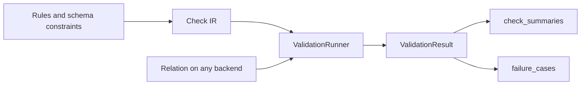

# Validation

`mountainash.validation` is the engine that runs data checks against a relation on any supported backend and reports the outcome in one result model. Checks are plain declarations (a row expression, a dataset-level expression, a relation plan that returns failing rows, a logical value validator, or a foreign key). `ValidationRunner` compiles them through the ordinary expression and relation machinery and returns a `ValidationResult`: one summary row per check and a frame of failure cases keyed by row identity. [Data contracts](../12-data-contracts/index.md) and [DAG validation](../14-relationdag/index.md#validating-a-dag) both run on this engine; most users reach it through them and use the runner directly for ad hoc checks.

Assumes: [Booleanization](../06-ternary-logic/index.md#booleanization), [Collect and terminals](../08-collecting-results/index.md#collect-and-terminals) and [TableSchema and fields](../10-table-schemas-and-datapackage/index.md#tableschema-and-fields).

Status: `mountainash.validation` is a semi-public, evolving surface. Its exports serve data contracts, DAG validation and direct use, but the module does not yet mark which names are stable, so names and signatures may change between releases. The result model and the check types shown here are the parts other mountainash features build on.



## Check IR and rule kinds

<!-- concept:437 -->
The check IR is a small set of frozen dataclasses, one per kind of check. Each declares what to test, not how to run it, and each carries an `id` and a `severity`. The union type is `ValidationCheck`:

| Class | Kind | Tests | Counts |
|---|---|---|---|
| `RowRule` | `row` | A boolean or ternary expression, once per row | pass, fail, unknown per row |
| `ScalarRule` | `scalar` | An aggregate expression, once for the dataset | one verdict |
| `RelationRule` | `relation` | A function from the relation to a relation of failing rows | failing rows |
| `ValueRule` | `value` | A named logical validator over one or more fields | pass, fail, unknown per row |
| `ForeignKeyRule` | `foreign_key` | Child key values present in a parent's key | orphan rows |
| `DistributionRule` | reserved | Not implemented | |

Row checks have three outcomes: pass, fail and unknown. A null in a boolean comparison gives unknown, as does UNKNOWN (0) from a ternary expression; nothing is silently dropped. The `booleanizer` on a row check does not change those counts. It names which outcomes count as passing, using the [booleanizer vocabulary](../06-ternary-logic/index.md#booleanization):

| Booleanizer | Passing outcomes |
|---|---|
| `t_is_true` (default) | pass |
| `t_maybe_true` | pass, unknown |
| `t_is_false` | fail |
| `t_maybe_false` | fail, unknown |
| `t_is_unknown` | unknown |
| `t_is_known` | pass, fail |

A row check passes when every row has a passing outcome, or when the passing fraction of all rows reaches `mostly`. An expression that already ends in a booleanizer (`.t_is_true()`) is treated as boolean, so its rows are only pass or fail.

Declaration mistakes raise `CheckDeclarationError` (from `mountainash.exceptions`) before any data is read: an unknown severity or booleanizer, `mostly` outside (0, 1], duplicate field names, or a foreign key whose two sides have different arity. The runner's dispatch is closed: an object that is not one of the check classes raises `UnknownCheckTypeError` rather than being skipped.

<!-- concept:438 -->
Each kind is declared directly when using the runner without a contract. This set of checks over a small table is run in [Running checks](#running-checks):

```python
import polars as pl
import mountainash as ma
from mountainash.validation import (
    RelationRule, RowRule, ScalarRule, ValueRule, ValueValidatorKey, ValidationRunner,
)

people = pl.DataFrame({
    "id": [1, 2, 3, 4],
    "age": [30, -1, None, 45],
    "state": ["open", "closed", "open", "void"],
})

checks = [
    RowRule(id="age_non_negative", expr=ma.col("age").ge(0), fields=["age"]),
    RowRule(id="age_lenient", expr=ma.col("age").ge(0),
            booleanizer="t_maybe_true"),
    ScalarRule(id="max_age_plausible", expr=ma.col("age").max().lt(120)),
    RelationRule(
        id="ids_unique",
        plan=lambda rel: rel.group_by("id")
            .agg(ma.count_records().alias("n"))
            .filter(ma.col("n").gt(1)),
    ),
    ValueRule(id="state_allowed", fields=["state"],
              validator=ValueValidatorKey.MEMBERSHIP,
              options={"allowed": ["open", "closed"]}, severity="warning"),
]
```

`RowRule` takes `expr`, `mostly`, `booleanizer`, `error_message` and `fields` (the columns copied into failure cases). `ScalarRule` takes an expression that reduces to one boolean; a null result counts as not passing. `RelationRule.plan` receives the relation under test and returns the rows that break the rule, so any join, group or window the relation API supports can express a check; the check passes when the plan returns no rows.

A data-contract `Rule` is not itself a check. `classify(rule)` turns it into a `ScalarRule` when the expression aggregates the whole dataset (an aggregate outside any window, with every column reference inside an aggregate), and into a `RowRule` otherwise. A window (`over`) re-broadcasts its aggregate, so it stays row-valued:

```python
from mountainash.validation import classify
from mountainash.datacontracts import Rule
from mountainash.exceptions import CheckDeclarationError

print(type(classify(Rule("avg", expr=ma.col("age").mean().gt(18)))).__name__)
print(type(classify(Rule("above_avg", expr=ma.col("age").gt(ma.col("age").mean())))).__name__)
try:
    classify(Rule("avg", expr=ma.col("age").mean().gt(18), mostly=0.9))
except CheckDeclarationError as exc:
    print(exc)
```

```text
ScalarRule
RowRule
rule 'avg': mostly is meaningless for a scalar-valued expression (a single verdict has no pass rate)
```

An expression with no column reference and no aggregate is rejected as a literal-only rule.

`ValueRule` runs a validator from the closed `ValueValidatorKey` vocabulary on the logical Python value of each row after conformance: `TYPE_FORMAT`, `LENGTH`, `RANGE`, `STRING_FORMAT`, `XSD_PATTERN`, `MEMBERSHIP`, `UNIQUE`, `NESTED`, `JSON_SCHEMA`, `GEOJSON`, `GEOJSON_WINDING` and `TOPOJSON`. Options are checked against the validator when the rule is constructed (`MEMBERSHIP` needs a sequence `allowed`, `RANGE` at least one bound, and so on). Schema constraints compile to these: a field's `minimum` becomes a `RANGE` value rule named `<field>_range`, `enum` becomes `<field>_enum_membership`, and so on, while `required` becomes a row rule because it tests nulls after conformance. Value rules compare values by canonical logical equality, so structured values (lists, records) compare the same way on every backend. The vocabulary is closed: new value validators are added to the package, not registered by callers.

<!-- concept:445 -->
`DistributionRule` is a reserved slot for aggregate and statistical checks (distribution shape, drift between runs). It is part of the `ValidationCheck` union so that the IR has a place for it, but it is not implemented, and constructing one raises:

```python
from mountainash.validation import DistributionRule

try:
    DistributionRule()
except NotImplementedError as exc:
    print(exc)
```

```text
DistributionRule is a reserved check type (Tier B); it is not implemented yet.
```

Dataset-level conditions that can be written as one aggregate expression (`ma.col("x").mean().lt(...)`, `ma.col("x").std()...`) are `ScalarRule`s today.

<!-- concept:446 -->
Nested JSON values are checked with JSON Schema. A field declared with `json_schema=` compiles to a `JSON_SCHEMA` value rule named `<field>_json_schema`, and a `ValueRule` can name one directly with `options={"schema": {...}}`. The JSON Schema uses the draft named by its `$schema` (Draft 2020-12 by default) and may not reference remote documents. In a table schema it is checked when the schema is compiled (see [Table schema semantic validation](#table-schema-semantic-validation)), so an invalid JSON Schema or a remote `$ref` is reported as a declaration issue instead of being fetched. Each violation becomes a failure case with JSON Pointer `instance_path` and `schema_path`, the JSON Schema keyword as `validator`, and the validator's message:

```python
import json
from mountainash.datacontracts import compile_datacontract
from mountainash.typespec import UniversalType

events = pl.DataFrame({"payload": [json.dumps({"kind": "click"}), json.dumps({"size": 3})]})
events_schema = ma.TableSchema(fields={
    "payload": ma.FieldDefinition(type=UniversalType.OBJECT,
                                  json_schema={"type": "object", "required": ["kind"]}),
})
result = ValidationRunner().validate_relation(
    ma.relation(events), plan=compile_datacontract(events_schema),
)
print(result.failure_cases.select("check_id", "instance_path", "schema_path",
                                  "validator", "message"))
```

```text
shape: (1, 5)
┌─────────────────────┬───────────────┬─────────────┬───────────┬───────────────────────────────┐
│ check_id            ┆ instance_path ┆ schema_path ┆ validator ┆ message                       │
│ ---                 ┆ ---           ┆ ---         ┆ ---       ┆ ---                           │
│ str                 ┆ str           ┆ str         ┆ str       ┆ str                           │
╞═════════════════════╪═══════════════╪═════════════╪═══════════╪═══════════════════════════════╡
│ payload_json_schema ┆               ┆ /required   ┆ required  ┆ 'kind' is a required property │
└─────────────────────┴───────────────┴─────────────┴───────────┴───────────────────────────────┘
```

The `plan=` argument runs a compiled schema: the runner conforms the relation to the schema, which decodes the JSON text into objects, and then runs the plan's checks.

Geospatial values have three validators. `GEOJSON` validates an RFC 7946 GeoJSON object against a vendored GeoJSON schema and adds the rules that schema cannot express, such as closed polygon rings; `GEOJSON_WINDING` reports rings whose winding order differs from the RFC's recommendation; `TOPOJSON` validates a TopoJSON topology and its arc references. A field of type `geojson` compiles to `<field>_geojson` and a `warning`-severity `<field>_geojson_winding`.

```python
areas = pl.DataFrame({"area": [
    {"type": "Polygon", "coordinates": [[[0, 0], [1, 0], [1, 1], [0, 0]]]},
    {"type": "Polygon", "coordinates": [[[0, 0], [1, 0], [1, 1], [0, 1]]]},
]})
result = ValidationRunner().validate_relation(
    ma.relation(areas),
    [ValueRule(id="area_geojson", fields=["area"],
               validator=ValueValidatorKey.GEOJSON, options={})],
)
print(result.failure_cases.select("check_id", "instance_path", "validator", "message"))
```

```text
shape: (1, 4)
┌──────────────┬────────────────┬─────────────────────┬────────────────────────────┐
│ check_id     ┆ instance_path  ┆ validator           ┆ message                    │
│ ---          ┆ ---            ┆ ---                 ┆ ---                        │
│ str          ┆ str            ┆ str                 ┆ str                        │
╞══════════════╪════════════════╪═════════════════════╪════════════════════════════╡
│ area_geojson ┆ /coordinates/0 ┆ geojson.ring_closed ┆ linear ring must be closed │
└──────────────┴────────────────┴─────────────────────┴────────────────────────────┘
```

!!! warning "GeoJSON fields declared in a schema"
    A field declared with `type=UniversalType.GEOJSON` currently conforms to JSON text, and the compiled `<field>_type_format` and `<field>_geojson` checks then fail on every non-null row, valid or not, because the text is not decoded back into an object. Until that is fixed, validate GeoJSON with a `ValueRule` over a column that already holds GeoJSON objects (a struct column, as above), and do not declare the column as `geojson` in the contract.

!!! warning "Backend limit"
    Conforming GeoJSON text is available only on Polars; on other backends the conform step fails and the GeoJSON checks report `error` (`tests/validation/cross_backend/test_typespec_constraints.py`).

## Running checks

<!-- concept:439 -->
`ValidationRunner().validate_relation(relation, checks, ...)` runs a list of checks against one relation, or against a native dataframe that it wraps with `ma.relation`. It returns a `ValidationResult` and does not raise for failing or erroring checks. The main keyword arguments are:

| Argument | Effect |
|---|---|
| `plan` | A `CompiledValidationPlan`: conform to its schema, then run its checks before `checks` |
| `conform_contract` | Conform contract used with `plan` |
| `identity` | Row identity for failure cases (see [row identity](#results-row-identity-and-failure-cases)) |
| `allow_imperfect_key` | Proceed when a keyed identity has null or duplicate keys |
| `context` | Run context, recorded on the result |
| `fail_fast` | Stop after the first blocking check |
| `failure_sample` | Keep at most this many failure rows per check |
| `validator_name`, `datacontract_name` | Names recorded on the result |

```python
runner = ValidationRunner()
result = runner.validate_relation(ma.relation(people), checks)
print(result.passes)
print(result.check_summaries.select("check_id", "check_kind", "status", "severity",
                                    "pass_count", "fail_count", "unknown_count"))
```

```text
False
shape: (5, 7)
┌───────────────────┬────────────┬────────┬──────────┬────────────┬────────────┬───────────────┐
│ check_id          ┆ check_kind ┆ status ┆ severity ┆ pass_count ┆ fail_count ┆ unknown_count │
│ ---               ┆ ---        ┆ ---    ┆ ---      ┆ ---        ┆ ---        ┆ ---           │
│ str               ┆ str        ┆ str    ┆ str      ┆ i64        ┆ i64        ┆ i64           │
╞═══════════════════╪════════════╪════════╪══════════╪════════════╪════════════╪═══════════════╡
│ age_non_negative  ┆ row        ┆ failed ┆ blocking ┆ 2          ┆ 1          ┆ 1             │
│ age_lenient       ┆ row        ┆ failed ┆ blocking ┆ 2          ┆ 1          ┆ 1             │
│ max_age_plausible ┆ scalar     ┆ passed ┆ blocking ┆ null       ┆ null       ┆ null          │
│ ids_unique        ┆ relation   ┆ passed ┆ blocking ┆ null       ┆ 0          ┆ null          │
│ state_allowed     ┆ value      ┆ failed ┆ warning  ┆ 3          ┆ 1          ┆ 0             │
└───────────────────┴────────────┴────────┴──────────┴────────────┴────────────┴───────────────┘
```

Both age checks see the same counts. `age_lenient` counts the null row as passing but still fails on -1; `age_non_negative` fails on both. The runner contains no backend-specific code, so the same checks over a DuckDB table through Ibis give the same summaries:

```python
import ibis

con = ibis.duckdb.connect()
people_db = con.create_table("people", people)
on_duckdb = runner.validate_relation(ma.relation(people_db), checks)
print(on_duckdb.check_summaries.drop("elapsed").equals(
    result.check_summaries.drop("elapsed")))
```

```text
True
```

!!! warning "Backend limit"
    pandas, directly or through Narwhals, stores a missing number as NaN, and a comparison with NaN is false rather than null. A boolean row check therefore counts those rows as `fail`, not `unknown`, and `t_maybe_true` cannot exempt them. On Ibis over SQLite, a `ScalarRule` over an all-null column also gives a different verdict from Polars and Narwhals. Both are recorded as known divergences in `tests/validation/cross_backend/test_runner_semantics.py`; see [Backend support and known limits](../16-backend-support-and-limits/index.md).

```python
import pandas as pd

ages = pd.DataFrame({"age": [30, -1, None]})
on_pandas = runner.validate_relation(ma.relation(ages), checks[:1])
print(on_pandas.check_summaries.select("check_id", "pass_count", "fail_count", "unknown_count"))
```

```text
shape: (1, 4)
┌──────────────────┬────────────┬────────────┬───────────────┐
│ check_id         ┆ pass_count ┆ fail_count ┆ unknown_count │
│ ---              ┆ ---        ┆ ---        ┆ ---           │
│ str              ┆ i64        ┆ i64        ┆ i64           │
╞══════════════════╪════════════╪════════════╪═══════════════╡
│ age_non_negative ┆ 1          ┆ 2          ┆ 0             │
└──────────────────┴────────────┴────────────┴───────────────┘
```

`runner.validate_dag(dag, checks_by_resource, ...)` validates several resources of a `RelationDAG` in one session and then runs the foreign-key checks; it returns a `DAGValidationResult` (see [Foreign keys](#foreign-keys)). `RelationDAG.validate(specs)` is the usual entry point for that and is described in [Validating a DAG](../14-relationdag/index.md#validating-a-dag).

### How the runner executes checks

The runner prepares the input once. It compiles the relation (and the conform step, when a plan is given), materializes it for validation inside one [materialization scope](../09-execution-targets-and-capabilities/index.md#materialization-scopes-and-checkpoints), and runs every check against that prepared source rather than re-running the plan per check. Row rules stay native on the source backend: the rule expression is added as a temporary column with `with_columns` (never used as a filter, so null results cannot disappear as dropped rows), an outcome column of `pass`, `fail` or `unknown` is derived from it, and the counts are aggregated with the relation API. A non-terminal ternary expression reaches the backend as raw -1/0/1 values, because relation compilation applies no booleanization (see [the relation warning in chapter 6](../06-ternary-logic/index.md#booleanization)); the runner maps those values to outcomes itself. Only counts and the selected failure rows are converted to Polars. Value and foreign-key checks run on the logical values of the prepared snapshot.

Each check runs in isolation: an exception while executing one check becomes a summary with status `error` and the exception text in `error`, and the other checks still run. A failure while preparing the shared input (most often a conform cast failure) turns every check into `error`. Declaration errors still raise. The expression and relation compilation the runner relies on is described in [How expressions compile](../18-expression-compilation/index.md) and [How relations compile](../19-relation-compilation/index.md).

<!-- concept:443 -->
Severity is a closed vocabulary of two values, `"blocking"` (the default) and `"warning"`. A warning check runs exactly like a blocking one and keeps its true status in the summaries, but a failed warning does not make `passes` false. One rule decides what blocks:

| Status | `blocking` severity | `warning` severity |
|---|---|---|
| `passed` | does not block | does not block |
| `failed` | blocks | does not block |
| `error` | blocks | blocks |
| `skipped` | does not block | does not block |

A check that could not run always blocks, whatever its severity, because its outcome is unknown. `skipped` comes from rules a data contract's registry left out of the run. `fail_fast=True` stops after the first blocking summary, using the same rule:

```python
quick = runner.validate_relation(ma.relation(people), checks, fail_fast=True)
print(quick.check_summaries.select("check_id", "status"))
```

```text
shape: (1, 2)
┌──────────────────┬────────┐
│ check_id         ┆ status │
│ ---              ┆ ---    │
│ str              ┆ str    │
╞══════════════════╪════════╡
│ age_non_negative ┆ failed │
└──────────────────┴────────┘
```

In a schema, a field's `severity="warning"` makes every check compiled from that field a warning.

## Results, row identity and failure cases

<!-- concept:440 -->
`ValidationResult` holds `passes`, `validator_name`, `datacontract_name`, `context`, `check_summaries`, `failure_cases`, `identity`, `identity_diagnostics` and `processor`. Checks execute on the data's backend, but both frames are Polars `DataFrame`s on every backend, so reporting code is the same everywhere.

`check_summaries` has one row per check, the frame form of `CheckSummary` records:

```python
print(result.check_summaries.columns)
print(result.failure_cases.columns)
```

```text
['check_id', 'check_kind', 'status', 'pass_count', 'fail_count', 'unknown_count', 'total_rows', 'mostly', 'severity', 'diagnostic', 'error', 'elapsed']
['check_id', 'check_kind', 'column', 'outcome', 'value', 'message', 'instance_path', 'schema_path', 'validator', 'label_declarations', 'row_number', 'row']
```

`status` is one of `passed`, `failed`, `error` and `skipped`. Row and value checks fill the three counts and `total_rows`; a relation check fills `fail_count` with its failing rows; a scalar check puts its value in `diagnostic` and leaves the counts null; a foreign-key check puts the orphan count in `diagnostic`. `error` holds the exception text of an errored check, and `elapsed` its run time in seconds. `DAGValidationResult` has `passes`, `results` (one `ValidationResult` per resource) and `fk_result` (a `ValidationResult` for the foreign-key phase).

<!-- concept:441 -->
Row identity says how a failure case points back to its source row. `RowIdentity(kind, key_fields)` has three tiers, resolved by `resolve_identity(natural_key=..., spec=..., row_identity=...)` in this order, with no silent fallback between them:

- `keyed`: an explicit natural key, else the schema's `primary_key`. Key columns are added to every failure case. The key is checked first: a null or duplicate key raises `IdentityInvalidError` unless `allow_imperfect_key=True`, in which case the counts go to `identity_diagnostics`.
- `row_number`: opt in with `row_identity="row_number"`. Failure cases carry the zero-based position of the row in the validated input. It is a diagnostic ordinal, not a key; it is not stable across reorderings and is never used to join back to the source.
- `none`: the default. Failure cases carry only what the check itself provides.

```python
from mountainash.validation import RowIdentity, resolve_identity

keyed = runner.validate_relation(ma.relation(people), checks,
                                 identity=resolve_identity(natural_key=["id"]))
print(keyed.failure_cases.select("check_id", "outcome", "column", "value", "id", "row"))

numbered = runner.validate_relation(ma.relation(people), checks[:1],
                                    identity=resolve_identity(row_identity="row_number"))
print(numbered.failure_cases.select("check_id", "outcome", "row_number"))
```

```text
shape: (4, 6)
┌──────────────────┬─────────┬────────┬───────┬─────┬──────────────────┐
│ check_id         ┆ outcome ┆ column ┆ value ┆ id  ┆ row              │
│ ---              ┆ ---     ┆ ---    ┆ ---   ┆ --- ┆ ---              │
│ str              ┆ str     ┆ str    ┆ str   ┆ i64 ┆ struct[3]        │
╞══════════════════╪═════════╪════════╪═══════╪═════╪══════════════════╡
│ age_non_negative ┆ fail    ┆ age    ┆ -1    ┆ 2   ┆ {-1,null,null}   │
│ age_non_negative ┆ unknown ┆ age    ┆ null  ┆ 3   ┆ {null,null,null} │
│ age_lenient      ┆ fail    ┆ null   ┆ null  ┆ 2   ┆ null             │
│ state_allowed    ┆ fail    ┆ null   ┆ null  ┆ 4   ┆ {45,4,"void"}    │
└──────────────────┴─────────┴────────┴───────┴─────┴──────────────────┘
shape: (2, 3)
┌──────────────────┬─────────┬────────────┐
│ check_id         ┆ outcome ┆ row_number │
│ ---              ┆ ---     ┆ ---        │
│ str              ┆ str     ┆ i64        │
╞══════════════════╪═════════╪════════════╡
│ age_non_negative ┆ fail    ┆ 1          │
│ age_non_negative ┆ unknown ┆ 2          │
└──────────────────┴─────────┴────────────┘
```

A data contract resolves identity from its `natural_key` or `primary_key`, and `Validator.validate(row_identity="row_number")` opts in to the second tier.

<!-- concept:442 -->
`failure_cases` has one row per failing row and check (or per diagnostic, for nested value checks). Only non-passing outcomes appear, so a row that is unknown under a `t_maybe_true` check is absent. The columns are:

| Column | Content |
|---|---|
| `check_id`, `check_kind` | The check |
| `outcome` | `fail` or `unknown` |
| `column`, `value` | The field and its value, for a row check that declares exactly one field |
| `message` | The check's `error_message`, with `{field}` placeholders filled (keyed identity only) |
| `instance_path`, `schema_path`, `validator` | Location and validator for JSON Schema, GeoJSON and nested value diagnostics |
| `label_declarations` | Reserved; currently always null |
| key columns | The key values, under keyed identity |
| `row_number` | The row position, under `row_number` identity; null otherwise |
| `row` | A struct of source values: the whole failing row for relation, value and foreign-key checks, the declared `fields` for row checks |

The source row is nested in `row` so that source column names never collide with the reserved columns. Different checks contribute different fields, so the column is a struct with the union of all fields, null where a check did not provide one; in the output above, `age_non_negative` provides only `age`.

`failure_sample=n` keeps at most `n` failure rows per check (the summaries still count every row), and `error_message` is filled per row from the declared fields:

```python
messages = runner.validate_relation(
    ma.relation(people),
    [RowRule(id="age_non_negative", expr=ma.col("age").ge(0), fields=["age"],
             error_message="age {age} is negative")],
    identity=RowIdentity("keyed", ("id",)),
    failure_sample=1,
)
print(messages.failure_cases.select("check_id", "outcome", "id", "message"))
```

```text
shape: (1, 4)
┌──────────────────┬─────────┬─────┬────────────────────┐
│ check_id         ┆ outcome ┆ id  ┆ message            │
│ ---              ┆ ---     ┆ --- ┆ ---                │
│ str              ┆ str     ┆ i64 ┆ str                │
╞══════════════════╪═════════╪═════╪════════════════════╡
│ age_non_negative ┆ fail    ┆ 2   ┆ age -1 is negative │
└──────────────────┴─────────┴─────┴────────────────────┘
```

When a data contract's `Validator` run does not pass, `result.processor` is a `ValidationResultProcessor` over the failure cases, with summaries such as `failure_count()`, `failure_count_by_rule()`, `failure_count_by_column()`, `passed_for_rule(rule_id)` and `failure_cases_for_rule(rule_id)`. Methods that join failures back to source rows (`pivot_key_fields()`, `enriched_failure_cases()` and message interpolation) need keyed identity and raise `IdentityRequiredError` otherwise. `result.processor` is `None` on a passing run and on results returned by the runner directly.

## Foreign keys

<!-- concept:444 -->
`ForeignKeyRule(id, child, parent, child_fields, parent_fields, exclude_null_child=True, severity="blocking")` checks that every child key appears among the parent's keys. The comparison uses canonical logical key values taken from each side's prepared snapshot, not a backend join, so keys of different physical types or structured keys compare by value. Null handling follows SQL `MATCH SIMPLE`: a child key with any null component is not an orphan, unless `exclude_null_child=False`. A child key component that could not be decoded is neither a match nor an orphan, and a parent row with a null or invalid component contributes no key. Orphans are reported as failure cases with the child row in `row`, and their number is the summary's `fail_count` and `diagnostic`.

Foreign keys are usually declared on a schema (see [Foreign keys](../10-table-schemas-and-datapackage/index.md#foreign-keys)), and the engine generates the rules. A self-reference (a reference with no resource) can be checked on a single relation by passing the compiled schema as `plan`:

```python
from mountainash.typespec import ForeignKey, ForeignKeyReference

D = ma.MountainashDtype
staff = pl.DataFrame({"id": [1, 2, 3], "manager_id": [None, 1, 7]})
staff_schema = ma.TableSchema(
    fields={"id": ma.FieldDefinition(dtype=D.I64),
            "manager_id": ma.FieldDefinition(dtype=D.I64)},
    primary_key=["id"],
    foreign_keys=[ForeignKey(fields=["manager_id"],
                             reference=ForeignKeyReference(resource=None, fields=["id"]))],
)
staff_result = runner.validate_relation(
    ma.relation(staff), plan=compile_datacontract(staff_schema), validator_name="staff",
)
print(staff_result.check_summaries.filter(pl.col("check_kind") == "foreign_key")
      .select("check_id", "status", "fail_count"))
print(staff_result.failure_cases.select("check_id", "outcome", "row"))
```

```text
shape: (1, 3)
┌──────────────────────────────┬────────┬────────────┐
│ check_id                     ┆ status ┆ fail_count │
│ ---                          ┆ ---    ┆ ---        │
│ str                          ┆ str    ┆ i64        │
╞══════════════════════════════╪════════╪════════════╡
│ fk__staff__manager_id__staff ┆ failed ┆ 1          │
└──────────────────────────────┴────────┴────────────┘
shape: (1, 3)
┌──────────────────────────────┬─────────┬───────────┐
│ check_id                     ┆ outcome ┆ row       │
│ ---                          ┆ ---     ┆ ---       │
│ str                          ┆ str     ┆ struct[2] │
╞══════════════════════════════╪═════════╪═══════════╡
│ fk__staff__manager_id__staff ┆ fail    ┆ {3,7}     │
└──────────────────────────────┴─────────┴───────────┘
```

Generated ids have the form `fk__<child>__<fields>__<parent>`. The null `manager_id` of the first row is excluded under `MATCH SIMPLE`. A reference to another resource needs that resource's data, so on a single relation it raises `RelationDAGRequired` (from `mountainash.exceptions`). Cross-table keys are validated over a `RelationDAG`, where the runner prepares each resource once and runs the foreign-key phase after the per-resource checks:

```python
from mountainash.validation import ForeignKeyRule

dag = ma.RelationDAG()
dag.add("customers", ma.relation(pl.DataFrame({"id": [1, 2]})))
dag.add("orders", ma.relation(pl.DataFrame({"order_id": [10, 11, 12],
                                            "customer_id": [1, 99, None]})))
orders_fk = ForeignKeyRule(id="orders_customer", child="orders", parent="customers",
                           child_fields=["customer_id"], parent_fields=["id"])
dag_result = runner.validate_dag(dag, {"orders": [orders_fk]})
print(dag_result.passes, list(dag_result.results))
print(dag_result.fk_result.failure_cases.select("check_id", "outcome", "row"))
```

```text
False ['orders']
shape: (1, 3)
┌─────────────────┬─────────┬───────────┐
│ check_id        ┆ outcome ┆ row       │
│ ---             ┆ ---     ┆ ---       │
│ str             ┆ str     ┆ struct[2] │
╞═════════════════╪═════════╪═══════════╡
│ orders_customer ┆ fail    ┆ {11,99}   │
└─────────────────┴─────────┴───────────┘
```

`build_fk_checks(dag, specs)` is the one place that generates foreign-key rules. It reads the DAG's constraint metadata and the `foreign_keys` of each resource's schema, removes duplicates, and returns the rules together with `error` summaries for declarations that cannot be checked (an unknown parent, mismatched arity, or key fields missing from either side). Those are reported, not raised and not skipped. `RelationDAG.validate` calls it for you; see [Validating a DAG](../14-relationdag/index.md#validating-a-dag).

## Table schema semantic validation

<!-- concept:447 -->
Validating data assumes the schema itself makes sense. `validate_table_schema_semantics(schema)` checks a `TableSchema` declaration without touching data and returns a tuple of `TableSchemaIssue(path, code, message)`, sorted by JSON Pointer path. It checks, among other things, that primary keys, unique keys and foreign keys name declared fields, that `fields_match` is a supported mode, that missing-value declarations are well formed, that constraints suit the field type, and, when given `package_resource_names` and `package_schemas`, that foreign keys point at real resources and fields.

```python
from mountainash.validation import validate_table_schema_semantics
from mountainash.exceptions import InvalidTypeSpecSemantics

broken = ma.TableSchema(
    fields={"id": ma.FieldDefinition(dtype=D.I64)},
    primary_key=["order_id"],
    foreign_keys=[ForeignKey(fields=["customer_id"],
                             reference=ForeignKeyReference(resource="customers",
                                                           fields=["id"]))],
)
for issue in validate_table_schema_semantics(broken):
    print(issue.path, issue.code, issue.message)

try:
    compile_datacontract(broken)
except InvalidTypeSpecSemantics as exc:
    print(type(exc).__name__)
```

```text
/foreign_keys/0/fields/0 typespec.invalid_constraint_declaration key field 'customer_id' is not declared
/primary_key/0 typespec.invalid_constraint_declaration key field 'order_id' is not declared
InvalidTypeSpecSemantics
```

`require_valid_table_schema(schema)` runs the same checks and raises one `InvalidTypeSpecSemantics` listing every issue. Compiling a schema into a validation plan (`compile_datacontract`, and therefore every data contract) calls it first, so a contract with an inconsistent schema fails before any data is read instead of producing misleading check results.
