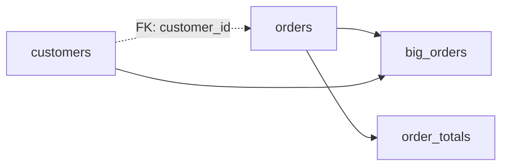

# RelationDAG

A `RelationDAG` holds several named relations that refer to each other by name, and collects any one of them with its dependencies resolved. Users reach for it when a piece of work spans more than one table: load a set of resources, derive tables from them with `dag.ref(...)`, collect a target, export the whole set as a Frictionless `DataPackage`, or validate every table and the foreign keys between them in one call.

Assumes: [Relations](../07-relations/index.md), [Collecting results](../08-collecting-results/index.md), [Execution targets and capabilities](../09-execution-targets-and-capabilities/index.md), [Table schemas and DataPackage](../10-table-schemas-and-datapackage/index.md) and [Validation](../13-validation/index.md).

## The graph kernel

<!-- concept:450 -->
`RelationDAG` and [pipelines](../15-pipelines/index.md) share one small graph container, `Graph`, in `mountainash.graph`. A `Graph` stores named nodes of any type and two separate sets of edges. It orders nodes, finds ancestors and descendants, groups nodes into layers that can run side by side, and renders itself as a summary or as Graphviz DOT. It does not execute, cache or persist anything: its owner decides what a node is and what running it means.

```python
from mountainash.graph import Graph

g = Graph()
g.add("customers", "load customers")
g.add("orders", "load orders")
g.add("report", "join and summarise", depends_on=["customers", "orders"])
g.add_constraint("customers", "orders", meta="orders.customer_id -> customers.id")

order = g.topological_order()
print(order)
print(g.parallel_layers(order))
print(sorted(g.ancestors("report")))
print(g.describe()["orders"])
```

```text
['customers', 'orders', 'report']
[['customers', 'orders'], ['report']]
['customers', 'orders']
{'depends_on': [], 'constraints': ['customers']}
```

Ties in the ordering are broken alphabetically, so the order is deterministic. `topological_order("report")` restricts the result to `report` and its ancestors. Adding a name twice raises `DuplicateNodeError`, ordering an unknown target raises `UnknownNodeError`, and a dependency cycle raises `CycleError` (a `ValueError`). All three live in `mountainash.graph`.

<!-- concept:451 -->
The two edge sets mean different things and are never merged. Dependency edges, added through `depends_on`, say that one node needs another's output; they alone drive ordering and layering. Constraint edges, added through `add_constraint()`, record a relationship between the data in two nodes, such as a foreign key, with optional metadata. They never change the order: in the example above `orders` declares a constraint on `customers`, yet both sit in the first layer.

In a `RelationDAG` the dependency edges come from the relations you write, and the constraint edges come from foreign keys. In this small shop example, `orders` has a foreign key to `customers` (dashed), and two derived tables depend on the stored ones (solid):



Collecting `orders` reads only `orders`, even though its foreign key points at `customers`. A foreign key describes the data, not how to build it, so declaring one never changes what a collect runs. The project calls this rule the two-edge graph model.

## Building a DAG

<!-- concept:452 -->
`ma.RelationDAG()` starts an empty DAG. `dag.add(name, relation)` registers a [relation](../07-relations/index.md#relation-objects) under a name, and `dag.source(name, data)` wraps raw data in `ma.relation()`, registers it and returns a reference to it. Inside a relation, `dag.ref(name)` stands for another named relation. When you add a relation, the DAG walks its plan for those references and records one dependency edge for each.

```python
import mountainash as ma
import polars as pl

dag = ma.RelationDAG()
customers = dag.source("customers", pl.DataFrame({"id": [1, 2, 3], "name": ["Ada", "Grace", "Linus"]}))
dag.add("orders", ma.relation(pl.DataFrame({
    "order_id": [10, 11, 12], "customer_id": [1, 2, 1], "amount": [25.0, 40.0, 15.5],
})))
dag.add(
    "big_orders",
    dag.ref("orders")
    .filter(ma.col("amount") > 20)
    .join(customers, left_on="customer_id", right_on="id"),
)
print(sorted(dag.dependency_edges))
print(dag.topological_order())
```

```text
[('customers', 'big_orders'), ('orders', 'big_orders')]
['customers', 'orders', 'big_orders']
```

`dag.relations`, `dag.dependency_edges`, `dag.constraint_edges` and `dag.constraint_metadata` are read-only views; change the DAG through its methods. Adding an existing name raises `ValueError`. `dag.describe()` summarises each relation's column count, dependencies and constraints, and `dag.to_dot()` returns Graphviz DOT with constraint edges drawn dashed.

<!-- concept:453 -->
`dag.ref(name)` returns a `DAGRelation`: a relation bound to the DAG, whose chained methods keep that binding. Its terminals compile through the DAG, so references resolve without registering anything. To keep a result, `dag.add()` it. The referenced name only has to exist when something is collected, so you can add relations in any order.

`dag.bind(**sources)` treats a DAG as a template. It returns a new DAG with the given data registered as sources, followed by every relation, constraint and asset of the template, which stays unchanged. A name that collides with a template relation raises `DuplicateNodeError`.

```python
names = dag.ref("big_orders").select("name", "amount")
print(type(names).__name__)
print(names.to_dict())
print(sorted(dag.relations))

template = ma.RelationDAG()
template.add("adults", template.ref("people").filter(ma.col("age") >= 18))
run = template.bind(people=pl.DataFrame({"name": ["Ana", "Ben"], "age": [12, 40]}))
print(sorted(template.relations), sorted(run.relations))
print(run.ref("adults").to_dicts())

dag.add("broken", dag.ref("returns").select("order_id"))
try:
    dag.collect("broken")
except KeyError as exc:
    print(type(exc).__name__, exc)
```

```text
DAGRelation
{'name': ['Ada', 'Grace'], 'amount': [25.0, 40.0]}
['big_orders', 'customers', 'orders']
['adults'] ['adults', 'people']
[{'name': 'Ben', 'age': 40}]
UnknownRelationRef relation 'returns' referenced but not in DAG (referenced by 'broken')
```

A reference to a missing name raises `UnknownRelationRef` when it is compiled. It is a `DAGError` and also a `KeyError`; import it from `mountainash.relations.dag.errors`, as `mountainash.exceptions` does not re-export it. Collecting a relation that holds a reference outside any DAG raises `RelationDAGRequired` (a `RuntimeError`, available from `mountainash.exceptions`). `dag.execute(relation)` compiles an unregistered relation against the DAG and returns the native result, without changing the DAG.

## Collecting a DAG

<!-- concept:454 -->
`dag.collect(name)` compiles the named relation and everything it depends on, in topological order, and returns the backend's native result. For Polars inputs that is a `LazyFrame`, as a lazy plan is the native form. The [terminals](../08-collecting-results/index.md#collect-and-terminals) on `dag.ref(name)` (`to_polars()`, `to_dicts()`, `to_dict()` and the rest) return the usual egress formats instead. Asking for a name that is not registered raises `KeyError`.

```python
out = dag.collect("big_orders")
print(type(out))
print(out.collect())
print(dag.schema("big_orders"))
```

```text
<class 'polars.lazyframe.frame.LazyFrame'>
shape: (2, 5)
┌──────────┬─────────────┬────────┬─────┬───────┐
│ order_id ┆ customer_id ┆ amount ┆ id  ┆ name  │
│ ---      ┆ ---         ┆ ---    ┆ --- ┆ ---   │
│ i64      ┆ i64         ┆ f64    ┆ i64 ┆ str   │
╞══════════╪═════════════╪════════╪═════╪═══════╡
│ 10       ┆ 1           ┆ 25.0   ┆ 1   ┆ Ada   │
│ 11       ┆ 2           ┆ 40.0   ┆ 2   ┆ Grace │
└──────────┴─────────────┴────────┴─────┴───────┘
{'order_id': <MountainashDtype.I64: 'i64'>, 'customer_id': <MountainashDtype.I64: 'i64'>, 'amount': <MountainashDtype.FP64: 'fp64'>, 'id': <MountainashDtype.I64: 'i64'>, 'name': <MountainashDtype.STRING: 'string'>}
```

`dag.schema(name)` infers the output schema without running anything, resolving references through the DAG. `collect(name, target=...)` accepts the same [execution targets](../09-execution-targets-and-capabilities/index.md#execution-targets-and-locations) as a single relation. `dag.collect_with_drift(name)` also returns the [drift reports](../11-conforming-data/index.md#drift-reporting) of any conform steps in the plan.

<!-- concept:455 -->
Each collect or validation runs inside one DAG materialization session. The session compiles each named relation at most once, in the order it is first needed, and hands the cached result to every consumer: a relation used by two joins, a validation rule and a foreign-key check is still computed once. When a consumer needs a dependency in another backend, the session converts it and caches that conversion as well, once per destination. It runs under the same capability policy and [materialization scopes](../09-execution-targets-and-capabilities/index.md#materialization-scopes-and-checkpoints) as a single relation, and releases what it owns when the call ends. The class, `DAGMaterializationSession` in `mountainash.relations.dag`, is the engine behind `collect()` and `validate()`; normal use never creates one directly.

<!-- concept:458 -->
The named relations in one DAG can live in different backends. When a relation combines two of them, it runs in the backend of its anchor, the first input of its plan (the left side of a join), and each foreign dependency is materialized in its own backend, then [transferred](../09-execution-targets-and-capabilities/index.md#operand-transfer-and-owned-copies) to the anchor's. Here `customers` is a DuckDB table and `orders` is a Polars frame:

```python
import ibis

con = ibis.duckdb.connect()
db_customers = con.create_table("customers", pl.DataFrame({"id": [1, 2], "name": ["Ada", "Grace"]}))

mixed = ma.RelationDAG()
mixed.add("customers", ma.relation(db_customers))
mixed.add("orders", ma.relation(pl.DataFrame({"customer_id": [1, 2, 1], "amount": [25.0, 40.0, 15.5]})))
mixed.add("by_customer", mixed.ref("customers").join(mixed.ref("orders"), left_on="id", right_on="customer_id"))
mixed.add("by_order", mixed.ref("orders").join(mixed.ref("customers"), left_on="customer_id", right_on="id"))

print(type(mixed.collect("by_customer")).__module__)
print(type(mixed.collect("by_order")).__module__)
print(type(mixed.collect("by_customer", target="polars")).__module__)
print(mixed.ref("by_customer").sort("amount").to_dicts())
```

```text
ibis.expr.types.relations
polars.lazyframe.frame
polars.lazyframe.frame
[{'id': 1, 'name': 'Ada', 'customer_id': 1, 'amount': 15.5}, {'id': 1, 'name': 'Ada', 'customer_id': 1, 'amount': 25.0}, {'id': 2, 'name': 'Grace', 'customer_id': 2, 'amount': 40.0}]
```

`by_customer` runs in DuckDB with the Polars orders moved into it, and `by_order` runs in Polars with the DuckDB customers moved out. An explicit `target=` overrides the anchor.

!!! warning "Backend limit"
    Two cross-backend combinations are refused rather than converted. A lazy Narwhals frame cannot anchor a relation whose dependencies live in another backend (`TypeError: Cross-family DAG coercion is not supported with a lazy Narwhals anchor.`), and a dependency cannot be moved between two different Ibis connections (`BackendConversionError: Cross-connection Ibis DAG coercion is unsupported`). Collect such inputs eagerly, or put the Ibis tables on one connection. See [Backend support and known limits](../16-backend-support-and-limits/index.md).

## Resources and DataPackage

<!-- concept:459 -->
`ma.ResourceRef` wraps one `DataResource` from a [DataPackage](../10-table-schemas-and-datapackage/index.md#datapackage-resources-and-dialects) and answers two questions: is it a table, and how do I read it? `is_tabular` is true when the resource declares `"type": "table"`, when its format is `csv`, `tsv`, `json`, `ndjson`, `jsonl` or `parquet`, or when it holds inline data with format `json`. A tabular resource becomes a relation with `ref.relation()`; any other resource gives its raw content with `ref.read_bytes()`. Inline rows with a schema but no `type` or tabular format count as non-tabular, so declare `"type": "table"` for them.

```python
rates = ma.DataResource.model_validate({
    "name": "rates",
    "type": "table",
    "data": [{"code": "AUD", "rate": None}, {"code": "NZD", "rate": None}],
    "schema": {"fields": [{"name": "code", "type": "string"}, {"name": "rate", "type": "number"}]},
})
ref = ma.ResourceRef(rates)
print(ref.is_tabular)
print(ref.relation().to_polars().schema)
```

```text
True
Schema({'code': String, 'rate': Float64})
```

<!-- concept:460 -->
A resource relation reads its data only when collected, and the read takes one of three routes. Inline `data` becomes an in-memory frame, and a column that is entirely null takes the dtype declared in the schema (above, `rate` is `Float64` rather than null-typed); if that cast fails, `ResourceSchemaCastError` names the resource and columns. A local CSV or Parquet file whose CSV dialect the backend can represent is scanned natively and lazily. Everything else, including remote paths, compressed files, other formats and less common dialect options, is parsed through the `files` extra into Arrow first. Without that extra the read raises `MissingFilesDependency` (also an `ImportError`). A dialect option no reader can represent raises `UnsupportedResourceFormat`, on every backend alike. `UnsupportedResourceFormat` is in `mountainash.exceptions`; `MissingFilesDependency` and `ResourceSchemaCastError` are imported from `mountainash.relations.dag.errors`. Remote locations are opened through `mountainash-transport`; see [Where mountainash sits](../02-installation-and-package-surface/index.md#where-mountainash-sits).

<!-- concept:456 -->
`DataPackage.to_relation_dag()` turns a package into a DAG. Each tabular resource becomes a named relation that reads that resource, each other resource becomes an entry in `dag.assets` (a `ResourceRef`), and each foreign key becomes a constraint edge with the `ForeignKey` as metadata. A freshly loaded package has no dependency edges, because no resource is built from another. The example uses a `datapackage.json` with `customers.csv`, `orders.csv` (foreign key `customer_id` to `customers.id`) and a text `README.txt`:

```python
pkg = ma.DataPackage.from_path("data/datapackage.json")
shop = pkg.to_relation_dag()
print(shop.dependency_edges)
print(shop.constraint_edges)
print(sorted(shop.relations), sorted(shop.assets))
print(shop.assets["readme"].read_bytes())
print(shop.ref("orders").to_dicts()[-1])
```

```text
set()
{('customers', 'orders')}
['customers', 'orders'] ['readme']
b'Shop sample data.\n'
{'order_id': 13, 'customer_id': 4, 'amount': 9.0}
```

Order 13 points at customer 4, who does not exist; [validation](#validating-a-dag) finds it below.

`dag.to_package()` goes the other way. A resource relation re-emits its original `DataResource`, so path, format, dialect and schema survive the round trip. A derived relation gets a CSV resource named after it, with a schema inferred by `dag.schema()` and any foreign keys declared on it; columns whose type cannot be inferred become `"any"`. Assets pass through unchanged. The result is a descriptor only: no data is written, so the paths of derived resources are placeholders for wherever you write them.

```python
shop.add(
    "order_totals",
    shop.ref("orders").group_by("customer_id").agg(ma.col("amount").sum().alias("total")),
)
exported = shop.to_package()
for resource in exported.resources:
    print(resource.name, resource.path, resource.table_schema)
```

```text
customers customers.csv {'fields': [{'name': 'id', 'type': 'integer'}, {'name': 'name', 'type': 'string'}], 'primaryKey': ['id']}
orders orders.csv {'fields': [{'name': 'order_id', 'type': 'integer'}, {'name': 'customer_id', 'type': 'integer'}, {'name': 'amount', 'type': 'number'}], 'primaryKey': ['order_id'], 'foreignKeys': [{'fields': ['customer_id'], 'reference': {'resource': 'customers', 'fields': ['id']}}]}
order_totals order_totals.csv {'fields': [{'name': 'customer_id', 'type': 'integer'}, {'name': 'total', 'type': 'number'}]}
readme README.txt None
```

`to_package(strict=True)` raises `MissingResourceSchema` instead of emitting a relation whose schema is empty or has a column of unknown type. A derived relation with declared foreign keys but no inferable schema raises it in either mode, since the keys would otherwise be lost.

`to_relation_dag(overrides={name: data})` replaces a resource's file with in-memory data, conformed to the resource's schema, which is useful in tests:

```python
test_shop = pkg.to_relation_dag(overrides={"customers": pl.DataFrame({"id": [1, 4], "name": ["Ada", "Zed"]})})
print(test_shop.ref("customers").to_dicts())
```

```text
[{'id': 1, 'name': 'Ada'}, {'id': 4, 'name': 'Zed'}]
```

Foreign keys on a derived relation are declared with `dag.add_constraint(child, foreign_key)`. It adds the constraint edge and its metadata and leaves dependency edges alone. Calling it on a resource relation raises `ValueError`: a resource's foreign keys belong in its own `table_schema`.

```python
from mountainash.typespec import ForeignKey, ForeignKeyReference

shop.add_constraint(
    "order_totals",
    ForeignKey(fields=["customer_id"], reference=ForeignKeyReference(resource="customers", fields=["id"])),
)
print(sorted(shop.constraint_edges))
print(sorted(shop.dependency_edges))
```

```text
[('customers', 'order_totals'), ('customers', 'orders')]
[('orders', 'order_totals')]
```

## Validating a DAG

<!-- concept:457 -->
`dag.validate(specs)` validates several tables and the foreign keys between them in one call, using the [validation engine](../13-validation/index.md). `specs` maps relation names to a `TableSchema` or a [data contract](../12-data-contracts/index.md#declaring-a-contract) class. Each named table is checked against its spec. Then foreign-key checks are generated from the DAG's constraint metadata and from foreign keys declared in the specs, with duplicates removed, and run as [anti-joins](../13-validation/index.md#foreign-keys). Every relation is materialized once, in one shared session, through the backend you pass as `backend=` or the one detected.

```python
specs = {r.name: r.to_table_schema() for r in pkg.resources if r.name in ("customers", "orders")}
result = shop.validate(specs)
print(result.passes)
print({name: r.passes for name, r in result.results.items()})
print(result.fk_result.passes)
for case in result.fk_result.failure_cases.to_dicts():
    print(case["check_id"], case["row"]["customer_id"])
```

```text
False
{'customers': True, 'orders': True, 'order_totals': True}
False
fk__orders__customer_id__customers 4
fk__order_totals__customer_id__customers 4
```

The result is a `DAGValidationResult`: `passes` for the whole run, `results` with one [`ValidationResult`](../13-validation/index.md#results-row-identity-and-failure-cases) per table, and `fk_result` holding the foreign-key checks and their failing child rows. Both foreign keys fail on customer 4: the one read from the package and the one declared on `order_totals`. A table whose key fields cannot identify rows reports the problem as its own failing check (`check_id="__identity__"`) while the other tables still validate; `allow_imperfect_key=True` relaxes that. `dag.validate_quick(specs)` takes the same arguments and returns the same shape, but stops at the first blocking failure. `failure_sample=` caps the failure rows kept per check, and `context=` attaches a mapping of run metadata to every result. A spec for a name that is not in the DAG raises `KeyError`.
