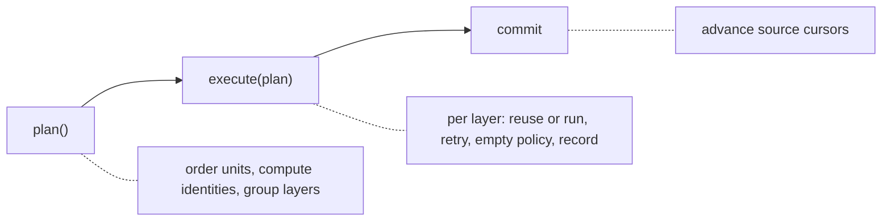

# Pipelines

A pipeline runs a named graph of units, each of which produces one value from the values of the units it depends on. Typical units fetch data incrementally from a source, run a [RelationDAG](../14-relationdag/index.md) over upstream data, call a Python function, or write a result to Parquet or a database table. A `Runner` plans the run, executes the units in dependency order, and records each result in a checkpoint keyed by the unit's identity, so a later run reuses results whose inputs are unchanged and resumes incremental sources where they stopped.

Assumes: [Installation and the package surface](../02-installation-and-package-surface/index.md) and [RelationDAG](../14-relationdag/index.md).

The pipelines API is evolving: it is a recent rebuild that replaced an earlier runner and storage API, and the package profile marks it as evolving. `Runner.run()` is the main entry point; `Runner.plan()` and `Runner.execute()` are public but lightly specified, and names may change between releases. Everything lives in `mountainash.pipelines` and is imported from there; the `mountainash` top level exports none of it.

## Pipelines and units

<!-- concept:465 -->
`Pipeline(name)` creates an empty pipeline, and `pipeline.add(unit)` registers a unit under the unit's own name and returns the pipeline, so calls chain. A unit names the units it depends on, and `add()` checks that each one is already in the pipeline. The pipeline stores its units in the same [graph kernel](../14-relationdag/index.md#the-graph-kernel) as `RelationDAG`, with one dependency edge per input. The `@unit` decorator turns a function into a unit; the function receives one positional argument per dependency, then a run context.

```python
import mountainash as ma
import polars as pl
from mountainash.pipelines import Pipeline, Runner, unit

@unit(name="orders")
def orders(ctx):
    return pl.DataFrame({"customer_id": [1, 2, 1], "amount": [25.0, 40.0, 15.5]})

@unit(name="totals", depends_on=("orders",))
def totals(orders, ctx):
    return (
        ma.relation(orders)
        .group_by("customer_id")
        .agg(ma.col("amount").sum().alias("total"))
        .sort("customer_id")
        .to_polars()
    )

pipeline = Pipeline("daily").add(orders).add(totals)
result = Runner(pipeline).run()
print({name: status.value for name, status in result.statuses.items()})
print(result.values["totals"].kind)
print(result.values["totals"].payload)
```

```text
{'orders': 'complete', 'totals': 'complete'}
ValueKind.TABULAR
shape: (2, 2)
┌─────────────┬───────┐
│ customer_id ┆ total │
│ ---         ┆ ---   │
│ i64         ┆ f64   │
╞═════════════╪═══════╡
│ 1           ┆ 40.5  │
│ 2           ┆ 40.0  │
└─────────────┴───────┘
```

`Runner(pipeline).run()` returns a `RunResult`. `statuses` maps each unit to `complete`, `partial`, `failed`, `skipped` or `reused`, `values` maps each unit to the `Value` it produced, `executed` lists the units that ran, and `run_id` identifies the run. The status enum, `Status`, lives in `mountainash.pipelines.core.values`; import it from there to compare members instead of their `.value` strings.

<!-- concept:466 -->
A unit is any object that satisfies the `Unit` protocol: a `name`, a `version`, the names of its inputs, an `identity()` computed from its inputs and parameters, a `run(upstream, ctx)` method, and a `lifecycle` class that tells the runner how to plan, run and commit it. Three settings shape how a unit runs:

- `empty` is the [empty-output policy](#running-a-pipeline).
- `affinity` is `Affinity.WORKER` by default. `Affinity.MAIN` keeps the unit on the main thread when the runner uses worker threads.
- `partitions_preserved` says the unit keeps its single input's partitions, so [coverage](#values-identity-and-checkpoints) passes through it.

At most one run of a given unit is in progress at a time.

The ready-made units cover the usual cases, so writing a unit class is an extension point for less common needs. The base class `BaseUnit` (in `mountainash.pipelines.units.base`) supplies everything except `run()`. It leaves `lifecycle` unset, so a direct subclass must set `lifecycle = UnitLifecycle` from `mountainash.pipelines.runtime.lifecycle`; otherwise planning fails with `AttributeError: ... has no attribute 'lifecycle'`. Subclasses of `PythonUnit`, `SourceUnit` and `SinkUnit` inherit theirs.

```python
from mountainash.pipelines import PythonUnit
from mountainash.pipelines.units.base import BaseUnit
from mountainash.pipelines.runtime.lifecycle import UnitLifecycle

class Constant(BaseUnit):
    lifecycle = UnitLifecycle

    def __init__(self, name, rows, version="1"):
        self.name, self.rows, self.version = name, rows, version

    def run(self, upstream, ctx):
        return self.rows

count = PythonUnit(lambda rows, ctx: len(rows), name="count", depends_on=("seed",))
result = Runner(Pipeline("custom").add(Constant("seed", [{"a": 1}, {"a": 2}])).add(count)).run()
print(result.values["count"].kind, result.values["count"].payload)
```

```text
ValueKind.OPAQUE 2
```

`run()` receives `upstream`, a mapping from input name to `Value`, and `ctx`, a run context carrying `params`, the source `state`, `pipeline_name`, `unit_name` and `run_id`. The default identity covers the unit's class name, version, parameters and upstream identities. Code and constructor arguments fall outside it, so a unit whose output depends on its configuration must include that configuration by overriding `identity()`, or bump `version` when the configuration changes.

<!-- concept:467 -->
A source unit fetches data from outside the pipeline, possibly in increments. `CallableSource(fetch, name=...)` wraps a function `fetch(upstream, params, state)` that returns a `SourceResult`: the fetched `Value`, with a `Coverage` of the partitions it attempted, and the cursor to resume from next time. The runner keeps a `SourceState` per source (cursor, outstanding failed partitions, partitions already succeeded) in the checkpoint and hands it to the next fetch. For a custom source, subclass `SourceUnit` and implement `fetch()`.

```python
from mountainash.pipelines import (
    CallableSource, Coverage, Identity, MemoryCheckpoint, SourceResult, Value,
)

feed = {"2026-10-01": [{"id": 1}], "2026-10-02": [{"id": 2}, {"id": 3}]}

def fetch(upstream, params, state):
    days = sorted(day for day in feed if state.cursor is None or day > state.cursor)
    rows = [row for day in days for row in feed[day]]
    coverage = Coverage.source(attempted=days, succeeded=days, failed=[])
    next_cursor = days[-1] if days else state.cursor
    return SourceResult(Value.of(rows, Identity.of("feed"), coverage), next_cursor)

events = CallableSource(fetch, name="events")
checkpoint = MemoryCheckpoint()
ingest = Runner(Pipeline("ingest").add(events), checkpoint=checkpoint)
print(ingest.run().values["events"].payload, checkpoint.progress("events").cursor)
feed["2026-10-03"] = [{"id": 4}]
print(ingest.run().values["events"].payload, checkpoint.progress("events").cursor)
```

```text
[{'id': 1}, {'id': 2}, {'id': 3}] 2026-10-02
[{'id': 4}] 2026-10-03
```

A sink writes its single upstream value somewhere and returns a `LocatorReference` (a locator string and a record count) as its value. `ParquetDirectorySink(path, ...)` writes Parquet files into a directory. `IbisTableSink(connection, table, ...)` writes to a table on an Ibis connection inside a transaction. Every sink takes `name`, `depends_on` (exactly one unit) and a `WriteMode`:

| Mode | Effect | Requires |
|---|---|---|
| `APPEND` | add the rows | |
| `REPLACE` | replace all contents | complete coverage |
| `UPSERT` | replace rows whose `keys` match, insert the rest | `keys`; Ibis sink only |
| `REPLACE_PARTITION` | replace only the partitions that succeeded | `partition_columns` and coverage from a source |

```python
import ibis
from mountainash.pipelines import IbisTableSink, WriteMode

con = ibis.duckdb.connect()
store = IbisTableSink(
    con, "customer_totals",
    name="store", depends_on=("totals",), mode=WriteMode.UPSERT, keys=("customer_id",),
)
result = Runner(Pipeline("daily").add(orders).add(totals).add(store)).run()
print(result.values["store"].payload.record_count)
print(con.table("customer_totals").to_polars().sort("customer_id").to_dicts())
```

```text
2
[{'customer_id': 1, 'total': 40.5}, {'customer_id': 2, 'total': 40.0}]
```

Sinks accept tabular or records values and raise `UnsupportedValueKind` for any other kind. `REPLACE` raises `IncompleteCoverage` for a value with incomplete coverage, since writing it would delete rows that succeeded earlier. Writing to a new destination is an extension point: subclass `SinkUnit` and implement `destination()`, a stable string naming where the data goes, and `write(value)`. Override `reference_exists(ref)` so the runner can tell whether an earlier write is still there.

```python
from mountainash.pipelines import LocatorReference, SinkUnit, ValueKind

class ListSink(SinkUnit):
    def __init__(self, target, **kw):
        super().__init__(**kw)
        self.target = target

    def destination(self):
        return f"memory://list-{id(self.target)}"

    def write(self, value):
        rows = ma.relation(value.payload).to_dicts() if value.kind is ValueKind.TABULAR else value.payload
        if self.mode is WriteMode.REPLACE:
            self.target.clear()
        self.target.extend(rows)
        return LocatorReference(self.destination(), len(rows))

kept = []
keep = ListSink(kept, name="keep", depends_on=("totals",), mode=WriteMode.REPLACE)
Runner(Pipeline("daily").add(orders).add(totals).add(keep)).run()
print(kept)
```

```text
[{'customer_id': 1, 'total': 40.5}, {'customer_id': 2, 'total': 40.0}]
```

<!-- concept:468 -->
`PythonUnit(fn, name=..., depends_on=...)` is the class behind `@unit`; both accept `version`, `empty`, `affinity` and `partitions_preserved`. Whatever the function returns becomes the unit's value. A `Value` returned directly keeps its kind, but its identity is replaced by the unit's and its coverage by any coverage propagated from the inputs.

`DagUnit(template, target_name, name=..., inputs={unit: source})` runs a [RelationDAG](../14-relationdag/index.md#building-a-dag) inside a pipeline. The template refers to its inputs by name with `ref()`, and `inputs` maps each upstream unit to the template name it fills. On each run the unit [binds](../14-relationdag/index.md#building-a-dag) the upstream values into a fresh copy of the template and collects `target_name`, optionally on `target=`. Tabular values are bound as they are, and records become Arrow tables.

```python
from mountainash.pipelines import DagUnit

template = ma.RelationDAG()
template.add("big", template.ref("raw_orders").filter(ma.col("amount") > 20))
big = DagUnit(template, "big", name="big_orders", inputs={"orders": "raw_orders"})

result = Runner(Pipeline("daily").add(orders).add(big)).run()
print(ma.relation(result.values["big_orders"].payload).to_dicts())
```

```text
[{'customer_id': 1, 'amount': 25.0}, {'customer_id': 2, 'amount': 40.0}]
```

A `DagUnit`'s identity includes a structural digest of the template, the target name and the target backend, so editing the template's logic is enough to invalidate earlier results. Binding a reference value raises `UnsupportedValueKind`; read it back with a source unit. A template receives its dataframes through `inputs`; one that embeds a dataframe directly cannot be digested and raises `UnhashableIdentityInput`.

`PipelineUnit(pipeline, target, name=..., depends_on=...)` nests one pipeline in another and produces the inner pipeline's `target` value. The inner pipeline declares its external inputs with `Pipeline(name, inputs=...)`, named after the outer units it consumes:

```python
from mountainash.pipelines import PipelineUnit

summary = Pipeline("summary", inputs=("orders",)).add(
    PythonUnit(lambda o, ctx: ma.relation(o).count_rows(), name="count", depends_on=("orders",))
)
outer = Pipeline("outer").add(orders).add(PipelineUnit(summary, "count", name="order_count", depends_on=("orders",)))
print(Runner(outer).run().values["order_count"].payload)
```

```text
3
```

<!-- concept:473 -->
Parameters reach every unit through `ctx.params` and are part of every unit's identity, so the same pipeline run with different parameters is checkpointed separately. `run(params={...})` takes one set. `ParamAxis(names, values)` declares one axis to iterate over, and `expand_axes(*axes)` yields the Cartesian product as parameter dictionaries. An axis can name several parameters at once, with tuples as values. Repeating a name across axes raises `ValueError`. `ParamSpec(name, type, required=True, default=None)` describes one accepted parameter; the runner does not check parameters against it.

```python
from mountainash.pipelines import ParamAxis, expand_axes

@unit(name="extract")
def extract(ctx):
    return [{"region": ctx.params["region"], "day": ctx.params["day"]}]

regional = Runner(Pipeline("regional").add(extract))
for params in expand_axes(ParamAxis("region", ["north", "south"]), ParamAxis("day", [1, 2])):
    print(regional.run(params=params).values["extract"].payload)
```

```text
[{'region': 'north', 'day': 1}]
[{'region': 'north', 'day': 2}]
[{'region': 'south', 'day': 1}]
[{'region': 'south', 'day': 2}]
```

## Running a pipeline

<!-- concept:469 -->
`Runner(pipeline, checkpoint=None, workers=1, retry=None)` runs a pipeline in phases. `run(params=None, target=None, resume=True, force=False)` performs all of them in order:



`plan()` orders the units, restricted to `target` and its ancestors when a target is given, and computes every unit's identity from its parameters and upstream identities before any unit runs. It groups the units into layers that can run in parallel and returns a `Plan` with `order`, `layers` and `identity_of(name)`. `execute(plan)` walks the layers. For each unit it reuses a checkpointed result when one applies, and otherwise runs the unit and records the result. With `workers` above 1, each layer's units run on a thread pool, except units with `Affinity.MAIN`. `commit(plan, result)` advances source cursors. When you drive the phases yourself, call it after `execute()` to save source progress.

```python
runner = Runner(Pipeline("daily").add(orders).add(totals).add(big))
plan = runner.plan()
print(plan.order)
print(plan.layers)
result = runner.execute(plan)
runner.commit(plan, result)
print(result.executed)
```

```text
['orders', 'big_orders', 'totals']
[['orders'], ['big_orders', 'totals']]
('orders', 'big_orders', 'totals')
```

`resume=False` ignores earlier results and `force=True` reruns everything, including discarding a source's unfinished attempt. A unit that raises is recorded as `failed`, the runner logs the exception with its traceback (logger `mountainash.pipelines.runtime.runner`), and every unit downstream of it is `skipped`; independent units still run. The exception goes to the log, and the `RunResult` records only the status. `runner.invalidate_descendants(name)` drops the checkpointed results of everything downstream of `name`, including inside nested pipelines.

<!-- concept:472 -->
`retry=RetryConfig(max_attempts=3, backoff_rate=2.0, initial_delay_seconds=1.0)` retries a failing unit run, waiting `initial_delay_seconds` and multiplying the wait by `backoff_rate` after each attempt. By default each unit gets one attempt. An exception derived from `NonRetryable` ends the retries at once. A unit's `empty` policy decides what an empty result means: `EmptyPolicy.WARN` (the default) logs a warning, `EmptyPolicy.FAIL` raises `EmptyUnitOutput` so the unit fails, and `EmptyPolicy.SILENT` skips the check. Checking emptiness counts rows, which runs a lazy result, so use `SILENT` where that cost matters.

```python
from mountainash.pipelines import EmptyPolicy, RetryConfig

attempts = []

@unit(name="flaky")
def flaky(ctx):
    attempts.append(1)
    if len(attempts) < 3:
        raise ConnectionError("upstream timeout")
    return [{"ok": True}]

@unit(name="nothing", empty=EmptyPolicy.FAIL)
def nothing(ctx):
    return []

retrying = Runner(
    Pipeline("policies").add(flaky).add(nothing),
    retry=RetryConfig(max_attempts=3, initial_delay_seconds=0.1),
)
result = retrying.run()
print(len(attempts), {name: status.value for name, status in result.statuses.items()})
```

```text
3 {'flaky': 'complete', 'nothing': 'failed'}
```

The `nothing` failure also appears in the log as `EmptyUnitOutput: nothing returned empty data`.

## Values, identity and checkpoints

<!-- concept:470 -->
Everything that passes between units is a `Value`: a payload, the producing unit's `Identity`, a `ValueKind`, the payload's backend location when it is a frame, and an optional `Coverage`. `Value.of(payload, identity)` classifies the payload. A list of mappings or a dict of lists is `RECORDS`. A dataframe of any supported backend, or an Arrow table, is `TABULAR`. An object with `locator` and `record_count` (such as `LocatorReference`) is `REFERENCE`. Anything else is `OPAQUE`.

An `Identity` is a digest of everything that determines a unit's output. `Identity.of(*parts)` builds one from plain data (strings, numbers, dates, mappings with string keys, sequences, sets, enums, dataclasses), and raises `UnhashableIdentityInput` for anything else. A `Coverage` records which partitions a value `attempted`, which `succeeded` and which `failed`; `Coverage.source(...)` sets `complete` when the failed set is empty. A source with failed partitions finishes as `partial`, and its next fetch receives them in `state.outstanding` so it can try them again. Downstream units mark their output partial when any input is partial. A unit with `partitions_preserved=True` and one input passes its input's coverage through unchanged, which `REPLACE_PARTITION` sinks rely on.

```python
print(Value.of([{"id": 1}], Identity.of("x")).kind)
print(Value.of(pl.DataFrame({"id": [1]}), Identity.of("x")).kind)
print(Value.of(LocatorReference("s3://bucket/key", 10), Identity.of("x")).kind)
print(Value.of(42, Identity.of("x")).kind)
print(Identity.of("totals", "1", {"day": 1}) == Identity.of("totals", "1", {"day": 1}))
print(Coverage.source(attempted={"A", "B"}, succeeded={"B"}, failed={"A"}).complete)
```

```text
ValueKind.RECORDS
ValueKind.TABULAR
ValueKind.REFERENCE
ValueKind.OPAQUE
True
False
```

<!-- concept:471 -->
A checkpoint stores, per unit, the results recorded under each identity, plus each source's progress and any unfinished source attempt. `MemoryCheckpoint` (the default) keeps them for the life of the object. `FileCheckpoint(root)` writes one JSON file per entry under `root` and reloads them, so a new process resumes where the last stopped. JSON holds no dataframes, so `FileCheckpoint` retains references, records and other payloads that survive JSON unchanged, and marks a `TABULAR` value as not retained.

On each run, a unit whose identity matches a completed, retained record is `reused` and skips running. For a reference, reuse also requires the producing unit's `reference_exists()` to confirm the destination is still there. A sink's identity includes its destination, mode, keys and partition columns. Here the second process recomputes `orders` and `totals`, whose frames the checkpoint did not retain, and reuses the export because everything that determines it is unchanged:

```python
import shutil
from mountainash.pipelines import FileCheckpoint, ParquetDirectorySink

shutil.rmtree("run-state", ignore_errors=True)
shutil.rmtree("out", ignore_errors=True)
export = ParquetDirectorySink("out/totals", name="export", depends_on=("totals",), mode=WriteMode.REPLACE)
daily = Pipeline("daily").add(orders).add(totals).add(export)

first = Runner(daily, checkpoint=FileCheckpoint("run-state")).run()
second = Runner(daily, checkpoint=FileCheckpoint("run-state")).run()
print({name: status.value for name, status in first.statuses.items()})
print({name: status.value for name, status in second.statuses.items()})
print(second.values["export"].payload.record_count)
print(Runner(daily, checkpoint=FileCheckpoint("run-state")).run(force=True).executed)
```

```text
{'orders': 'complete', 'totals': 'complete', 'export': 'complete'}
{'orders': 'complete', 'totals': 'complete', 'export': 'reused'}
2
('orders', 'totals', 'export')
```

Sources resume differently. A source's fetch is held as a pending attempt and its cursor advances only at commit, after every unit downstream of it has succeeded. If a downstream unit fails, the next run replays the pending attempt's retained value and skips the fetch. If the value was not retained, the next run fetches again from the same starting state and invalidates the downstream results. If the source's inputs, parameters or version changed in between, planning raises `IncompatibleResume` before anything runs. Finish the attempt with the original inputs, or pass `force=True` to discard it.

A new store, such as a database table of records, is an extension point: implement the `Checkpoint` protocol in `mountainash.pipelines.runtime.checkpoint`. It covers records (`lookup`, `record`, `last_status`), source progress (`progress`, `set_progress`), pending attempts (`pending`, `pending_all`, `set_pending`, `clear_pending`), `invalidate`, and `scoped(name)`, which returns the child store used by a nested pipeline.

## Pipeline errors

<!-- concept:474 -->
Pipeline errors derive from `PipelineError`, a subclass of [`ma.MountainashError`](../02-installation-and-package-surface/index.md#errors). Import them from `mountainash.pipelines` or `mountainash.pipelines.errors`; `mountainash.exceptions` leaves them out.

| Error | Raised when |
|---|---|
| `UnitFailed` | a nested pipeline's target failed or was skipped |
| `EmptyUnitOutput` (a `UnitFailed`) | a unit with `EmptyPolicy.FAIL` returned no rows |
| `NonRetryable` | raise it from a unit to stop retries |
| `AmbiguousWrite` (a `NonRetryable`) | an `APPEND` to an Ibis table committed but could not be verified or cleaned up, so retrying could duplicate rows; pass `allow_duplicate=True` to the sink to accept that risk |
| `UnsupportedValueKind` (also `TypeError`) | a unit received a value kind it cannot use |
| `IncompleteCoverage` (also `ValueError`) | a `REPLACE` or `REPLACE_PARTITION` sink lacks the coverage it needs |
| `UnhashableIdentityInput` (also `TypeError`) | an identity input cannot be digested |
| `IncompatibleResume` | a source's pending attempt does not match its current inputs |

The runner catches errors raised while a unit runs and reports each as a `failed` status plus a log entry. Errors raised while planning, such as `IncompatibleResume` and `UnhashableIdentityInput`, propagate from `run()` or `plan()` before any unit runs, as do construction errors such as an unknown dependency in `Pipeline.add()`:

```python
from mountainash.pipelines import PipelineError

try:
    regional.run(params={"region": object(), "day": 1})
except PipelineError as exc:
    print(type(exc).__name__, isinstance(exc, TypeError), isinstance(exc, ma.MountainashError))

try:
    Pipeline("broken").add(totals)
except KeyError as exc:
    print(exc)
```

```text
UnhashableIdentityInput True True
"'totals' depends on 'orders', which is neither a unit of 'broken' nor a declared input"
```
