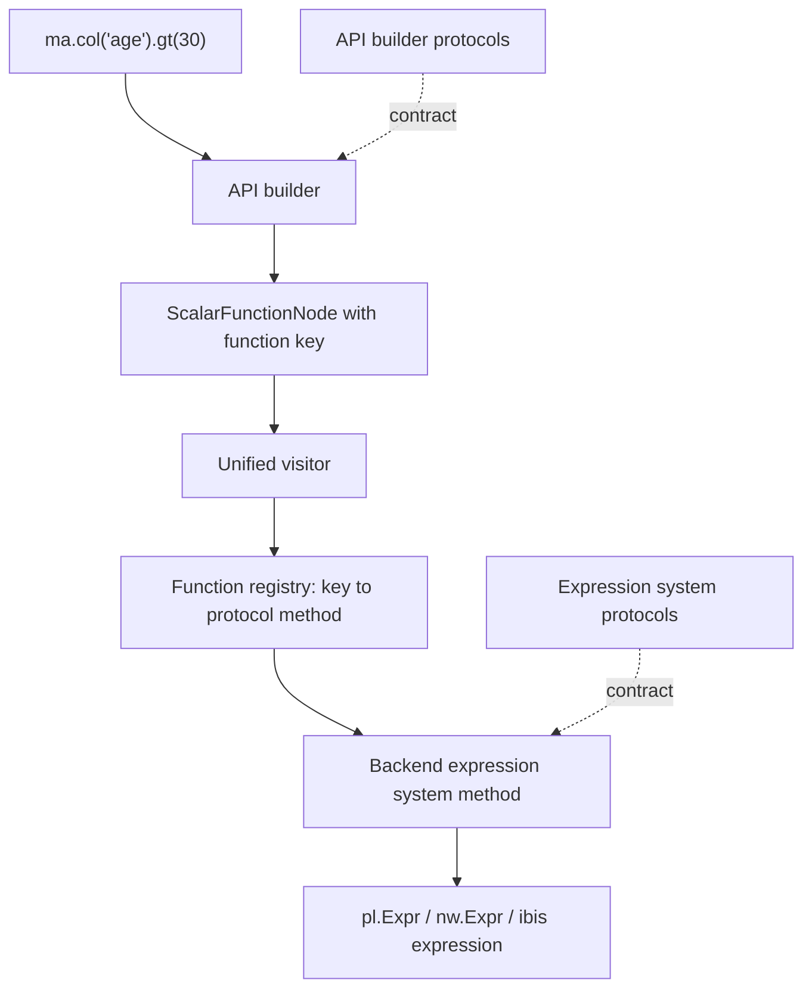

# Architecture

mountainash is built in three layers. Protocols state what each operation looks like, API builders turn user calls into backend-free AST nodes, and backend expression systems turn those nodes into Polars, Narwhals or Ibis code. Between the builders and the backends sit the pieces that connect them: function keys that name each operation, a registry that binds each key to a protocol method, and one visitor that walks the tree. Expressions and relations follow the same layering.

Assumes: [What mountainash does](../01-what-mountainash-does/index.md) and [Building expressions](../04-building-expressions/index.md).

## Three-layer separation

<!-- concept:490 -->

[Build then compile](../01-what-mountainash-does/index.md#lazy-plans-and-the-ast) splits the user's view into two phases. Inside the package, the same split becomes three layers, each with one job and one kind of knowledge:

| Layer | Location (expressions) | Responsibility | Knows about |
|---|---|---|---|
| Protocol | `expressions/core/expression_protocols/` | Declares the methods each builder and each backend must provide | The generic `ExpressionT` type only |
| API builder | `expressions/core/expression_api/` | Turns a Polars-style call into AST nodes | Nodes and function keys only |
| Backend | `expressions/backends/expression_systems/` | Turns nodes into native expressions | One backend's native types |

The AST, the function keys, the function registry and the visitor live in `expressions/core/` beside the builders. They belong to no backend: the keys and registry are in `expression_system/`, the node classes in `expression_nodes/`, the visitor in `unified_visitor/`. [How expressions compile](../18-expression-compilation/index.md) covers each of them.



One call shows all three layers at work. The builder that supplies `.gt()` produces a node; the registry binds the node's function key to a protocol method; each backend has a class that implements that method:

```python
import mountainash as ma
from mountainash.core.constants import CONST_BACKEND
from mountainash.expressions.core.expression_api.boolean import BooleanExpressionAPI
from mountainash.expressions.core.expression_system.expsys_base import get_expression_system
from mountainash.expressions.core.expression_system.function_mapping import FunctionRegistry

expr = ma.col("age").gt(30)

builder = next(ns for ns in BooleanExpressionAPI._FLAT_NAMESPACES if hasattr(ns, "gt"))
print("builder: ", builder.__name__)
print("node:    ", expr.node.function_key)
protocol_method = FunctionRegistry.get_protocol_method(expr.node.function_key)
print("contract:", protocol_method.__qualname__)
for backend in (CONST_BACKEND.POLARS, CONST_BACKEND.NARWHALS, CONST_BACKEND.IBIS):
    system = get_expression_system(backend)
    owner = next(cls for cls in system.__mro__ if "gt" in vars(cls))
    print(f"{backend.value:9}", system.__name__, "->", owner.__name__)
```

```text
builder:  SubstraitScalarComparisonAPIBuilder
node:     FKEY_SUBSTRAIT_SCALAR_COMPARISON.GT
contract: SubstraitScalarComparisonExpressionSystemProtocol.gt
polars    PolarsExpressionSystem -> SubstraitPolarsScalarComparisonExpressionSystem
narwhals  NarwhalsExpressionSystem -> SubstraitNarwhalsScalarComparisonExpressionSystem
ibis      IbisExpressionSystem -> SubstraitIbisScalarComparisonExpressionSystem
```

The dependencies run one way. Builders never import Polars, Ibis or Narwhals and never produce native objects; they only build nodes. Protocols never name a backend type. Backends never call a builder, and never see the Polars-style call the user made: they read the Substrait-aligned node. That last rule is what lets the public surface follow Polars while the AST follows [Substrait](../01-what-mountainash-does/index.md#lazy-plans-and-the-ast). The API builder is the single place where one vocabulary is translated into the other, so `.ge()` and `.gte()` reach the backend as the same comparison node, and Polars-style parameters such as `.rank(method="dense", descending=True)` arrive as a Substrait-aligned window function node with a window specification.

The layering explains where a change goes. A new backend implements the backend layer and touches nothing above it. A new operation touches every layer, in a fixed order: function key, protocol method, builder method, registry entry, then one implementation per backend, with tests. Each link is checked by the contract tests described in [Protocols as contracts](#protocols-as-contracts), and [Adding an expression operation](../22-extending-mountainash/index.md#adding-an-expression-operation) walks through it.

### Where the code lives

Expressions and relations mirror the same layering. Within the expression layers, every directory splits into `substrait/` and `extensions_mountainash/`, so an operation's provenance is visible in its path:

```text
src/mountainash/
├── expressions/
│   ├── core/
│   │   ├── expression_protocols/
│   │   │   ├── api_builders/{substrait,extensions_mountainash}/        # builder contracts
│   │   │   └── expression_systems/{substrait,extensions_mountainash}/  # backend contracts
│   │   ├── expression_api/          # BooleanExpressionAPI, entrypoints, api_builders/
│   │   ├── expression_nodes/        # AST node classes
│   │   ├── expression_system/       # function_keys/, function_mapping/ (registry), expsys_base.py
│   │   └── unified_visitor/         # UnifiedExpressionVisitor, TypeContext
│   └── backends/
│       ├── expression_systems/{polars,narwhals,ibis}/{substrait,extensions_mountainash}/
│       └── capabilities/            # capability declarations per family and dialect
└── relations/
    ├── core/
    │   ├── relation_protocols/      # relation system contracts
    │   ├── relation_api/            # Relation, GroupedRelation
    │   ├── relation_nodes/          # relation AST nodes
    │   ├── relation_system/         # relation operation keys and mapping
    │   └── unified_visitor/         # UnifiedRelationVisitor, visit registry
    └── backends/relation_systems/{polars,narwhals,ibis}/
```

File and class prefixes (`prtcl_`, `api_bldr_`, `expsys_`, `exn_`, `ext_ma_`, the backend infixes) are explained in [Naming and import conventions](../23-contributing-and-testing/index.md#naming-and-import-conventions). The relation layers are covered in [How relations compile](../19-relation-compilation/index.md).

## Protocols as contracts

<!-- concept:491 -->

A protocol is a `typing.Protocol` class that lists the methods one operation domain requires, with their exact signatures. It is the source of truth for what a backend must implement: a method in the protocol must exist on every backend, and a backend must not add operations the protocol does not declare. There are two families of protocols, one per consuming layer:

- `expression_protocols/expression_systems/` declares what each backend expression system implements, one protocol per domain (`SubstraitScalarComparisonExpressionSystemProtocol`, `MountainAshNullExpressionSystemProtocol` and so on).
- `expression_protocols/api_builders/` declares what each fluent builder provides to users.

Expression system protocols are generic over `ExpressionT`. Each backend class inherits the protocol and binds `ExpressionT` to its native type. Polars and Narwhals bind one type everywhere; Ibis binds the narrowest Ibis type that carries the methods the domain needs (numeric values for arithmetic, general values for comparison and strings, column types for aggregates). The signatures show the binding:

```python
import inspect

from mountainash.expressions.core.expression_protocols.expression_systems.substrait.prtcl_expsys_scalar_comparison import (
    SubstraitScalarComparisonExpressionSystemProtocol as Comparison,
)

print(inspect.signature(Comparison.gt))
for backend in (CONST_BACKEND.POLARS, CONST_BACKEND.NARWHALS, CONST_BACKEND.IBIS):
    owner = next(cls for cls in get_expression_system(backend).__mro__ if "gt" in vars(cls))
    print(backend.value, inspect.signature(owner.gt))
```

```text
(self, x: 'ExpressionT', y: 'ExpressionT', /) -> 'ExpressionT'
polars (self, x: 'PolarsExpr', y: 'PolarsExpr', /) -> 'PolarsExpr'
narwhals (self, x: 'NarwhalsExpr', y: 'NarwhalsExpr', /) -> 'NarwhalsExpr'
ibis (self, x: 'IbisValueExpr', y: 'IbisValueExpr', /) -> 'IbisValueExpr'
```

Parameter types also carry meaning. A parameter typed `ExpressionT` is an argument that may be any expression; a parameter with a concrete Python type is an option that is always a raw value. [Arguments and options](../18-expression-compilation/index.md#expression-ast-nodes) explains the two channels.

The contract is checked mechanically. The same check the test suite performs can be run by hand: every method of the protocol must be implemented by a class other than the protocol itself in each composed backend.

```python
required = [name for name, value in vars(Comparison).items()
            if inspect.isfunction(value) and not name.startswith("_")]
for backend in (CONST_BACKEND.POLARS, CONST_BACKEND.NARWHALS, CONST_BACKEND.IBIS):
    system = get_expression_system(backend)
    missing = [name for name in required
               if next(cls for cls in system.__mro__ if name in vars(cls)) is Comparison]
    print(backend.value, Comparison in system.__mro__, missing)

dispatched = {
    FunctionRegistry.get_protocol_method(key).__name__
    for key in FunctionRegistry.list_all()
    if FunctionRegistry.get_protocol_method(key) is not None
    and FunctionRegistry.get_protocol_method(key).__qualname__.startswith(Comparison.__name__)
}
print([name for name in required if name not in dispatched])
```

```text
polars True []
narwhals True []
ibis True []
['is_not_distinct_from', 'is_distinct_from']
```

Every backend inherits the comparison protocol and implements all of it. The last line shows the other half of the wiring: two protocol methods have no function key and no registry entry, so no builder can reach them. They are aspirational: declared because Substrait defines them, implemented in the backends, but not yet dispatched.

### The wiring matrix

An operation is complete only when it is wired through every layer: a function key, a protocol method, a builder method, a registry entry, and an implementation in each of the three backends. A gap at any point fails quietly or late. A key without a registry entry cannot be compiled; a protocol method missing from one backend raises `AttributeError` on that backend only. The tests in `tests/core/` close these gaps:

| Test module | What it checks |
|---|---|
| `test_protocol_alignment.py` | Every protocol method is implemented on every backend and builder, implementations add no unprotocolled methods, and parameter names match. `TestWiringAudit` checks each protocol method against the registry and all three backends; `test_no_orphan_enums` rejects function keys without a protocol method. |
| `test_protocol_completeness.py` | Every builder and backend category has its protocol file and inherits its protocol. |
| `test_signature_conformance.py` | Backend signatures match protocol signatures, and registered options exist on the protocol and can be passed by keyword. |
| `test_mro_method_collisions.py` | No method name that the registry dispatches is declared on two different protocols. The visitor finds backend methods by bare name, so such a collision would send one operation to another's implementation. |

Aspirational methods are listed in `KNOWN_ASPIRATIONAL` in `test_protocol_alignment.py`, each with a reason and a date, and are tested with strict expected-failure markers. Wiring one fully makes its marker pass unexpectedly, which fails the run until the entry is removed. A contributor runs the module directly:

```bash
hatch run test:test-target-quick tests/core/test_protocol_alignment.py
```

## API builders and expression systems

<!-- concept:492 -->

An API builder is a small class that holds the methods for one operation category and builds nodes for them. The expression object a user holds, `BooleanExpressionAPI` (see [Expression objects](../04-building-expressions/index.md#expression-objects)), defines operator overloads and little else. Its flat methods come from the builder classes listed in its `_FLAT_NAMESPACES` tuple, which `__getattr__` searches in order; its namespaces (`.str`, `.dt`, `.name`, `.struct`, `.list`, `.cat`, `.geo`) are `NamespaceDescriptor` attributes that bind a builder class to the expression on access. Every builder method returns a new expression wrapping a new node, so chains never mutate.

```python
for method in ("gt", "ge", "fill_null", "t_gt", "is_in", "round", "alias"):
    owner = next(ns for ns in BooleanExpressionAPI._FLAT_NAMESPACES if hasattr(ns, method))
    print(f"{method:10}", owner.__name__)
print(type(ma.col("name").str).__name__, [c.__name__ for c in type(ma.col("name").str).__bases__])
```

```text
gt         SubstraitScalarComparisonAPIBuilder
ge         MountainAshScalarComparisonAPIBuilder
fill_null  MountainAshNullAPIBuilder
t_gt       MountainAshScalarTernaryAPIBuilder
is_in      MountainashScalarSetAPIBuilder
round      SubstraitScalarRoundingAPIBuilder
alias      MountainAshNameAPIBuilder
StringAPIBuilder ['MountainAshScalarStringAPIBuilder', 'SubstraitScalarStringAPIBuilder']
```

Substrait builders carry only the canonical Substrait names (`gt`, `gte`). Short and Polars-style aliases such as `ge` live in the matching extension builder and build the same node. A namespace that draws on both domains, such as `.str`, is a combined class inheriting the extension and Substrait builders. Builders also validate options at call time: `round(decimals=...)` raises `TypeError` for anything other than a literal `int`, because an option can never be an expression.

<!-- concept:493 -->

An expression system is a backend's implementation of every expression system protocol, composed into one class. Each backend directory holds one mixin class per category, for example `SubstraitPolarsScalarComparisonExpressionSystem` in `polars/substrait/expsys_pl_scalar_comparison.py` and `MountainAshPolarsNullExpressionSystem` in `polars/extensions_mountainash/expsys_pl_ext_ma_null.py`. The backend's `__init__.py` composes the mixins by multiple inheritance into `PolarsExpressionSystem`, `NarwhalsExpressionSystem` or `IbisExpressionSystem` and registers the result with `@register_expression_system(CONST_BACKEND.<FAMILY>)`. All three derive from `BaseExpressionSystem` (`expressions/backends/expression_systems/base.py`), which fixes the constructor, the `backend_type` and `is_native_expression` contract, and the hooks the visitor uses for argument preparation and operand metadata.

There is one expression system per backend family, not per engine. When an expression compiles, [backend detection](../02-installation-and-package-surface/index.md#backend-detection) returns the family and the dialect; the family selects the registered class, and the dialect is passed to the instance:

```python
import ibis
import polars as pl

from mountainash.core.backend_detection import native_identity

people = pl.DataFrame({"age": [25, 40]})
con = ibis.duckdb.connect()
for source in (people, people.to_pandas(), con.create_table("people", people.to_arrow())):
    identity = native_identity(source)
    system = get_expression_system(identity.family)
    print(identity.family.value, identity.dialect, system.__name__)
```

```text
polars polars PolarsExpressionSystem
narwhals narwhals-pandas NarwhalsExpressionSystem
ibis ibis-duckdb IbisExpressionSystem
```

`expr.compile(df)` instantiates the class for each compilation with that dialect and a prepared execution context, then hands it to the visitor. The instance is where engine differences are handled: a method can branch on `self.dialect` (pandas through Narwhals behaves differently from PyArrow through Narwhals), and capability declarations are looked up by family and dialect. Methods return native expressions and nothing else; they never build nodes or call builders.

`expsys_base.py` also defines an abstract `ExpressionSystem` class that inherits the core Substrait protocols. The registry is typed against it, but the three concrete systems derive from `BaseExpressionSystem` and their protocol mixins, not from `ExpressionSystem`. Composition order, registration and per-backend details are in [Composition and registration](../21-backends/index.md#composition-and-registration).
