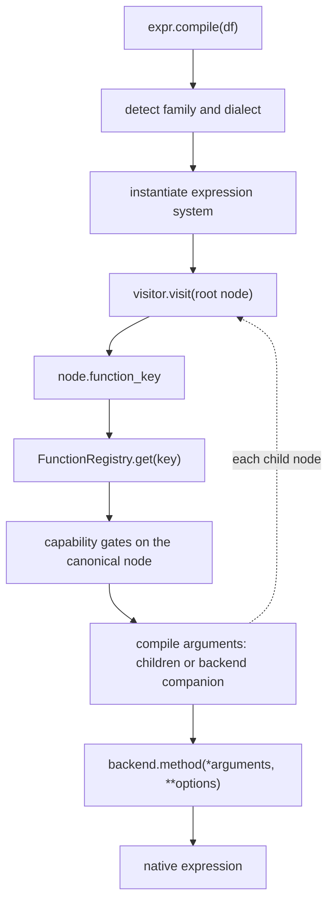

# How expressions compile

One visitor compiles an expression by walking it node by node. Each operation node names its operation with a function key. The visitor looks the key up in the function registry, finds the protocol method bound to it, checks the call against the backend's capability policy, compiles the node's arguments, and calls the method of that name on the backend's expression system with the compiled arguments and the node's raw options. The path has four parts (function keys, the registry, the node types and the visitor), and it compiles every expression inside a relation too.

Assumes: [Architecture](../17-architecture/index.md), [Inspecting an expression](../04-building-expressions/index.md#inspecting-an-expression) and [Compiling an expression](../04-building-expressions/index.md#compiling-an-expression).



## Function keys

<!-- concept:494 -->

A function key is an enum member that identifies one operation, for example `FKEY_SUBSTRAIT_SCALAR_COMPARISON.GT` or `FKEY_MOUNTAINASH_NULL.FILL_NULL`. The key identifies the operation from the moment a builder creates the node, through the registry lookup, to the capability lookup and the backend dispatch. Because keys are enum members, a misspelt operation fails at import, where a misspelt string would slip through to compile time. Walking any expression shows the keys:

```python
import mountainash as ma
from mountainash.expressions.introspect import walk

price = (ma.col("price") * 1.1).round(2).fill_null(0).alias("price_taxed")
for node in walk(price):
    print(f"{type(node).__name__:19}", node.function_key)
```

```text
ScalarFunctionNode  FKEY_MOUNTAINASH_NAME.ALIAS
ScalarFunctionNode  FKEY_MOUNTAINASH_NULL.FILL_NULL
ScalarFunctionNode  FKEY_SUBSTRAIT_SCALAR_ROUNDING.ROUND
ScalarFunctionNode  FKEY_SUBSTRAIT_SCALAR_ARITHMETIC.MULTIPLY
FieldReferenceNode  None
LiteralNode         None
LiteralNode         None
```

Leaves report `None`, because a column reference and a literal are node types in their own right. All keys live in `src/mountainash/expressions/core/expression_system/function_keys/enums.py`, grouped into one enum class per category:

```python
from mountainash.expressions.core.expression_system.function_keys import enums

names = sorted(name for name in dir(enums) if name.startswith("FKEY_"))
for prefix in ("FKEY_SUBSTRAIT_", "FKEY_MOUNTAINASH_"):
    print(prefix, ", ".join(name.removeprefix(prefix) for name in names if name.startswith(prefix)))
```

```text
FKEY_SUBSTRAIT_ CAST, CONDITIONAL, FIELD_REFERENCE, LITERAL, SCALAR_AGGREGATE, SCALAR_ARITHMETIC, SCALAR_BOOLEAN, SCALAR_COMPARISON, SCALAR_DATETIME, SCALAR_LOGARITHMIC, SCALAR_ROUNDING, SCALAR_SET, SCALAR_STRING
FKEY_MOUNTAINASH_ NAME, NULL, SCALAR_AGGREGATE, SCALAR_ARITHMETIC, SCALAR_BOOLEAN, SCALAR_CATEGORICAL, SCALAR_COMPARISON, SCALAR_DATETIME, SCALAR_GEOSPATIAL, SCALAR_LIST, SCALAR_SET, SCALAR_STRING, SCALAR_STRUCT, SCALAR_TERNARY, SCALAR_VALUE, WINDOW
```

One class breaks the naming pattern: the Substrait window functions (`row_number`, `rank`, `dense_rank`, `lead`, `lag` and the others) are keyed by `SUBSTRAIT_ARITHMETIC_WINDOW`, without the `FKEY_` prefix, and the module defines no `__all__`, so that class and `FKEY_MOUNTAINASH_WINDOW` must be imported by name. Member values are an arbitrary mix of `auto()` integers and strings; compare the members themselves. The module also defines the frozensets `MOUNTAINASH_TERNARY_TERMINAL` and `MOUNTAINASH_TERNARY_NON_TERMINAL` that drive [booleanization](../06-ternary-logic/index.md#booleanization), and the `SubstraitFunction` and `MountainashFunction` unions over the key classes.

<!-- concept:495 -->

The prefix records provenance. `FKEY_SUBSTRAIT_*` keys name operations that the [Substrait](../01-what-mountainash-does/index.md#lazy-plans-and-the-ast) function extensions define; `FKEY_MOUNTAINASH_*` keys name operations outside Substrait, such as ternary logic, `fill_null` or column naming. Every layer keeps the split: in the key class, in the registry entry, in the `substrait/` and `extensions_mountainash/` directories of protocols, builders and backends, and in the `ext_ma_` file infix. The registry entry states it explicitly:

```python
from mountainash.expressions.core.expression_system.function_keys.enums import (
    FKEY_MOUNTAINASH_NULL,
    FKEY_SUBSTRAIT_SCALAR_COMPARISON,
)
from mountainash.expressions.core.expression_system.function_mapping import FunctionRegistry

for key in (FKEY_SUBSTRAIT_SCALAR_COMPARISON.GT, FKEY_MOUNTAINASH_NULL.FILL_NULL):
    definition = FunctionRegistry.get(key)
    print(key, definition.is_extension, definition.substrait_name, definition.substrait_uri)
```

```text
FKEY_SUBSTRAIT_SCALAR_COMPARISON.GT False gt https://github.com/substrait-io/substrait/blob/main/extensions/functions_comparison.yaml
FKEY_MOUNTAINASH_NULL.FILL_NULL True fill_null file://extensions/functions_null.yaml
```

Substrait operations point at the official Substrait extension files; extensions use `file://extensions/...` URIs. Custom operations always take a Mountainash key. When Substrait adopts an extension, the operation moves to a Substrait key, Substrait directories and the official URI.

## The function registry

<!-- concept:496 -->

The function registry, `ExpressionFunctionRegistry` in `expression_system/function_mapping/registry.py` (imported as `FunctionRegistry` from `mountainash.expressions.core.expression_system.function_mapping`), maps every function key to an `ExpressionFunctionDef`. It is a class-level dictionary filled on the first lookup by `register_all_functions()`, which reads the definitions in `function_mapping/definitions.py`. The visitor reads operations from the registry alone, so adding an operation takes a registry entry and leaves the visitor unchanged. An entry holds:

| Field | Meaning |
|---|---|
| `function_key` | The key the entry is registered under |
| `substrait_uri`, `substrait_name`, `is_extension` | Provenance and the Substrait function name |
| `protocol_method` | The protocol method the key dispatches to; its `__name__` is the backend method name |
| `options` | Names of the option parameters the operation accepts |
| `result_type`, `type_arguments` | Result-type rule and the operands whose types must be resolved; see [operand type resolution](#the-unified-expression-visitor) |
| `projection_rule` | How the output column is named and how many rows it produces (see [Output names](../04-building-expressions/index.md#output-names)) |
| `lowering` | Whether a compiled result may be reused within one compilation (see [Compilation reuse](../09-execution-targets-and-capabilities/index.md#compilation-reuse)) |

A lookup shows what a key maps to on each backend. `str.contains` is keyed `CONTAINS`, bound to the string protocol's `contains`, takes one option, names its output after its first operand, and is implemented by one string mixin per backend:

```python
from mountainash.core.constants import CONST_BACKEND
from mountainash.expressions.core.expression_system.expsys_base import get_expression_system

key = ma.col("name").str.contains("an").node.function_key
definition = FunctionRegistry.get(key)
print(key)
print(definition.protocol_method.__qualname__)
print(definition.options, definition.projection_rule.name_kind)
method = definition.protocol_method.__name__
for backend in (CONST_BACKEND.POLARS, CONST_BACKEND.NARWHALS, CONST_BACKEND.IBIS):
    owner = next(cls for cls in get_expression_system(backend).__mro__ if method in vars(cls))
    print(f"{backend.value:9}", f"{owner.__module__.rsplit('.', 1)[-1]}.{owner.__name__}.{method}")
```

```text
FKEY_SUBSTRAIT_SCALAR_STRING.CONTAINS
SubstraitScalarStringExpressionSystemProtocol.contains
('case_sensitivity',) operand
polars    expsys_pl_scalar_string.SubstraitPolarsScalarStringExpressionSystem.contains
narwhals  expsys_nw_scalar_string.SubstraitNarwhalsScalarStringExpressionSystem.contains
ibis      expsys_ib_scalar_string.SubstraitIbisScalarStringExpressionSystem.contains
```

Dispatch uses the protocol method's bare name, independent of the key's value and of the public method name: `.ge()` and `.gte()` both reach `gte`, and the public `case_sensitive=` flag becomes the `case_sensitivity` option. Because the name is the link, each dispatched name belongs to exactly one protocol, a rule `tests/core/test_mro_method_collisions.py` enforces. Other lookups are `get_protocol_method`, `get_method_signature`, `get_substrait_name`, `get_substrait_uri`, `is_extension` and `list_all`; `get()` raises `KeyError` for an unregistered key. The entries also feed the projection naming rules, the capability registry and the coverage report in [Backend support and limits](../16-backend-support-and-limits/index.md#support-matrix).

<!-- concept:506 -->

Other registries in the package share one primitive, `KeyedRegistry` in `mountainash.core.registries`: a dictionary with decorator registration, an optional lazy initialiser, an optional validator and a duplicate-key check. The expression system registry behind `@register_expression_system` is one, keyed by family name; the relation system registry, the relation visit-handler registry, the optimisation-pass registry and the typespec schema adapter registries are the others. The function registry stands apart: it keeps its own class-level dictionary keyed by enum member. The primitive behaves the same for any key and value:

```python
from mountainash.core.registries import KeyedRegistry
from mountainash.expressions.core.expression_system.expsys_base import _expression_system_registry

print(_expression_system_registry.list_keys())

formatters = KeyedRegistry("formatter")

@formatters.decorator("upper")
def shout(text):
    return text.upper()

print(formatters.get("upper")("quiet"))
try:
    formatters.register("upper", str.lower)
except ValueError as exc:
    print(exc)
try:
    formatters.get("title")
except KeyError as exc:
    print(exc)
```

```text
['polars', 'narwhals', 'ibis']
QUIET
formatter already registered for key 'upper'
"No formatter registered for key 'title'. Available: ['upper']"
```

`multi=True` collects several values per key in registration order (the optimisation-pass registry uses this), and `reset()` clears a registry and re-arms its initialiser for tests. [Composition and registration](../21-backends/index.md#composition-and-registration) covers registering backends.

## Expression AST nodes

<!-- concept:497 -->

Expression nodes are frozen Pydantic models in `src/mountainash/expressions/core/expression_nodes/`. They hold data and one method, `accept(visitor)`, which calls the visitor method for their type. Compilation logic and backend objects stay in the visitor and the backends. Builders create nodes, the visitor reads them, and because they are immutable several expressions can share a subtree. The set is small because each new scalar operation is a new function key on `ScalarFunctionNode`:

| Node | Built by | Fields |
|---|---|---|
| `FieldReferenceNode` | `ma.col`, `ma.t_col` | `field`, `unknown_values` (ternary sentinels) |
| `LiteralNode` | `ma.lit`, plain Python values | `value`, `dtype`, `is_native` (a native expression passed through) |
| `ScalarFunctionNode` | almost every method and operator | `function_key`, `arguments`, `options`, `diagnostic_context` |
| `IfThenNode` | `ma.when(...).then(...).otherwise(...)` | `conditions` (pairs), `else_clause` |
| `CastNode` | `.cast()` | `input`, `target_type`, `failure_behavior` |
| `WindowFunctionNode` | `rank`, `row_number`, `lead`, `lag` and other window functions | `function_key`, `arguments`, `window_spec`, `options` |
| `OverNode` | `.over()` on any other expression | `expression`, `window_spec` |
| `SingularOrListNode` | not produced by the current builders | `value`, `options` |

`OverNode` is the one Mountainash extension node (in `mountainash_extensions/`); the rest are Substrait-aligned (in `substrait/`). The visitor compiles `IfThenNode` and `CastNode` through the registry entries for `FKEY_SUBSTRAIT_CONDITIONAL.IF_THEN_ELSE` and `FKEY_SUBSTRAIT_CAST.CAST`, so the gates and dispatch treat them like any function, even though neither node carries a key of its own. A window function written in Polars style becomes a `WindowFunctionNode` carrying its own window specification, while `.over()` on an aggregate wraps it in an `OverNode`:

```python
label = (
    ma.when(ma.col("score").cast("fp64") > 50).then(ma.lit("pass")).otherwise(ma.lit("fail"))
)
ranked = ma.col("score").rank(method="dense", descending=True).over("team")
running = ma.col("score").sum().over("team")
for expr in (label, ranked, running):
    print([type(node).__name__ for node in walk(expr)])
```

```text
['IfThenNode', 'ScalarFunctionNode', 'CastNode', 'FieldReferenceNode', 'LiteralNode', 'LiteralNode', 'LiteralNode']
['WindowFunctionNode', 'FieldReferenceNode']
['OverNode', 'ScalarFunctionNode', 'FieldReferenceNode', 'FieldReferenceNode']
```

Set membership compiles through a `ScalarFunctionNode`. `.is_in([1, 2])` builds one keyed `FKEY_MOUNTAINASH_SCALAR_SET.IS_IN` whose second argument is a `COLLECT_VALUES` node holding the literals ([Membership](../05-namespaces-aggregates-and-windows/index.md#membership) describes the public behaviour). The visitor keeps a `visit_singular_or_list` method for `SingularOrListNode`, which the current builders leave unused. Nodes also define `to_substrait()` and `from_substrait()`; both raise `NotImplementedError`, because mountainash does not serialise Substrait plans.

<!-- concept:498 -->

`ScalarFunctionNode` and `WindowFunctionNode` have two parameter channels. `arguments` holds nodes, which the visitor compiles into native expressions before the backend sees them. `options` holds raw Python values, which reach the backend method unchanged as keyword arguments. The rule: a parameter that any backend accepts as a column or computed expression is an argument; a parameter that every backend needs as a literal is an option. Search patterns, `fill_null` values and datetime offsets are arguments. Units, formats, flags, rounding precision and column names are options:

```python
for expr in (
    ma.col("name").str.contains(ma.col("pattern")),
    ma.col("name").str.contains("an", case_sensitive=False),
    ma.col("joined").dt.truncate("1mo"),
    ma.col("score").round(2),
):
    node = expr.node
    print(node.function_key.name, [type(arg).__name__ for arg in node.arguments], node.options)
```

```text
CONTAINS ['FieldReferenceNode', 'FieldReferenceNode'] {'case_sensitivity': 'CASE_SENSITIVE'}
CONTAINS ['FieldReferenceNode', 'LiteralNode'] {'case_sensitivity': 'CASE_INSENSITIVE'}
TRUNCATE ['FieldReferenceNode'] {'unit': '1mo'}
ROUND ['FieldReferenceNode'] {'s': 2}
```

Option names follow the protocol: `round(2)` stores Substrait's `s`. Builders raise `TypeError` at build time when an option receives an expression. When a parameter is an argument but one engine accepts only a literal there, the backend's own argument preparation takes the literal's raw value and raises `BackendCapabilityError` for anything else; it uses the value the caller wrote and never substitutes a default. pandas through Narwhals searches only for literal patterns:

```python
import polars as pl

from mountainash.exceptions import BackendCapabilityError

names_pl = pl.DataFrame({"name": ["anna", "bob"], "pattern": ["nn", "x"]})
search = ma.col("name").str.contains(ma.col("pattern")).alias("hit")
print(ma.relation(names_pl).select(search).to_dict())
try:
    ma.relation(names_pl.to_pandas()).select(search).to_dict()
except BackendCapabilityError as exc:
    print(exc)
print(ma.relation(names_pl.to_pandas()).select(ma.col("name").str.contains("nn").alias("hit")).to_dict())
```

```text
{'hit': [True, False]}
[narwhals] Narwhals pandas search substrings must be literals
{'hit': [True, False]}
```

!!! warning "Backend limit"
    On pandas through Narwhals, `str.contains`, `str.starts_with` and `str.ends_with` need a literal search string (argument preparation in `expressions/backends/expression_systems/narwhals/substrait/expsys_nw_scalar_string.py`). A column or computed pattern raises `BackendCapabilityError`. The refusal belongs to the backend operation itself, outside the capability declarations, so it stays in force under any `ma.capability_policy(...)`. See [Backend support and limits](../16-backend-support-and-limits/index.md).

## The unified expression visitor

<!-- concept:499 -->

`UnifiedExpressionVisitor` (`src/mountainash/expressions/core/unified_visitor/visitor.py`) compiles every node type with one class. `expr.compile(df)` detects the backend, builds an execution context, instantiates the family's expression system with the dialect, and calls `visitor.visit(root)`. Each node's `accept()` calls back `visit_literal`, `visit_field_reference`, `visit_scalar_function`, `visit_if_then`, `visit_cast`, `visit_singular_or_list`, `visit_window_function` or `visit_over`. Leaves map to the backend's `lit` and `col`. For a `ScalarFunctionNode`, `visit_scalar_function` performs these steps in order:

1. Look up the key in the function registry and take the protocol method's name.
2. Check the call against the capability gates for the backend family and dialect: first whole-call predicates on the raw arguments, then the operation itself.
3. Resolve any operand types the operation or a capability rule needs.
4. Check each argument against its parameter's gate, which refuses an unsupported parameter or a literal-only parameter given a computed expression. Then compile the arguments: through the backend's argument-preparation companion (`_prepare_call_<method>`, reached via `prepare_call_arguments`) when it defines one, otherwise by visiting each child node.
5. Re-check predicates that depend on resolved operand types, then check the options against their gates.
6. Call `getattr(backend, method_name)(*arguments, **options)` and return the native result.

The visitor works from nodes alone. A node built by hand compiles on every backend, and a key with no registry entry fails at step 1:

```python
import enum

import ibis

from mountainash.expressions.core.expression_api.boolean import BooleanExpressionAPI
from mountainash.expressions.core.expression_nodes import (
    FieldReferenceNode,
    LiteralNode,
    ScalarFunctionNode,
)

node = ScalarFunctionNode(
    function_key=FKEY_SUBSTRAIT_SCALAR_COMPARISON.GT,
    arguments=[FieldReferenceNode(field="score"), LiteralNode(value=50)],
)
scores = pl.DataFrame({"score": [40, 70]})
con = ibis.duckdb.connect()
print(BooleanExpressionAPI.create(node).compile(scores))
print(BooleanExpressionAPI.create(node).compile(con.create_table("scores", scores.to_arrow())))

class LocalKey(enum.Enum):
    SHOUT = "shout"

unknown = ScalarFunctionNode(function_key=LocalKey.SHOUT, arguments=[FieldReferenceNode(field="score")])
try:
    BooleanExpressionAPI.create(unknown).compile(scores)
except KeyError as exc:
    print(exc.args[0].split(". Available")[0])
```

```text
[(col("score")) > (dyn int: 50)]
(_['score'] > <scalar[int8]>)
Unknown function: LocalKey.SHOUT
```

The relation visitor uses the same class for every expression embedded in a relation, binding each to the native input it applies to ([The unified relation visitor](../19-relation-compilation/index.md#the-unified-relation-visitor)). Within one input scope the visitor caches each node's compiled result by identity, except where the operation's lowering declaration forbids reuse (host-clock values such as `now()`, native expressions passed through). `function_mapping/lowering.py` attaches those declarations; they govern reuse of compiled results and leave the AST as built.

<!-- concept:500 -->

Some operations need to know their operands' types before they can be lowered, for example `value_kind()`, which returns the kind of each value. A registry entry declares this with `type_arguments` (the protocol parameters whose types must be known) and `result_type`; capability rules can request operand types too. The visitor resolves them through its `TypeContext` (`unified_visitor/type_context.py`) from the native input's schema metadata alone: column types come from the frame or table schema, literal types from the value, cast results from the target type. Resolution reads zero rows, and the AST stays schema-free. The backend method then lowers with the type known, so the compiled expression differs by column type. When metadata leaves a type unresolved, compilation stops with `BackendCapabilityError`:

```python
from mountainash.expressions.core.expression_system.function_keys.enums import FKEY_MOUNTAINASH_SCALAR_VALUE

definition = FunctionRegistry.get(FKEY_MOUNTAINASH_SCALAR_VALUE.VALUE_KIND)
print(definition.type_arguments, definition.result_type)

mixed = pl.DataFrame({"n": [1, None], "s": ["a", None]})
print(ma.col("n").value_kind().compile(mixed))
print(ma.col("s").value_kind().compile(mixed))
for source, expr in (
    (mixed.to_pandas(), (ma.col("n") + 1).value_kind()),
    (mixed, ma.col("missing").value_kind()),
):
    try:
        expr.compile(source)
    except BackendCapabilityError as exc:
        print(exc)
```

```text
('x',) FixedResultType(logical_kind='text', nullable=False)
.when(col("n").is_null()).then("absent").otherwise("integer")
.when(col("s").is_null()).then("absent").otherwise("text")
[narwhals] operand metadata is unresolved for computed Narwhals-Pandas expression
[polars] operand metadata is unresolved: field 'missing' is absent
```

Polars infers the type of a computed expression from its schema, so `(ma.col("n") + 1).value_kind()` compiles there; Narwhals over pandas lacks that inference, so compilation raises. Backend methods read resolved types through `operand_type(name)` on the expression system during the call.

<!-- concept:501 -->

Gate then lower is the ordering rule for operations that some backends lack natively: the AST keeps the canonical operation node, the capability gate inspects that node, and lowering into primitives follows once the gate passes. The gate, introspection and Substrait identity all attach to that canonical node. A builder that expanded the operation into other operations would remove that node, and a refused call would then report an error about an inner operation the user never wrote. The visitor implements the first half: every gate in the steps above runs on the node the builder created, before argument preparation and before the backend method runs. Lowering into primitives happens inside the backend method, after the gate, as native code with the AST left intact, so the canonical node's gate is the only check those primitives pass. A backend-independent lowering registry, which would rewrite a gated node into other nodes and revisit them, is a proposed design outside the current package. [Gates and preflight](../20-capability-spine/index.md#gates-and-preflight) covers what the gates check, how declarations become policies, and how `capability_policy` turns them on and off.
