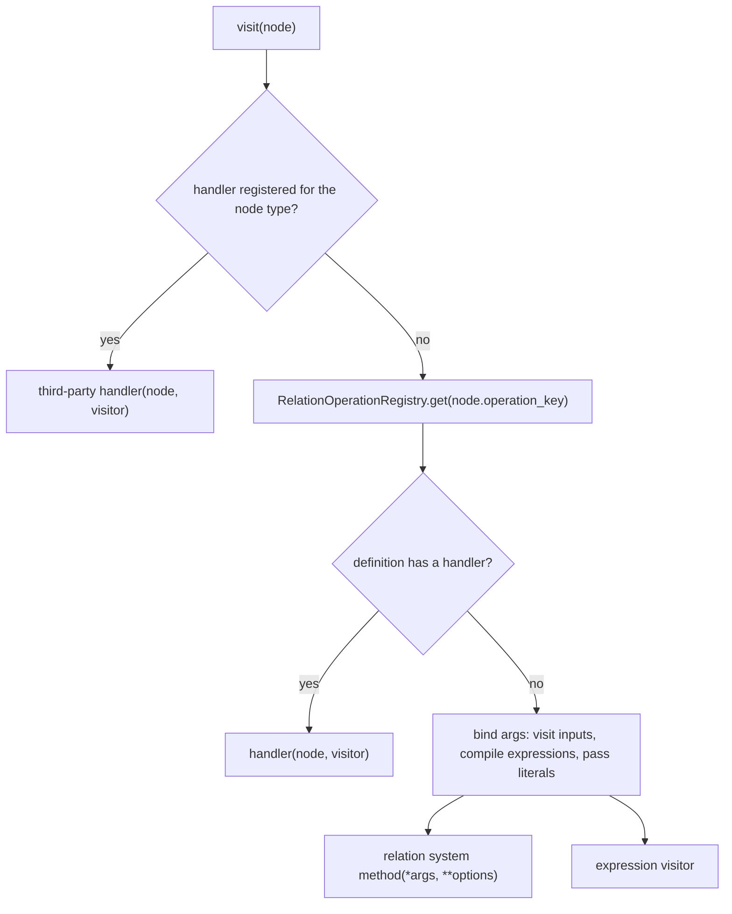

# How relations compile

A relation compiles by walking its tree of relation nodes with the unified relation visitor. For each node the visitor looks up the node's operation key in the relation operation registry, calls the matching method on the relation system for the execution location, and hands every embedded expression to the expression visitor. Maintainers reach for this path when they add a relational operation, change how a backend executes one, or debug a plan that compiles differently on two engines.

Assumes: [Architecture](../17-architecture/index.md), [How expressions compile](../18-expression-compilation/index.md), [Relations](../07-relations/index.md) and [Execution targets and backend capabilities](../09-execution-targets-and-capabilities/index.md).

## Relation AST nodes

<!-- concept:502 -->

Every relation method returns a new `Relation` whose `_node` is one more node on top of the previous tree. Nodes are Pydantic models defined under `src/mountainash/relations/core/relation_nodes/`. They hold plain data. The visitor does the compiling, and native backend expressions appear only when it runs. Each node reports its structural children through `children()`, which reads the `input`, `left`, `right` and `inputs` fields, and its dispatch key through `operation_key`.

```python
import polars as pl

import mountainash as ma

orders = pl.DataFrame({
    "order_id": [1, 2, 3, 4],
    "customer_id": [10, 20, 10, None],
    "amount": [25.0, 40.0, 15.5, 60.0],
})
plan = (
    ma.relation(orders)
    .drop_nulls(subset=["customer_id"])
    .filter(ma.col("amount") > 20)
    .select("order_id", "amount")
    .sort("amount", descending=True)
    .head(2)
)


def show(node, depth=0):
    print("  " * depth + type(node).__name__, node.operation_key.name)
    for child in node.children():
        show(child, depth + 1)


show(plan._node)
```

```text
FetchRelNode FETCH
  SortRelNode SORT
    ProjectRelNode PROJECT_SELECT
      FilterRelNode FILTER
        ExtensionRelNode DROP_NULLS
          ReadRelNode READ
```

Embedded expressions stay as mountainash expression objects until compile time, and extension options are stored as plain values:

```python
filter_node = plan._node.input.input.input
print(type(filter_node.predicate).__name__)
print(filter_node.input.operation, filter_node.input.options)
```

```text
BooleanExpressionAPI
RKEY_MOUNTAINASH_REL.DROP_NULLS {'subset': ['customer_id']}
```

### Substrait-aligned nodes

Eight node types in `relation_nodes/substrait/` correspond to Substrait logical relations. Their nodes are frozen.

| Node | Substrait relation | Fields |
|---|---|---|
| `ReadRelNode` | `ReadRel` | `dataframe` (the native source), `structured_field_plans` |
| `ProjectRelNode` | `ProjectRel` | `input`, `expressions`, `operation` (select, with_columns, drop or rename), `rename_mapping` |
| `FilterRelNode` | `FilterRel` | `input`, `predicate` |
| `SortRelNode` | `SortRel` | `input`, `sort_fields` |
| `FetchRelNode` | `FetchRel` | `input`, `offset`, `count`, `from_end` |
| `JoinRelNode` | `JoinRel` | `left`, `right`, `join_type`, `on`, `left_on`, `right_on`, `by`, `suffix`, `coalesce`, `strategy`, `tolerance`, `execute_on` |
| `AggregateRelNode` | `AggregateRel` | `input`, `keys`, `measures` |
| `SetRelNode` | `SetRel` | `inputs`, `set_type`, `timezone` |

One node type can carry more than one operation. `ProjectRelNode` names its operation in a field. The others derive the key from their fields: an `AggregateRelNode` with no measures is `DISTINCT`, a `FetchRelNode` with `from_end` is `FETCH_FROM_END`, an as-of `JoinRelNode` is `JOIN_ASOF`, and a `SetRelNode` is `UNION_ALL` or `UNION_DISTINCT` by its `set_type`. Windows belong to the expression tree: `.over(...)` lives there ([Windows with over](../05-namespaces-aggregates-and-windows/index.md#windows-with-over)).

### Mountainash extension nodes

Five node types in `relation_nodes/extensions_mountainash/` cover operations outside Substrait.

| Node | Fields | Produced by |
|---|---|---|
| `ExtensionRelNode` | `input`, `operation` (a mountainash key), `options` | `drop_nulls`, `drop_nans`, `with_row_index`, `explode`, `sample`, `unpivot`, `pivot`, `top_k`, `unnest` |
| `SourceRelNode` | `data`, `detected_format` | `ma.relation(...)` over Python data ([Relations from Python data](../07-relations/index.md#relations-from-python-data)) |
| `ConformRelNode` | `input`, `spec`, `contract`, `apply_value_transforms` | `Relation.conform(...)` ([Conforming data to a schema](../11-conforming-data/index.md#relation-conform)) |
| `RefRelNode` | `name`, `output_schema` | `dag.ref(...)` ([RelationDAG](../14-relationdag/index.md#building-a-dag)) |
| `ResourceReadRelNode` | `resource`, `apply_schema_conform` | DataPackage resources read through a DAG |

`SourceRelNode`, `RefRelNode` and `ResourceReadRelNode` are leaves, like `ReadRelNode`. A new non-Substrait operation that fits the shape "one input plus options" becomes a new key on `ExtensionRelNode` and reuses that node type; [Adding a relation operation](../22-extending-mountainash/index.md#adding-a-relation-operation) walks through it.

## Relation operation keys and registry

<!-- concept:503 -->

Relation operations are named by two enums in `mountainash.relations.core.relation_system`: `RKEY_SUBSTRAIT_REL` and `RKEY_MOUNTAINASH_REL`. They play the role that [function keys](../18-expression-compilation/index.md#function-keys) play for expressions. A key lives in the namespace of the protocol file that owns its method, so `PROJECT_DROP` and `PROJECT_RENAME` are Substrait-namespace keys even though Substrait lacks a direct message for them.

`RelationOperationRegistry` holds one `RelationOperationDef` per key and fills itself on first use from `relation_mapping/definitions.py`. A definition records:

- the node type it dispatches for, or none for keys that dispatch another way;
- Substrait metadata: `substrait_rel` for a direct mapping, `lowers_to` for a convenience operation that a serializer must lower into another relation, or `is_extension` with an `extension_uri` for mountainash operations, plus `substrait_op` for message-level variants such as `SET_OP_UNION_DISTINCT`;
- `protocol_method`, the relation-system protocol method the operation calls;
- `args`, an ordered tuple of `ArgBinding(field, kind)` that turns node fields into positional arguments;
- `options` and `options_field`, node fields passed as keyword arguments (the whole `options` dict of an `ExtensionRelNode` is spread);
- `handler`, a function that replaces the generic call when an operation needs custom compilation;
- `gate_params`, extra node fields that capability declarations may test (see [The capability spine](../20-capability-spine/index.md#bound-calls-and-value-classes)).

`ArgKind` is the relational counterpart of [arguments and options](../18-expression-compilation/index.md#expression-ast-nodes): `INPUT` and `INPUT_LIST` fields are child relations that the visitor visits, `EXPRESSION` and `EXPRESSION_LIST` fields are compiled by the expression visitor, and `LITERAL` fields pass through unchanged.

```python
from mountainash.relations.core.relation_system import RelationOperationRegistry
from mountainash.relations.core.relation_system.relation_mapping.registry import (
    classify_relation_def,
)

for key in RelationOperationRegistry.list_all():
    op = RelationOperationRegistry.get(key)
    node = op.node_type.__name__ if op.node_type else "-"
    method = op.protocol_method.__name__ if op.protocol_method else "-"
    route = "handler" if op.handler else "bind" if op.node_type else "none"
    print(f"{key.name:20} {node:19} {classify_relation_def(op):9} {method:20} {route}")
```

```text
READ                 ReadRelNode         direct    read                 bind
PROJECT_SELECT       ProjectRelNode      direct    project_select       bind
PROJECT_WITH_COLUMNS ProjectRelNode      direct    project_with_columns bind
PROJECT_DROP         ProjectRelNode      lowered   project_drop         bind
PROJECT_RENAME       ProjectRelNode      lowered   project_rename       bind
FILTER               FilterRelNode       direct    filter               bind
SORT                 SortRelNode         direct    sort                 bind
FETCH                FetchRelNode        direct    fetch                bind
JOIN                 JoinRelNode         direct    join                 handler
AGGREGATE            AggregateRelNode    direct    aggregate            bind
DISTINCT             AggregateRelNode    direct    distinct             bind
UNION_ALL            SetRelNode          direct    union_all            bind
UNION_DISTINCT       SetRelNode          direct    union_distinct       bind
DROP_NULLS           ExtensionRelNode    extension drop_nulls           bind
DROP_NANS            ExtensionRelNode    extension drop_nans            bind
WITH_ROW_INDEX       ExtensionRelNode    extension with_row_index       bind
EXPLODE              ExtensionRelNode    extension explode              bind
SAMPLE               ExtensionRelNode    extension sample               bind
UNPIVOT              ExtensionRelNode    extension unpivot              bind
PIVOT                ExtensionRelNode    extension pivot                bind
TOP_K                ExtensionRelNode    extension top_k                bind
UNNEST               ExtensionRelNode    extension unnest               bind
SOURCE               SourceRelNode       extension -                    handler
REF                  RefRelNode          extension -                    handler
READ_RESOURCE        ResourceReadRelNode extension read_resource        handler
CONFORM              ConformRelNode      extension -                    handler
FETCH_FROM_END       FetchRelNode        extension fetch_from_end       bind
JOIN_ASOF            JoinRelNode         extension join_asof            handler
EMPTY_FRAME          -                   extension empty_frame          none
IMPORT_INTO          -                   extension import_into          none
```

The `classify_relation_def` column is the serialization class: every definition is exactly one of `direct`, `lowered` or `extension`. `EMPTY_FRAME` and `IMPORT_INTO` carry no node type, because the conform path and the operand transport call their protocol methods directly; the rows exist so that the wiring audit covers those methods and capability declarations can name the keys. The six handler rows use functions in `relation_mapping/handlers.py` for work such as transferring the right side of a join, converting Python data, resolving DAG references and running the conform pipeline.

A binding reads directly off a definition:

```python
from mountainash.relations.core.relation_system import RKEY_SUBSTRAIT_REL

op = RelationOperationRegistry.get(RKEY_SUBSTRAIT_REL.AGGREGATE)
print(op.substrait_rel, op.extension_uri)
print([(b.field, b.kind.name) for b in op.args])
```

```text
AggregateRel None
[('input', 'INPUT'), ('keys', 'EXPRESSION_LIST'), ('measures', 'EXPRESSION_LIST')]
```

The registry validates definitions when it is first populated, ahead of any dispatch: a bound field must exist on the node type, the number of positional bindings must match the protocol method's positional parameters, options must be keyword-only parameters of that method, and the serialization class must be exactly one of the three. `ExtensionRelNode` applies the same contract when it is constructed, checking its options against the keyword parameters of the operation's protocol method:

```python
from mountainash.relations.core.relation_nodes import ExtensionRelNode
from mountainash.relations.core.relation_system import RKEY_MOUNTAINASH_REL

try:
    ExtensionRelNode(
        input=filter_node,
        operation=RKEY_MOUNTAINASH_REL.DROP_NULLS,
        options={"columns": ["amount"]},
    )
except ValueError as exc:
    print(exc.errors()[0]["msg"])
```

```text
Value error, DROP_NULLS: unknown option(s) ['columns']; valid options: ['subset']
```

The registry follows the same registration discipline as the expression [function registry](../18-expression-compilation/index.md#the-function-registry): a duplicate key raises `ValueError`, and an unknown key raises `KeyError` listing the registered ones.

## Relation systems

<!-- concept:504 -->

A relation system is the backend layer for relations: one class per backend family whose methods perform each relational operation on native objects. The contract is a set of nine protocols under `src/mountainash/relations/core/relation_protocols/relation_systems/`, one per Substrait relation (read, project, filter, sort, fetch, join, aggregate, set) plus `MountainashExtensionRelationSystemProtocol` for the extension operations. They follow the [protocols as contracts](../17-architecture/index.md#protocols-as-contracts) rule: each protocol method's signature is the one the registry's bindings are validated against. For example, `join(left, right, *, join_type, on, left_on, right_on, suffix)`: relation operands are positional, and node fields that pass through raw are keyword-only.

`RelationSystem` in `relation_protocols/relsys_base.py` composes the nine protocols and adds abstract members every backend needs beyond the operations: `backend_type`, `describe_output_schema` (the output types of a native relation, read from metadata alone), and `infer_row_index_names` and `infer_cross_join_names` (output column order for operations whose native placement differs by engine). Shared behaviour lives in `BaseRelationSystem` (`relations/backends/relation_systems/base.py`). It stores the `dialect` the system was constructed for and supplies a default `describe_output_schema`. The composed backend classes and how they are assembled are described in [Backends](../21-backends/index.md#composition-and-registration).

The visitor takes each method name from the registry definition and resolves it on the system instance for the location being compiled:

```python
from mountainash.core.constants import CONST_BACKEND
from mountainash.relations.core.relation_protocols.relsys_base import get_relation_system

op = RelationOperationRegistry.get(RKEY_SUBSTRAIT_REL.FILTER)
for family, dialect in [
    (CONST_BACKEND.POLARS, "polars"),
    (CONST_BACKEND.NARWHALS, "narwhals-pandas"),
    (CONST_BACKEND.IBIS, "ibis-sqlite"),
]:
    system = get_relation_system(family)(dialect=dialect)
    method = getattr(system, op.protocol_method.__name__)
    print(system.backend_type.value, system.dialect, method.__qualname__)
```

```text
polars polars SubstraitPolarsFilterRelationSystem.filter
narwhals narwhals-pandas SubstraitNarwhalsFilterRelationSystem.filter
ibis ibis-sqlite SubstraitIbisFilterRelationSystem.filter
```

A system is instantiated per execution location with that location's dialect, so a dialect-specific branch inside a backend method reads `self.dialect`. The dialect is a system's only state, and construction must stay cheap: compilation creates one for each distinct location in a plan.

## The unified relation visitor

<!-- concept:505 -->

`UnifiedRelationVisitor` (`src/mountainash/relations/core/unified_visitor/relation_visitor.py`) turns a node tree into a native plan. Each one takes a relation system and a `UnifiedExpressionVisitor` for the same location, and holds the expression visitor as a component.

### From terminal to visitor

A terminal such as `collect()`, `compile()` or `explain()` first applies any registered [optimisation passes](#optimisation-passes), then prepares the whole tree (`relations/core/execution/preparation.py`). Preparation resolves an execution location for every node, records the transfers between locations, preflights the capability gates that the tree alone determines ([Gates and preflight](../20-capability-spine/index.md#gates-and-preflight)), and rejects a phase that would need to execute rows, for example `compile()` on a plan that needs an import first. The phases are `COMPILE`, `SCHEMA`, `EXPLAIN` and `EXECUTE`, which lets `explain()` and schema inference walk the same code and stop short of execution ([Schema inference and resolution](../09-execution-targets-and-capabilities/index.md#schema-inference-and-resolution)). A `CompilationSession` (`relations/core/execution/compilation.py`) then builds one visitor per location, each with `get_relation_system(family)(dialect=...)` and a matching expression system, and visits the root. When a child sits at another location, the session compiles it with that location's visitor and applies the recorded transfer.

### Dispatch



`visit()` is the single dispatch site. It checks `RelationVisitRegistry` first, the type-keyed surface where other packages register handlers for their own node types. Otherwise it reads the node's `operation_key` and fetches the definition. Before calling, it applies the capability gate for the bound call when the execution policy asks for one. A definition with a handler gets the node and the visitor. Otherwise the visitor binds the arguments by `ArgKind` and calls the system method named by `protocol_method`, with option fields as keyword arguments. Every native call runs inside the capability layer's error enrichment, so a native failure that a declaration explains surfaces as `BackendCapabilityError` ([Capability errors and capability_policy](../09-execution-targets-and-capabilities/index.md#capability-errors-and-capability_policy)).

The registry protects built-in node types from override, and compilation raises for a node that has neither a handler nor a key:

```python
from mountainash.relations.core.relation_api.relation import Relation
from mountainash.relations.core.relation_nodes import FilterRelNode, RelationNode
from mountainash.relations.core.unified_visitor import RelationVisitRegistry

try:
    RelationVisitRegistry.register(FilterRelNode, lambda node, visitor: None)
except TypeError as exc:
    print(exc)


class TagRelNode(RelationNode):
    input: RelationNode


try:
    Relation(TagRelNode(input=plan._node)).to_polars()
except Exception as exc:
    print(type(exc).__name__, exc)
```

```text
FilterRelNode is a protected Substrait-aligned node type and cannot be overridden via the registry
UnregisteredRelationNodeError TagRelNode cannot be compiled: it has no registered visit handler and no operation_key. Either register a handler via RelationVisitRegistry.register(TagRelNode, handler) or define _operation_key plus a RelationOperationDef for it.
```

[Custom relation nodes](../22-extending-mountainash/index.md#custom-relation-nodes) covers writing a handler for your own node.

### Composition with the expression visitor

`compile_expression` handles three cases. It hands an expression node to the expression visitor. It extracts the node from a mountainash expression object (such as the `BooleanExpressionAPI` predicate shown earlier) and visits that. It passes a native backend expression through unchanged. While it binds arguments, the visitor scopes the expression visitor to the operation's immediate input, so operand types resolve against the columns that exist at that point in the plan. The [unified expression visitor](../18-expression-compilation/index.md#the-unified-expression-visitor) does the rest. The relation visitor compiles expressions without booleanization, so a ternary expression reaches the backend as its raw integers ([Booleanization](../06-ternary-logic/index.md#booleanization)).

The source alone decides which native plan the same tree compiles to:

```python
import ibis

con = ibis.duckdb.connect()
orders_db = con.create_table("orders", orders.to_arrow())
for source in (orders, orders_db):
    native = ma.relation(source).filter(ma.col("amount") > 20).compile()
    print(type(native).__module__.split(".")[0], type(native).__name__)
```

```text
polars LazyFrame
ibis Table
```

### References and ref_resolver

The visitor takes an optional `ref_resolver`, a callable from a relation name to a native value. The `REF` handler calls it for each `RefRelNode`; `RelationDAG` supplies it so that references resolve to dependencies it has already compiled for the consumer's location ([Collecting a DAG](../14-relationdag/index.md#collecting-a-dag)). All DAG knowledge sits in the resolver. A plain relation over a reference has no resolver, so preparation refuses it:

```python
from mountainash.relations.core.relation_nodes.extensions_mountainash import RefRelNode

try:
    Relation(RefRelNode(name="orders")).to_polars()
except Exception as exc:
    print(type(exc).__name__, exc)
```

```text
RelationDAGRequired Reference 'orders' requires a RelationDAG resolver
```

`RelationDAGRequired` is importable from `mountainash.relations.dag.errors`.

## Optimisation passes

<!-- concept:507 -->

The engines optimise plans (Polars' optimiser, the SQL engine behind Ibis). mountainash provides a registry, empty by default, for passes that other packages contribute, in `src/mountainash/relations/core/relation_api/optimisation_registry.py`:

```python
from mountainash.relations.core.relation_api.optimisation_registry import (
    get_registered_node_types,
)

print(get_registered_node_types())
```

```text
set()
```

`register_optimisation(node_type, transform_fn)` adds a pass; several passes may share a node type, and they run in registration order. Terminals and `explain()` apply the passes before preparation, and only when the tree contains a node of a registered type; other trees skip the walk. The walk is bottom-up: children are rewritten first, and a parent whose children changed is rebuilt with `model_copy`, since built-in nodes are frozen. A transform receives nodes of its registered type, and it also receives every `FilterRelNode`, `ProjectRelNode` and `FetchRelNode` in the tree (`RelationBase._walk_and_push` in `relation_api/relation_base.py`). It must therefore return every node it leaves alone exactly as received. `tests/relations/test_relation_optimisation_walk.py` shows the rebuild behaviour.
