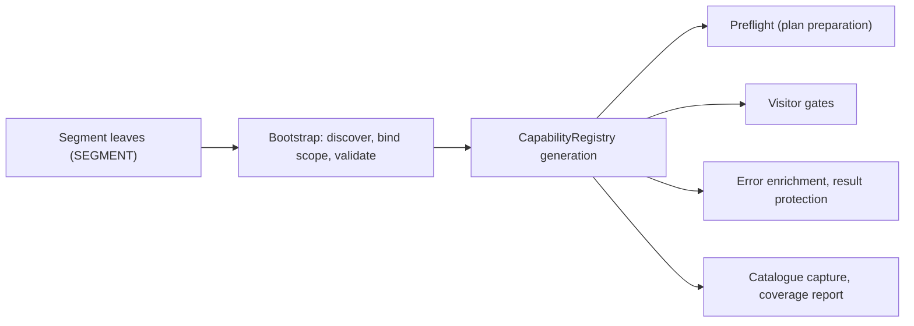

# The capability spine

The capability spine is the subsystem that records what each backend family and dialect can do, and acts on a selected part of that record while a plan is prepared and compiled. Declarations live as data in small segment modules beside the backends. The package loads them into one `CapabilityRegistry`, and the planner and both visitors ask that registry whether a bound call is allowed. Maintainers reach for three things: the segment modules under `expressions/backends/capabilities/` and `relations/backends/capabilities/`, the registry lookups `capability_for` and `violations_for`, and the catalogue views that the generated support page is built from.

Assumes: [Backend capabilities, families and dialects](../09-execution-targets-and-capabilities/index.md#backend-capabilities-families-and-dialects), [The unified expression visitor](../18-expression-compilation/index.md#the-unified-expression-visitor) and [The unified relation visitor](../19-relation-compilation/index.md#the-unified-relation-visitor).

## Information and policy

<!-- concept:510 -->
The spine runs in one direction. Segment leaves declare records; bootstrap discovers the leaves, binds each to its scope and validates it; the registry publishes the result as one immutable generation; consumers read that generation. Preflight checks every reachable occurrence of a relation plan before any source is read, the visitors check each call as it compiles, error enrichment and result protection act during materialization, and catalogue captures feed the coverage report.



The spine never implements an operation. Backend expression and relation systems own native call construction, argument conversion and ordinary validation ([Three-layer separation](../17-architecture/index.md#three-layer-separation)). A missing record means the catalogue says nothing, not that the call is supported, and switching a protection off under `ma.capability_policy` never switches off a backend's own conversion or validation. The user-facing side (the error type, the policy presets and the protection mechanisms) is described in [Capability errors and capability_policy](../09-execution-targets-and-capabilities/index.md#capability-errors-and-capability_policy).

<!-- concept:511 -->
A segment holds two kinds of record with different contracts. `CapabilityInformation` is descriptive: a level (`unsupported`, `literal_only`, `polymorphic`, `expr_capable`) at the `native` layer (what the engine does) or the `public` layer (what mountainash offers), a message, an optional workaround, an optional upstream issue identity and a set of issue kinds. It has no executable consumer, so editing a description can never enable or disable execution. `CapabilityPolicyRule` is executable: it names its consumer (`gate`, `immediate_error`, `materialization_error` or `result_protection`) and its action (`block`, `permit`, `enrich` or `detect_non_null_to_null`), and construction rejects mismatched pairs. A policy may point at the information that explains it; the registry then copies that record's workaround and issue identity onto the published fact, which is where the `Upstream ref:` line of an error comes from.

`CapabilityRegistry.reader(scope)` reads one scope's records. The Narwhals Polars dialect describes two decimal-cast limits but acts on only one of them:

```python
import mountainash as ma
from mountainash.core.capabilities import CapabilityRegistry
from mountainash.core.capabilities.catalogue import InformationQuery, PolicyQuery
from mountainash.core.capabilities.identity import Dialect, Scope
from mountainash.core.constants import CONST_BACKEND
from mountainash.expressions.core.expression_system.function_keys.enums import (
    FKEY_MOUNTAINASH_SCALAR_VALUE,
)

DECIMAL_CAST = FKEY_MOUNTAINASH_SCALAR_VALUE.DECIMAL_CAST
reader = CapabilityRegistry.reader(Scope(CONST_BACKEND.NARWHALS, Dialect("narwhals-polars")))
for record in reader.search(InformationQuery(operation=DECIMAL_CAST)):
    info = record.assertion
    print("information:", info.key.subject, info.layer.value, info.level.value, info.issue)
for record in reader.search(PolicyQuery(operation=DECIMAL_CAST)):
    policy = record.assertion
    print("policy:", policy.key.subject, policy.consumer.value, policy.action.value)
```

```text
information: * native unsupported NW-MATH-11
information: failure_behavior native unsupported NW-CAST-01
policy: * gate block
```

The subject `*` (`WILDCARD_PARAM`) means the whole operation rather than one parameter. Issue identities such as `NW-MATH-11` join to `registry/upstream-issues.yaml`, and `tests/core/test_upstream_registry_join.py` fails on a reference with no registry entry. A gate that refuses a call proves only that the gate acted; whether the native limitation still exists is tested separately, on the native path, as [Known divergences and per-backend xfail](../23-contributing-and-testing/index.md#known-divergences-and-per-backend-xfail) describes.

## Segments and scopes

<!-- concept:512 -->
A segment is one Python module that exports a `SEGMENT` constant of type `CapabilitySegment`: a domain, a tuple of information records, a tuple of policy rules and a tuple of change records. Its location is its identity. The path below either capability root encodes the backend family, the scope, the operation's source namespace and its domain:

```text
src/mountainash/expressions/backends/capabilities/
    narwhals/
        family/
            _scope.py                      SCOPE = Scope(NARWHALS, FamilyWide())
            substrait/string.py            SEGMENT (information only)
            extensions_mountainash/window.py
        dialects/
            narwhals_pandas/
                _scope.py                  SCOPE = Scope(NARWHALS, Dialect("narwhals-pandas"))
                substrait/string.py
                extensions_mountainash/string.py
src/mountainash/relations/backends/capabilities/
    ibis/dialects/ibis_duckdb/extensions_mountainash/relation.py
```

The scope comes from the `_scope.py` beside the leaf, never from the leaf itself. A family-wide scope covers every dialect of the family ([Backend capabilities, families and dialects](../09-execution-targets-and-capabilities/index.md#backend-capabilities-families-and-dialects) explains the identity pair). A dialect scope names one member of `KNOWN_DIALECTS`. The two scopes differ in what they may hold, not only in reach: family leaves hold information only, and every policy must be declared under a concrete dialect. Shared information composes into a dialect's view with its family provenance kept (`CatalogueCapture.composed_information`), but it is never inherited as an executable rule. Listing the string segments of the Narwhals family shows the split:

```python
for bound in CapabilityRegistry.segments():
    if bound.scope.backend is CONST_BACKEND.NARWHALS and "string" in bound.module:
        segment = bound.segment
        kinds = "information + policies" if segment.policies else "information"
        print(bound.module.removeprefix("mountainash.expressions.backends.capabilities."),
              bound.scope.dialect, kinds)
```

```text
narwhals.dialects.narwhals_lazy.substrait.string narwhals-lazy information
narwhals.dialects.narwhals_pandas.extensions_mountainash.string narwhals-pandas information + policies
narwhals.dialects.narwhals_pandas.substrait.string narwhals-pandas information + policies
narwhals.dialects.narwhals_polars.substrait.string narwhals-polars information
narwhals.dialects.narwhals_pyarrow.extensions_mountainash.string narwhals-pyarrow information + policies
narwhals.family.extensions_mountainash.string None information
narwhals.family.substrait.string None information
```

`BoundSegment`, which pairs a module address with its scope and segment, checks that the path agrees with the declaration: the backend directory matches the scope's family, `family` or `dialects/<dialect>` matches its applicability, the source directory (`substrait` or `extensions_mountainash`) matches each operation key's enum family (`FKEY_SUBSTRAIT_*` against `FKEY_MOUNTAINASH_*`), the root (`expressions` or `relations`) matches FKEY against RKEY, and the file name matches the segment's `Domain`. `CapabilitySegment` itself rejects a record whose operation classifies into another domain and duplicate keys within the segment. Relation leaves use the `relation` domain; `native_input` holds native construction contracts.

The `changes` tuple keeps history. An `AssertionChange` records a retired or narrowed record with its disposition (`upstream_fix`, `local_implementation_fix`, `narrowed_applicability`, `incorrect_declaration`, `supersession`), a reason, evidence and any successors, so removing a declaration leaves a trace in the catalogue.

## Bootstrap and the registry

<!-- concept:515 -->
Bootstrap turns leaves into a registry generation. Discovery walks both capability roots with `pkgutil` and takes every non-package module whose name does not start with an underscore, so `_scope.py` and helper modules are never leaves. Each leaf's source bytes are read and executed in a private module namespace rather than imported; the bytes are kept as the record's source capture, which is what lets the catalogue report the exact origin of every record. A leaf therefore has to be import-safe data with no registration side effects, and anything other than an exact `CapabilitySegment` named `SEGMENT` stops the load with `TypeError`.

Publication is staged and all-or-nothing. All information from every segment is staged first, then every policy, so a dialect policy can reference information held in a family leaf. Staging rejects duplicate information or policy keys, a policy that references unpublished or mismatched information, unknown operations, parameters or dialects, and competing executable policies whose call domains and environment domains are not provably disjoint. Two independent blocks on different parameters may coexist; a block and a permit over overlapping calls may not. If any step fails, the registry keeps its previous data, enters a failed state and rethrows the original error on every later query instead of retrying (`src/mountainash/core/capabilities/bootstrap.py`, `registry.py`).

Loading is lazy: the first query loads everything. `load_all_capability_declarations()` forces a complete load and refuses to enumerate an isolated registry, which keeps a test's isolated state from being mistaken for production data.

<!-- concept:516 -->
`CapabilityRegistry` is a class-level registry holding one published generation at a time. Each query captures the current generation, so a lookup never sees half a publication. Policies are qualified into `CapabilityFact` objects, the prepared runtime form that carries the scope, enforcement role (`gate` or `materialize_residue`), boundary (`build` or `materialize`) and the policy's issue classes.

`capability_for(operation_key, param, backend, dialect, option_value=None)` answers "what is this cell's policy?" with at most one fact, and raises `ValueError` if two selected facts would answer the same cell:

```python
from mountainash.core.capabilities import WILDCARD_PARAM

fact = CapabilityRegistry.capability_for(
    DECIMAL_CAST, WILDCARD_PARAM, CONST_BACKEND.NARWHALS, "narwhals-polars"
)
print(fact.level, fact.enforcement, fact.boundary)
print(fact.consumer, fact.action, fact.issue_classes)
print(fact.message)
print(CapabilityRegistry.capability_for(DECIMAL_CAST, WILDCARD_PARAM, CONST_BACKEND.POLARS, "polars"))
print(CapabilityRegistry.capability_for(DECIMAL_CAST, WILDCARD_PARAM, CONST_BACKEND.NARWHALS, None))
```

```text
CapabilityLevel.UNSUPPORTED Enforcement.GATE Boundary.BUILD
PolicyConsumer.GATE PolicyAction.BLOCK frozenset({<CapabilityIssueClass.UNCLASSIFIED: 'unclassified'>})
Narwhals cannot express decimal casts natively: no round mode (narwhals#3698) and no non-strict cast (narwhals#3702).
None
None
```

Polars declares no policy for the operation, so the answer is `None`. With an unknown dialect the answer is also `None`: executable lookups use only concrete-scope indexes and never fall back to the family.

### Applicability regions

A record can be limited to environments. `Applicability` is a union of `Region`s, each a conjunction of `CoordinateConstraint`s over packages, engines, adapters, platforms or the interpreter; `unbounded` applies everywhere. Matching is three-valued. The narwhals-pandas gate on dynamic regex patterns was observed at one exact environment point and is declared for that point only:

```python
from mountainash.core.capabilities.applicability import prepare_environment
from mountainash.core.capabilities.capture import Environment, EnvironmentCoordinate
from mountainash.expressions.core.expression_system.function_keys.enums import (
    FKEY_MOUNTAINASH_SCALAR_STRING,
)

regex = CapabilityRegistry.reader(Scope(CONST_BACKEND.NARWHALS, Dialect("narwhals-pandas"))).search(
    PolicyQuery(operation=FKEY_MOUNTAINASH_SCALAR_STRING.REGEX_CONTAINS)
)[0].assertion
print(regex.key.subject, regex.level.value, regex.issue_classes)
for region in regex.applicability.regions:
    print([(c.kind, c.name, c.specifier) for c in region.constraints])

def environment(**packages):
    return Environment(tuple(EnvironmentCoordinate("package", name, version) for name, version in packages.items()))

for packages in ({"narwhals": "2.27.1", "pandas": "3.0.6"},
                 {"narwhals": "2.27.1", "pandas": "3.0.3"},
                 {"narwhals": "2.27.1"}):
    prepared = prepare_environment(environment(**packages), regex.applicability.requirements)
    print(packages, regex.applicability.match(prepared).value)
```

```text
pattern literal_only frozenset({<CapabilityIssueClass.ARGUMENT_CONTRACT: 'argument_contract'>})
[('package', 'narwhals', '==2.27.1'), ('package', 'pandas', '==3.0.6')]
{'narwhals': '2.27.1', 'pandas': '3.0.6'} applicable
{'narwhals': '2.27.1', 'pandas': '3.0.3'} not_applicable
{'narwhals': '2.27.1'} indeterminate
```

Only `applicable` selects a fact. An indeterminate environment imposes no version-conditioned protection, error enrichment or expected failure. At run time the execution context observes just the coordinates that selected policies require for the target, and a lookup with no execution context selects only unbounded facts. Outside the declared region the call reaches the backend unchanged. In the environment this page was built in, pandas 3.0.3, the declaration does not apply and the native error surfaces:

```python
import pandas as pd

print(CapabilityRegistry.capability_for(
    FKEY_MOUNTAINASH_SCALAR_STRING.REGEX_CONTAINS, "pattern", CONST_BACKEND.NARWHALS, "narwhals-pandas"
))
words = pd.DataFrame({"word": ["apple", "kiwi"], "pattern": ["^a", "^b"]})
try:
    print(ma.relation(words).select(ma.col("word").str.regex_contains(ma.col("pattern"))).to_polars())
except TypeError as exc:
    print(type(exc).__name__, exc)
```

```text
None
TypeError `.str.contains` only supports str pattern values for pandas backend
```

### The coverage report

`CapabilityRegistry.capture()` returns an immutable `CatalogueCapture` of every scope, segment, information record and policy, each with its origins. The report behind [Backend support and known limits](../16-backend-support-and-limits/index.md#support-matrix) is built from that capture by `python -m mountainash.core.capabilities.render_markdown --output OUTDIR`. It gathers the captured records, takes the operation universe from the expression and relation operation registries, and discovers implementation independently by walking the method resolution order of the Polars, Narwhals and Ibis systems. `build_coverage_report` is then a pure function of those inputs: it keeps information and policies as separate records, performs no family expansion and derives no support claim from absence. Optional `--environment` and `--policy` files add a diagnostics view of which records an environment and policy would select. `docs-site/scripts/support-matrix/generate.sh` runs this command and turns `expression-coverage.json` into chapter 16's tables.

## Bound calls and value classes

<!-- concept:517 -->
A bound call is an operation applied to particular arguments at a particular location: `BoundCall(operation_key, backend, dialect, bindings, supplied)`. `bindings` maps every protocol parameter name to its bound value or AST node, including defaults; `supplied` names the parameters the caller actually passed. The visitors build it from the canonical AST node and the protocol method signature, so the same call binds identically whichever builder produced it. Two reserved roots carry compiler-derived metadata that callers cannot supply: `__window__` (the number of order keys, whether there are several, whether any is descending) and `__operand_types__`.

The spine asks two separate questions of a call. `capability_for` is the single-answer lookup per parameter or option value. `violations_for(bound_call)` is the collecting question "what forbids this call?": it evaluates every predicate gate for the exact backend and dialect and returns all that hold, so independent limits on different parameters each contribute a reason without competing. It collects blocking facts only. The Ibis seeded exact-count sample from chapter 09, asked directly:

```python
from mountainash.core.capabilities import BoundCall
from mountainash.relations.core.relation_system.relation_keys.enums import RKEY_MOUNTAINASH_REL

def sample_call(n=None, fraction=None, seed=None):
    bindings = {"n": n, "fraction": fraction, "seed": seed}
    return BoundCall(
        operation_key=RKEY_MOUNTAINASH_REL.SAMPLE,
        backend=CONST_BACKEND.IBIS,
        dialect="ibis-duckdb",
        bindings=bindings,
        supplied=frozenset(name for name, value in bindings.items() if value is not None),
    )

for call in (sample_call(n=5, seed=7), sample_call(n=5), sample_call(fraction=0.1, seed=7)):
    violations = CapabilityRegistry.violations_for(call)
    print(sorted(call.supplied), [fact.param for fact in violations])
```

```text
['n', 'seed'] ['seed']
['n'] []
['fraction', 'seed'] []
```

<!-- concept:521 -->
Selectors narrow a record within its parameter. `Selector("exact", value)` matches one option value, such as one Substrait rounding mode. `Selector("predicate", Predicate(...))` matches a conjunction of `Clause`s over binding paths, using a closed operator set: `eq`, `in`, `is_set`, `is_null`, `is_literal`, `is_dynamic` and `matches_class`. `Selector("value_class", ValueClass.X)` matches an unbounded family of strings through a predicate in `core/capabilities/value_classes.py`. These classify option strings for a capability decision; they are unrelated to [`ma.value_kind`](../02-installation-and-package-surface/index.md#value-classification), which classifies Python scalars. A value-class predicate tests membership, not shape:

```python
from mountainash.core.capabilities import ValueClass
from mountainash.core.capabilities.value_classes import matches

for value in ("Australia/Sydney", "Mars/Olympus_Mons", "UTC"):
    print(value, matches(ValueClass.IANA_TIMEZONE, value))
for value in ("2d", "1d", "12mo"):
    print(value, matches(ValueClass.DURATION_MULTIPLIER, value))

from mountainash.expressions.core.expression_system.function_keys.enums import (
    FKEY_SUBSTRAIT_SCALAR_DATETIME,
)

pandas_reader = CapabilityRegistry.reader(Scope(CONST_BACKEND.NARWHALS, Dialect("narwhals-pandas")))
query = InformationQuery(operation=FKEY_SUBSTRAIT_SCALAR_DATETIME.ASSUME_TIMEZONE, subject="timezone")
for record in pandas_reader.search(query):
    print(record.key.local.selector.kind, record.key.local.selector.value, record.assertion.level.value)
```

```text
Australia/Sydney True
Mars/Olympus_Mons False
UTC True
2d True
1d False
12mo True
value_class ValueClass.IANA_TIMEZONE unsupported
```

A class is only usable for gating where the API builder validates the parameter to exactly that class's domain, which is why `strftime` patterns have no value class. The published value-class records are information; the registry resolves a value-class policy within `capability_for` when a dialect declares one (`tests/core/test_capability_value_class_gate.py`).

## Gates and preflight

<!-- concept:518 -->
A gate is a policy whose consumer is `gate`. The expression visitor applies gates to the canonical node before the backend prepares or lowers any argument ([gate then lower](../18-expression-compilation/index.md#the-unified-expression-visitor)). It first asks whether the active policy demands gates and whether the call's dialect has any gate candidate at all. It then evaluates the bound call's predicate gates that need no metadata (`violations_for` in the `raw` phase), the whole-operation gate (`*`) and each argument (`unsupported`, or `literal_only` against a non-literal argument). After argument preparation it evaluates the remaining predicate gates with operand types attached (the `complete` phase) and finally each option value. Each lookup passes the execution context, so `ma.capability_policy` selection and applicability both apply. A refused call raises `BackendCapabilityError` naming the operation and the first violated fact, with every violated fact's key in `candidate_fact_keys`. Ranking by several sort keys is refused on pandas through Narwhals because the predicate reads compiler metadata:

```python
from mountainash.exceptions import BackendCapabilityError

sales = pd.DataFrame({"region": ["n", "n", "s", "s"], "month": [1, 2, 2, 1], "units": [5, 3, 4, 4]})
for order in ("month", ["month", "units"]):
    ranked = ma.relation(sales).select(
        ma.col("units").rank().over("region", order_by=order).alias("r")
    )
    try:
        print(order, ranked.to_polars()["r"].to_list())
    except BackendCapabilityError as exc:
        print(order, exc)
        print(exc.function_key, exc.limitation.dialect, exc.limitation.predicate)
```

```text
month [1.0, 2.0, 2.0, 1.0]
['month', 'units'] [narwhals] Narwhals pandas cannot rank by several sort keys: .over(partition) accepts only elementary expressions.
FKEY_MOUNTAINASH_WINDOW.RANK_AVERAGE narwhals-pandas Predicate(clauses=(Clause(path='__window__.multi_key', op=<ClauseOp.EQ: 'eq'>, operand=True),))
```

The relation visitor applies the same checks to relation operations, with the node's options and gate parameters as bindings (`src/mountainash/relations/core/execution/capabilities.py`).

<!-- concept:522 -->
Preflight runs those gates over the whole plan before anything executes. Plan preparation resolves an [execution location](../09-execution-targets-and-capabilities/index.md#execution-targets-and-locations) for every reachable occurrence, then checks each relation node and each expression it compiles against that location's dialect, before phase rejection, operand transfer or any source read. It evaluates predicates in the `raw` phase, which skips gates that need compiler metadata such as `__window__` or operand types; those are left to the visitor, which is why the ranking refusal above comes from compilation. A whole-operation gate is caught by preflight, so even `explain()` refuses a decimal cast on pandas:

```python
prices = ma.relation(pd.DataFrame({"price": [1.25, 3.5]})).select(
    ma.col("price").cast(ma.DecimalDtype(10, 2), rounding="half_to_even")
)
try:
    prices.explain()
except BackendCapabilityError as exc:
    print(exc)
```

```text
[narwhals] Narwhals cannot express decimal casts natively: no round mode (narwhals#3698) and no non-strict cast (narwhals#3702).
Upstream ref: NW-MATH-11
```

### Declaring a new segment

Declaring a segment is how a contributor records a backend fact or adds a protection, without touching visitor or backend code. The mechanism, in order:

1. Choose the scope. Information that holds for every dialect of a family goes under `<family>/family/`; anything executable goes under `<family>/dialects/<dialect>/`. A new dialect needs an entry in `KNOWN_DIALECTS` (`src/mountainash/core/capabilities/identity.py`) and a `_scope.py` exporting `SCOPE`.
2. Place the file at `<source>/<domain>.py`, where the source namespace matches the operation key's enum family and the file name is the `Domain` value. A new operation-key category needs a `Domain` member and a suffix in `_DOMAIN_SUFFIXES` (`declarations.py`); `classify_domain` raises until it has one.
3. Export `SEGMENT = CapabilitySegment(...)` and nothing with side effects. Key each record with `CapabilityKey(operation, subject, selector)`, give it an `applicability` (use `unbounded` unless there is version evidence), and link a policy to its explanation with `information=QualifiedInformationKey(...)`.
4. Run the declaration guards. Bootstrap picks the file up on the next load; no registration call is needed.

The same segment can be published into an isolated registry to see it act. This one declares a literal-only prefix for `starts_with` on Polars, publishes it with `register_segment`, and restores the production registry afterwards:

```python
from mountainash.core.capabilities import (
    BoundSegment,
    CapabilityIssueClass,
    CapabilityKey,
    CapabilityLevel,
    CapabilityPolicyRule,
    CapabilitySegment,
    Domain,
    PolicyAction,
    PolicyConsumer,
    unbounded,
)
from mountainash.expressions.core.expression_system.function_keys.enums import (
    FKEY_SUBSTRAIT_SCALAR_STRING,
)

literal_prefix = CapabilityPolicyRule(
    key=CapabilityKey(FKEY_SUBSTRAIT_SCALAR_STRING.STARTS_WITH, "substring"),
    level=CapabilityLevel.LITERAL_ONLY,
    message="Example: starts_with needs a literal prefix on this dialect.",
    consumer=PolicyConsumer.GATE,
    action=PolicyAction.BLOCK,
    applicability=unbounded,
    issue_classes=frozenset({CapabilityIssueClass.ARGUMENT_CONTRACT}),
)
segment = CapabilitySegment(domain=Domain.STRING, policies=(literal_prefix,))
bound = BoundSegment(
    "mountainash.expressions.backends.capabilities.polars.dialects.polars.substrait.string.example",
    Scope(CONST_BACKEND.POLARS, Dialect("polars")),
    segment,
)
import polars as pl
names = pl.DataFrame({"name": ["anna", "bob"], "prefix": ["a", "c"]})
snapshot = CapabilityRegistry.snapshot()
CapabilityRegistry.reset()
try:
    CapabilityRegistry.register_segment(bound)
    print(ma.relation(names).select(ma.col("name").str.starts_with("a")).to_polars()["name"].to_list())
    try:
        ma.relation(names).select(ma.col("name").str.starts_with(ma.col("prefix"))).to_polars()
    except BackendCapabilityError as exc:
        print(exc)
finally:
    CapabilityRegistry.restore(snapshot)
```

```text
[True, False]
[polars] Example: starts_with needs a literal prefix on this dialect.
```

Validation runs when the records are constructed and when they are bound, not when a call happens to hit them. The same policy under a family scope is rejected:

```python
from mountainash.core.capabilities.identity import FamilyWide

try:
    BoundSegment(
        "mountainash.expressions.backends.capabilities.polars.family.substrait.string.example",
        Scope(CONST_BACKEND.POLARS, FamilyWide()),
        segment,
    )
except ValueError as exc:
    print(exc)
```

```text
policy requires a concrete dialect scope
```

Declarations are covered by closed guards: `tests/core/test_capability_protocol_guard.py` fails when a discovered leaf has no segment, when importing declarations has registration side effects or when loaded keys collide, and `tests/core/test_capability_integrity.py` checks the loaded publication, for example that every policy has a concrete dialect scope. Run the targeted guards after adding a segment:

```text
hatch run test:test-target-quick tests/core/test_capability_protocol_guard.py
hatch run test:test-target-quick tests/core/test_capability_integrity.py
```

A segment states what is true or what to protect; the tests that prove it are written separately and are never generated from the records they check. A refusal test proves only that the gate acted, so a new gate also needs a test of the native behaviour it guards against ([Cross-backend testing](../23-contributing-and-testing/index.md#cross-backend-testing)).
