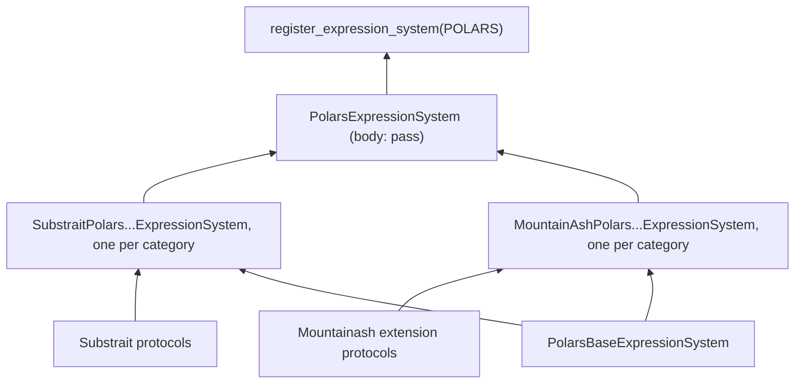

# Backends

A backend is the pair of classes that turn mountainash's AST into one family's native objects: an expression system that builds native column expressions and a relation system that builds native plans. There are three families. Polars compiles to `pl.Expr` and `LazyFrame`. Narwhals compiles to `nw.Expr` and reaches pandas, PyArrow, Dask, DuckDB and Polars through Narwhals. Ibis compiles to deferred Ibis expressions and tables that run as SQL on a connection. Backend architects work here when they change how a family executes an operation, add dialect-specific handling, or move data across the Arrow boundary between families.

Assumes: [Execution targets and backend capabilities](../09-execution-targets-and-capabilities/index.md), [Architecture](../17-architecture/index.md), [How expressions compile](../18-expression-compilation/index.md) and [How relations compile](../19-relation-compilation/index.md).

## Composition and registration

<!-- concept:530 -->

Each backend's expression system and relation system is a composed class with an empty body. The behaviour lives in per-category implementation classes, one per protocol, under `substrait/` and `extensions_mountainash/` in the backend's directory. The composed class lists them as bases, and Python's method resolution order assembles the full system. Each family also has a base mixin (`PolarsBaseExpressionSystem`, `NarwhalsBaseRelationSystem` and so on) that carries what is shared within it: the backend identity, the dialect, operand type resolution for expressions, and the Arrow export and import methods for relations.



The diagram shows Polars expressions; Narwhals and Ibis have the same shape, and relation systems differ only in listing the base mixin directly among the composed bases. The composition is observable from outside. Both kinds of system compose the same protocol set in every family, and the only names a composed class defines are the two that `typing.Protocol` adds:

```python
from mountainash.core.constants import CONST_BACKEND
from mountainash.expressions.core.expression_system.expsys_base import get_expression_system
from mountainash.relations.core.relation_protocols.relsys_base import get_relation_system

FAMILIES = (CONST_BACKEND.POLARS, CONST_BACKEND.NARWHALS, CONST_BACKEND.IBIS)


def protocols(cls):
    return {
        c.__name__ for c in cls.__mro__
        if c.__name__.endswith("Protocol") and c.__name__ != "Protocol"
    }


for get in (get_expression_system, get_relation_system):
    composed = [get(family) for family in FAMILIES]
    print([(cls.__name__, len(cls.__mro__)) for cls in composed])
    print(all(protocols(cls) == protocols(composed[0]) for cls in composed))
    print(sorted(name for name in vars(composed[0]) if not name.startswith("__")))
```

```text
[('PolarsExpressionSystem', 73), ('NarwhalsExpressionSystem', 73), ('IbisExpressionSystem', 73)]
True
['_abc_impl', '_is_protocol']
[('PolarsRelationSystem', 24), ('NarwhalsRelationSystem', 24), ('IbisRelationSystem', 24)]
True
['_abc_impl', '_is_protocol']
```

The composed classes satisfy the contracts of the abstract `ExpressionSystem` and `RelationSystem` bases through the same protocols, outside those bases' inheritance. That conformance is what `tests/core/test_protocol_alignment.py` and `tests/relations/test_rel_wiring_audit.py` check ([Cross-backend testing](../23-contributing-and-testing/index.md#cross-backend-testing)). Adding a category means writing its implementation in all three families and adding it to each composed class's bases. A family that lacks the category fails with a dispatch error at compile time.

The same tree compiles to each family's native expression type:

```python
import ibis
import polars as pl

import mountainash as ma

orders = pl.DataFrame({"order_id": [1, 2, 3], "amount": [25.0, 40.0, 15.5]})
con = ibis.duckdb.connect()
orders_db = con.create_table("orders", orders.to_arrow())

for source in (orders, orders.to_pandas(), orders_db):
    native = (ma.col("amount") * 2).compile(source)
    print(type(native).__module__.split(".")[0], type(native).__name__)
```

```text
polars Expr
narwhals Expr
ibis Deferred
```

All three families must produce the same logical result for the same expression or relation. Where an engine differs, the capability registry declares the difference and a per-backend expected failure tests it, in place of a code branch on backend identity ([Known divergences](../16-backend-support-and-limits/index.md#known-divergences), [Known divergences and per-backend xfail](../23-contributing-and-testing/index.md#known-divergences-and-per-backend-xfail)).

<!-- concept:531 -->

Registration is a decorator on the composed class: `@register_expression_system(CONST_BACKEND.POLARS)` in `expressions/core/expression_system/expsys_base.py` and `@register_relation_system(...)` in `relations/core/relation_protocols/relsys_base.py`. Both are keyed registries indexed by the family's string value (see [The function registry](../18-expression-compilation/index.md#the-function-registry)). Importing `mountainash.expressions` or `mountainash.relations` imports the backend packages, which register Polars always and Narwhals and Ibis when their libraries import. Each backend package's `__all__` lists what registered:

```python
import mountainash.expressions.backends as expression_backends
import mountainash.relations.backends as relation_backends

print(expression_backends.__all__)
print(relation_backends.__all__)
```

```text
['PolarsExpressionSystem', 'NarwhalsExpressionSystem', 'IbisExpressionSystem']
['PolarsRelationSystem', 'NarwhalsRelationSystem', 'IbisRelationSystem']
```

Lookup uses the family. The `pandas` and `pyarrow` identities are data carriers that run on the Narwhals system, so looking one up raises `KeyError`:

```python
try:
    get_relation_system(CONST_BACKEND.PANDAS)
except KeyError as exc:
    print(exc)
```

```text
"No RelationSystem registered for key 'pandas'. Available: ['polars', 'narwhals', 'ibis']"
```

[Backend detection](../02-installation-and-package-surface/index.md#backend-detection) picks the family from the native value. Compilation then instantiates the registered classes with the location's dialect, as described in [Relation systems](../19-relation-compilation/index.md#relation-systems).

## Polars

<!-- concept:532 -->

Polars is a base dependency and the reference backend: the cross-backend tests compare the other families against its results. Its systems live in `src/mountainash/expressions/backends/expression_systems/polars/` and `src/mountainash/relations/backends/relation_systems/polars/`. The family has one dialect, `polars`.

The relation system works on `LazyFrame`. The read step makes an eager `DataFrame` source lazy, so a compiled plan is a `LazyFrame` and a terminal collects it. Python data and Arrow imports without a target also land in Polars:

```python
print(type(ma.relation(orders).compile()).__name__)
print(type(ma.relation([{"order_id": 1}]).collect()).__name__)
```

```text
LazyFrame
DataFrame
```

The expression system's base resolves operand types from schema metadata: a column's dtype from `collect_schema()`, an expression's result dtype from a schema-only `select` on the lazy input. Compilation reads schemas only. Arrow export collects a lazy result and calls `to_arrow()`. Import uses `pl.from_arrow` and returns a lazy or eager frame to match the destination's form.

## Narwhals and its providers

<!-- concept:533 -->

The Narwhals family compiles to Narwhals expressions and frames, so one implementation serves every library Narwhals wraps. Narwhals is a base dependency. Its systems are in the `narwhals/` directories next to the Polars ones. The read step wraps a native pandas or PyArrow object with `narwhals.from_native` and passes a Narwhals frame through unchanged. `collect()` returns the underlying provider's native result.

The dialect is the provider, and the backend branches on it where providers differ. The base expression system and several category implementations check `self.dialect`, mostly to keep pandas results in a representation the rest of a pandas plan accepts (nullable dtypes, null carriers in conditionals, literal typing). They also recognise native error messages specific to a provider, so that capability declarations can explain them. The relation system's Arrow import chooses its conversion by dialect too ([Arrow import and export](#arrow-import-and-export)).

<!-- concept:535 -->

The providers are the dialects listed in [Backend capabilities, families and dialects](../09-execution-targets-and-capabilities/index.md#backend-capabilities-families-and-dialects): `narwhals-pandas`, `narwhals-pyarrow`, `narwhals-polars` (an eager Polars frame wrapped by Narwhals), `narwhals-lazy` (a lazy Polars frame wrapped by Narwhals), `narwhals-duckdb` and `narwhals-dask`. Detection reads the dialect from the frame's Narwhals implementation:

```python
import dask.dataframe as dd
import duckdb
import narwhals as nw

from mountainash.core.backend_detection import native_identity

providers = {
    "pandas": orders.to_pandas(),
    "pyarrow": orders.to_arrow(),
    "narwhals over polars": nw.from_native(orders),
    "narwhals over polars lazy": nw.from_native(orders.lazy()),
    "duckdb": nw.from_native(duckdb.sql("select * from orders")),
    "dask": nw.from_native(dd.from_pandas(orders.to_pandas(), npartitions=1)),
}
for label, source in providers.items():
    result = ma.relation(source).filter(ma.col("amount") > 20).collect()
    print(f"{label:26} {native_identity(source).dialect:17} {type(result).__module__.split('.')[0]}.{type(result).__name__}")
```

```text
pandas                     narwhals-pandas   pandas.DataFrame
pyarrow                    narwhals-pyarrow  pyarrow.Table
narwhals over polars       narwhals-polars   polars.DataFrame
narwhals over polars lazy  narwhals-lazy     polars.DataFrame
duckdb                     narwhals-duckdb   pyarrow.Table
dask                       narwhals-dask     pandas.DataFrame
```

DuckDB and Dask are lazy-only providers: a DuckDB relation collects to a PyArrow table and a Dask frame to pandas.

!!! warning "Backend limit"
    Pass DuckDB relations and Dask frames to `ma.relation` already wrapped with `narwhals.from_native`, as above. The Narwhals read wraps a bare native object with `eager_only=True` (`relations/backends/relation_systems/narwhals/substrait/relsys_nw_read.py`), which these lazy-only objects reject with Narwhals' own `TypeError`:

    ```python
    try:
        ma.relation(duckdb.sql("select * from orders")).to_dicts()
    except TypeError as exc:
        print(exc)
    ```

    ```text
    Cannot only use `series_only=True` or `eager_only=False` with DuckDBPyRelation
    ```

    Lazy-only providers also cannot be the destination of an Arrow import, so data from another family cannot move into them. `relations/backends/capabilities/narwhals/dialects/narwhals_duckdb/extensions_mountainash/relation.py` and the matching `narwhals_dask` file declare the refusal.

Detection rejects a Narwhals frame that wraps an Ibis table; see [Backend detection](../02-installation-and-package-surface/index.md#backend-detection).

## Ibis and SQL dialects

<!-- concept:534 -->

The Ibis family compiles expressions to deferred Ibis expressions and relations to Ibis tables, which the bound connection runs as SQL. Ibis is optional: it comes with the `ibis` extra, along with `mountainash-data`, which the relation system uses for owned copies on SQL connections (see [Where mountainash sits](../02-installation-and-package-surface/index.md#where-mountainash-sits)). Its systems are in the `ibis/` directories. The expression system's base reads operand types from the table's Ibis schema alone, so typing runs no query.

Alongside the composed operations, `relations/backends/relation_systems/ibis/` holds support modules for the relation system. `schema_metadata.py` describes a table's physical output types for DuckDB, SQLite and PostgreSQL, where the engine's stored type can differ from the Ibis logical type. `_physical.py` is the transaction boundary for owned copies on a connection. `_sqlite_compat.py` and `_sqlite_storage.py` cover what SQLite cannot store. Ordinary `collect()` on an Ibis plan returns a deferred, unmaterialised table ([Collect and terminals](../08-collecting-results/index.md#collect-and-terminals)).

<!-- concept:536 -->

One Ibis system serves every SQL dialect. The dialect is `ibis-` plus the name of the connection the table is bound to; an unbound `memtable` has the dialect `None`, and a relation over one needs a connection before it can run ([Relation objects](../07-relations/index.md#relation-objects)):

```python
for name, connection in {
    "duckdb": ibis.duckdb.connect(),
    "sqlite": ibis.sqlite.connect(),
    "polars": ibis.polars.connect(),
}.items():
    table = connection.create_table("orders", orders.to_arrow())
    print(name, native_identity(table).dialect)
print(native_identity(ibis.memtable(orders.to_arrow())).dialect)
```

```text
duckdb ibis-duckdb
sqlite ibis-sqlite
polars ibis-polars
None
```

SQL generation belongs to Ibis, so the same plan renders in each connection's dialect:

```python
lite = ibis.sqlite.connect()
orders_lite = lite.create_table("orders", orders.to_arrow())
for table in (orders_db, orders_lite):
    native = ma.relation(table).filter(ma.col("amount") > 20).select("order_id").compile()
    print(ibis.to_sql(native))
```

```text
SELECT
  "t0"."order_id"
FROM "memory"."main"."orders" AS "t0"
WHERE
  "t0"."amount" > 20
SELECT
  "t0"."order_id"
FROM "orders" AS "t0"
WHERE
  "t0"."amount" > 20
```

Capability facts per dialect declare most differences between SQL engines. Both Ibis systems still branch on `self.dialect` where an engine needs a different lowering or an explicit refusal. In the expression system, SQLite operand typing, integer overflow and domain-error modes, and several category implementations (string, datetime, list, struct and others) do. In the relation system, set operations on SQLite, the shape guard for multi-column `explode` and the as-of join strategies on DuckDB, and refusals on `ibis-polars` do. The declarations name the dialects DuckDB, SQLite, PostgreSQL, MySQL, Polars, SingleStoreDB and Exasol; how much each has declared and tested is in the [Support matrix](../16-backend-support-and-limits/index.md#support-matrix).

!!! warning "Backend limit"
    On the Ibis Polars backend, `with_row_index` raises `BackendCapabilityError` because Ibis Polars has no translation for the `row_number` window it lowers to (`relations/backends/relation_systems/ibis/extensions_mountainash/relsys_ib_ext_ma_util.py`, declared in `relations/backends/capabilities/ibis/dialects/ibis_polars/extensions_mountainash/relation.py`). The same declaration file covers forward and nearest `join_asof`.

    ```python
    orders_ipl = ibis.polars.connect().create_table("orders", orders.to_arrow())
    try:
        ma.relation(orders_ipl).with_row_index(name="n").to_dicts()
    except Exception as exc:
        print(type(exc).__name__, exc)
    ```

    ```text
    BackendCapabilityError [ibis] Ibis Polars cannot compile the window function needed for row indices.
    ```

## Arrow import and export

<!-- concept:537 -->

Arrow is the exchange format between families. Each relation system's base mixin implements three methods that the transport (`relations/core/execution/transport.py`) uses for every [operand transfer](../09-execution-targets-and-capabilities/index.md#operand-transfer-and-owned-copies), and that `ma.from_arrow` and `Relation.to_pyarrow()` use at the edges:

- `export(native, *, source)` returns a `pyarrow.Table`. Polars collects a lazy frame first. Narwhals exports the columns of a pandas frame and drops its index and pandas schema metadata. Ibis reads an in-memory table directly, with no execution, and normalises list child field names so that the same logical type compares equal across engines.
- `check_import(arrow, *, location)` runs before any work and refuses what the destination cannot take: lazy-only Narwhals providers refuse every import, and SQLite checks for values it cannot store.
- `import_into(arrow, *, location, owned=False)` returns the imported value plus, for an owned copy, its release hook. Polars returns a frame in the location's form, Narwhals converts through `narwhals.from_arrow` for the provider, and Ibis returns a `memtable`, or with `owned=True` a table created on the location's connection.

```python
import pandas as pd

indexed = pd.DataFrame({"amount": [25.0, 40.0]}, index=pd.Index([7, 8], name="order_id"))
print(ma.relation(indexed).to_pyarrow().column_names)
```

```text
['amount']
```

The import side can be called directly with a location, which is how the transport uses it:

```python
import pyarrow as pa

from mountainash.relations.core.execution.location import ExecutionLocation
from mountainash.relations.core.materialization import ExecutionForm

arrow = pa.table({"order_id": [1, 2]})
for family, dialect in [
    (CONST_BACKEND.POLARS, "polars"),
    (CONST_BACKEND.NARWHALS, "narwhals-pandas"),
    (CONST_BACKEND.IBIS, "ibis-duckdb"),
    (CONST_BACKEND.NARWHALS, "narwhals-duckdb"),
]:
    location = ExecutionLocation(family, dialect, ExecutionForm.EAGER, "memory")
    try:
        imported = get_relation_system(family)().import_into(arrow, location=location)
        print(dialect, type(imported.value).__module__.split(".")[0], type(imported.value).__name__)
    except ValueError as exc:
        print(dialect, "ValueError:", exc)
```

```text
polars polars DataFrame
narwhals-pandas narwhals DataFrame
ibis-duckdb ibis Table
narwhals-duckdb ValueError: eager Arrow import unsupported for lazy-only narwhals implementation 'narwhals-duckdb'
```

The transport turns a refusal into `UnsupportedRelationTransportError` and attaches the destination's declared `IMPORT_INTO` limitation when it explains the native error. That declaration is also what the `from_arrow` limits in [Relations from Arrow](../07-relations/index.md#relations-from-arrow) come from.
